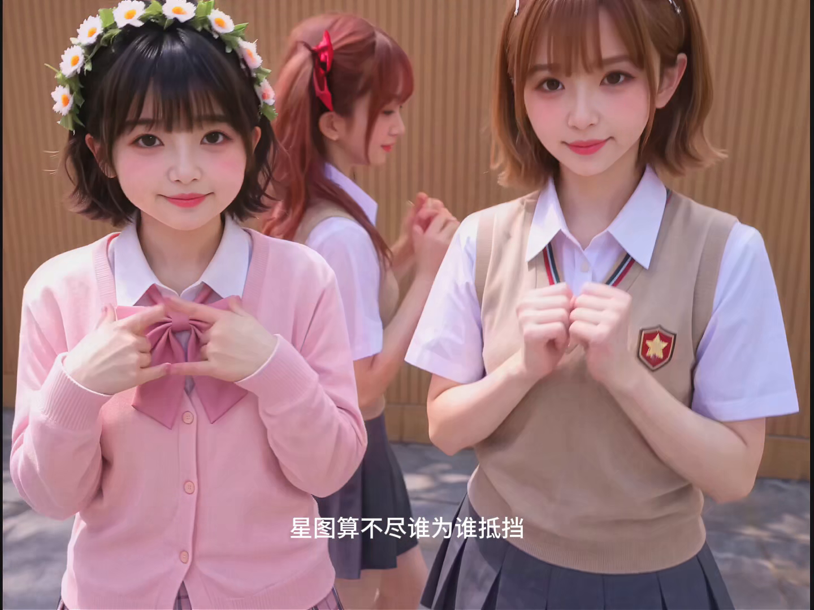
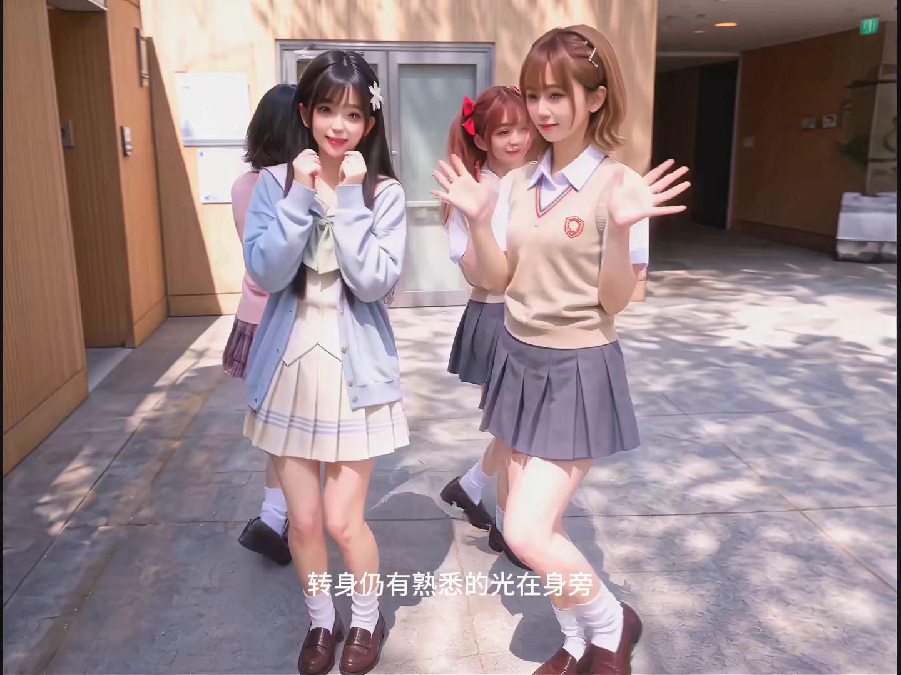
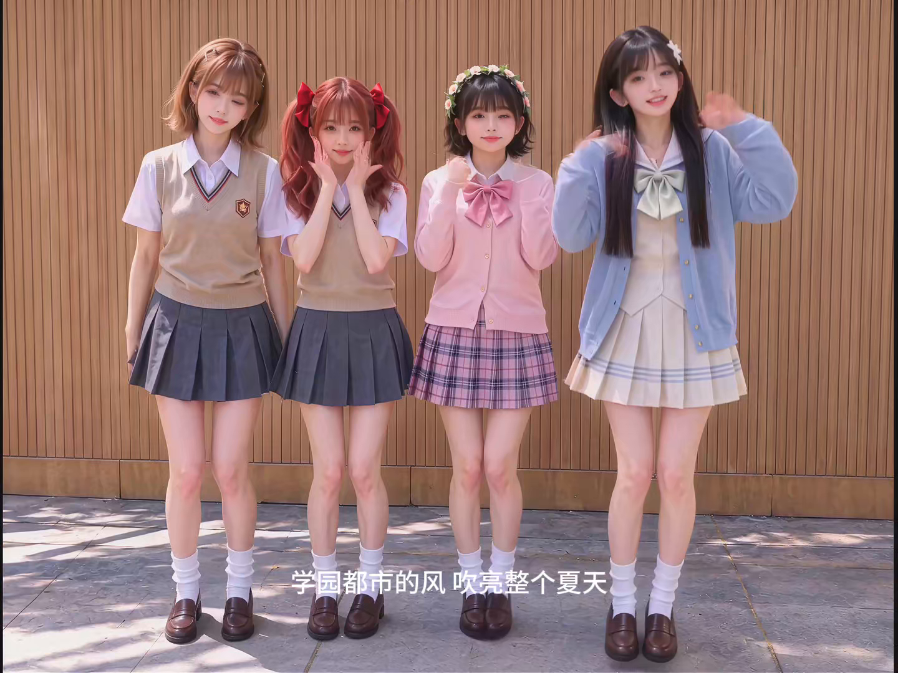

# 案例研究——在 181 秒的复杂队形变化中锁定四名角色

**一支由 14 个片段组成的舞蹈 MV，以逐字一致的锚定段落、动作状态交接，以及通过舞蹈而非走路完成的队形转换为基础。**

演示（第 10 段，完全由本条目中的提示词直接生成）：

▶ **[观看完整的第 10 段演示（13.7s，1080p）](../assets/demo_segment10.mp4)** · 完整提示词：[`prompt.md`](./prompt.md) · 日志：[github.com/LoveRain1997/h3-prompt-journal](https://github.com/LoveRain1997/h3-prompt-journal)

同一片段的更多画面——队形变化中途的层次交换，以及结尾向外扫动的手臂：

| | |
|---|---|
|  |  |

## 问题

四名以真人效果呈现的角色——美琴（Mikoto）、黑子（Kuroko）、初春（Uiharu）、佐天（Saten）——跳完整首
181.56 秒的歌曲，交付形式为**连续生成 14 段视频，每段 10.9–13.9 s**。
三类失败反复破坏多片段剪辑：

1. **跨片段身份漂移。** 每次生成都会重新发明这四名少女：
   背心徽章错误、发饰融合、服装被悄悄重新设计、后排多出第五名
   同学。SEG 03 中的角色 A 到 SEG 04 就不再是同一个角色 A。
2. **队形崩塌。** 要求“2×2 错位排列”或“两组对角线搭档”时，模型
   要么让舞者走成一排（舞蹈因此中断），要么让舞者瞬移，要么把
   重叠的双腿融合成无法辨认的一团。
3. **片段接缝。** 每个剪切点都落在静态集体姿势上——片段结束，所有人
   为摄影机停住，而下一段又从中性站姿重新开始。整支 MV
   看上去像摆拍照片的幻灯片。

## 突破：逐字一致的锚定段落、动作状态交接、以舞蹈完成转换

三种机制，按重要性排列如下：

### 1. 通用视觉锚点——只写一次，逐字粘贴 14 次

最具影响力的决定是：停止在每个片段中重新描述人物。
改用一个英文锚定段落，以**参考画面中的位置 + 完整准确的服装清单**定义全部四名主体，
再定义场景（木条墙、石质
地面、日光），最后加入最高优先级条款：

> *"<Picture 1> wins on every appearance AND environment question."*

这个段落**绝不翻译、绝不概括、绝不缩短**——它会
逐字粘贴到全部 14 份提示词的顶部。随后，各片段提示词仅使用
`Subject 1 = Mikoto` …… `Subject 4 = Saten` 指代人物。模型不再重新猜测身份，
因为提示词从未要求它重新描述人物。经过这一改动，身份漂移
降至接近零；残余漂移（背心徽章的细节）只出现在
徽章在画面中极小的镜头里。

锚定段落还包含关键的**姿态锁定条款（POSE LOCK）**：参考图片
*不是*动作模板。只有 SEG 01 可以从平静的站位开始；此后的每一个
片段都从明确写出的**入段状态（INCOMING STATE）**开始，人物已处于动作之中。

### 2. 动作状态交接——用一句文字定义接缝

每个片段以**出段衔接钩子（OUTGOING HOOK）**结束，以**入段状态（INCOMING STATE）**开始：
用几句话定格*剪切瞬间的准确身体状态*——脚部压力、
重心位置、躯干旋转、手臂的惯性延续、行进方向——并要求
下一次生成从那里、从动作中途开始。片段接缝不再只是剪辑点，
而成为连续编舞。交接示例，SEG 09 → SEG 10：

> *OUT (SEG 09):* S4 sweeps her arm across the foreground; S1/S2/S3 keep moving behind.
> *IN (SEG 10):* S1 is mid-shoulder-turn; S3 angled inward; S2/S4 crossing the center
> gap with real travel momentum. The camera opens tight on shoulders and widens along
> the crossing.

### 3. 队形变化是带有路线图的舞蹈转换

每个片段都包含一份**队形图（FORMATION MAP）**：开场排列 → 每次转换
（锚定具体拍号，例如“在 k50–k52 附近形成紧凑的 2×2 错位排列”）→
为下一片段提供入口的结束排列。三条规则确保队形在生成中成立：

- **脚先引导。** “支撑脚先转动；膝盖和躯干随后；头部
  最后转动。”这一句话就能消除“走到新位置”的失败。
- **仅在自己的区域内活动。** 舞者在各自通道内调整——用半步，绝不用走路；
  不跨越中线，不从另一具身体前方穿过。
- **用剪切，不后退。** 通过切到事先就位的近距离
  摄影机揭示新队形，因为摄影机后退会把编舞变成远景，
  舞蹈细节随之消失。

## 命名后的表达体系

> **Anchor-Locked Formation Journey** — one verbatim identity anchor + per-segment
> formation maps + motion-state handoffs, on a fixed BPM beat grid (93.75 BPM,
> 0.640 s/beat, k-labels from a cut manifest).

与环绕长镜头案例一样，命名产生了作用：提示词一旦包含
这个已命名的模式，模型就会把身份、间距和接缝连续性视为三项
可以分别解决的约束，而不是一句含糊的“保持一致”。

## 汇总后的 14 段方案

全部时间均来自歌曲清单（总长 181.560 s，BPM 93.75）。“最终来源”
指整合三轮剪辑修改后采用的权威版本
（Rev4.0 基础时间轴 → Rev4.2 对六个片段的人物性格／队形改写 →
SEG 03/13/14 的 Kankan 腿法最终改写）：

| SEG | 全曲时间 | 时长 | 队形变化过程 | 最终来源 |
|---|---|---|---|---|
| 01 | 0.000–13.193 | 13.193 | 风声前奏 → 首次共同律动 | Rev4.0 |
| 02 | 13.193–25.333 | 12.140 | 两组搭档 → 浅 V 字形 | Rev4.2 |
| 03 | 25.333–36.300 | 10.967 | 浅 V 字形 → 对角线搭档 → 2×2 错位排列 | 最终 Kankan 腿法英文版 |
| 04 | 36.300–49.366 | 13.066 | 背身转动后重新受光 → 快速外侧弧线 | Rev4.0 |
| 05 | 49.366–63.216 | 13.850 | 硬币闪光 → 下落成为开场动作 | Rev4.0 |
| 06 | 63.216–77.066 | 13.850 | 紧凑四角形 → 浅 V 字形重点造型 | Rev4.2 |
| 07 | 77.066–89.793 | 12.727 | 菱形 → 浅 V 字形，追逐落日 | Rev4.2 |
| 08 | 89.793–101.416 | 11.623 | 器乐爆发：双区域、浅菱形 | Rev4.2 |
| 09 | 101.416–114.966 | 13.550 | 三次有明确意图的队形变化 | Rev4.2 |
| **10** | **114.966–128.733** | **13.767** | **保护弧线 → 中央会合 → 层次交换 → 星芒展开（本条目）** | **本条目，完整英文版** |
| 11 | 128.733–142.416 | 13.683 | 一次下落，四名主体接力起身 | Rev4.0 |
| 12 | 142.416–156.133 | 13.717 | 高潮：快速完整外圈环绕 | Rev4.0 |
| 13 | 156.133–169.313 | 13.180 | 对角交叉线，摄影机在其中升起 | 最终 Kankan 腿法版 |
| 14 | 169.313–181.560 | 12.247 | 最终推进 → 四线花形 → 保持结束姿势 | 最终 Kankan 腿法英文版 |

每个片段共同使用：逐字一致的锚定段落（[`prompt.md`](./prompt.md) 的第 1 节）、
节拍网格、歌词窗口规则（只控制情绪和乐句表达——绝不把
歌词演成哑剧，绝不呈现歌词中的物件），以及同一份禁止默认行为清单。

## 完整示例：SEG 10——队形往返旅程

选择 SEG 10 作为参考实现，是因为它同时运用了全部
机制：两条保护弧线彼此穿过对方空间
但不碰撞、中央会合、前后层次交换、转动接力，以及
四线星芒展开——在 13.767 秒中明确写出 22 拍，每拍都是一个连续
动作单元，每次运镜都绑定其拍摄动作所在的同一拍。

完整提示词见 [`prompt.md`](./prompt.md)。结构依次为：

1. 通用锚定段落（逐字一致）
2. 格式 + 音频切片 + BPM 网格
3. 身份锚点 + 入段动作状态
4. 编舞风格 + 歌词窗口
5. 四种动作性格
6. 摄影机几何关系（六个镜头，分别绑定一个拍号范围）
7. 队形图（进入 → 弧线 → 会合 → 交换 → 星芒展开 → 离开）
8. 精确的 22 拍时间轴
9. 摄影机与连续性的绝对约束
10. 音频字段

本页顶部的演示视频由这份提示词直接生成。

## 48 小时内得到的经验

- **身份靠粘贴固定，而不是重新描述。** 锚定段落只写一次；禁止自己
  重新措辞。提示词一旦“热心地”重新描述人物，
  模型就开始重新设计她。
- **接缝本身也是内容。** 像编写任意一拍舞蹈那样认真地写出剪切帧的身体状态；
  多片段 MV 往往就在片段边界处失效。
- **队形必须以舞蹈完成。** 脚先引导、仅在自己的区域内活动、用剪切而不是后退——
  这三句话区分了“队形变化”和“四个人走路”。
- **歌词只指导情绪，绝不指导物象。** 歌词一旦变成画面里的物件，
  影片就开始幻觉式地生成锚定段落从未允许的道具。

## 文件

- [`prompt.md`](./prompt.md)——SEG 10 完整提示词（完整示例，英文）
- `assets/demo_segment10.mp4`——SEG 10 的生成演示
- `assets/frame_*.png`——演示视频的静帧

属于 [H3 提示词日志](https://github.com/LoveRain1997/h3-prompt-journal) ·
仓库：<https://github.com/LoveRain1997/h3-prompt-journal>
