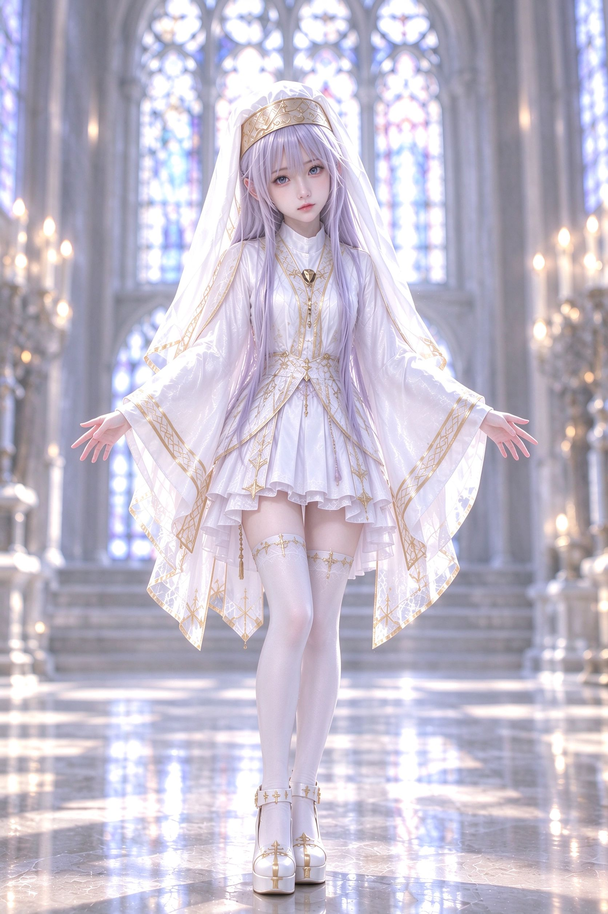

# 019 · 仅以身份为参考的半身肖像舞蹈，六段（111 BPM）

- **日期：**2026-10
- **形式：**六个自包含片段，111 BPM（单拍 0.5405s／小节 2.1622s），总长 ≈ 73.4s
- **输入合同：**`<Picture 1>` = 面部裁切图 · `<Picture 2>` = 全身外观 + 环境 · `<Audio 1>` = 音乐，每段以 1:1 复用
- **提示词：**见 [prompt.md](./prompt.md)

## 问题

表演者总会通过**重现参考图片的静态姿势**开始视频。H3 把参考图片视为整体事实：图片中女子的任何姿态都会渗入首帧，舞蹈要等到这个定格的“参考图角色扮演瞬间”结束后才开始。在全局规则段落中告诉模型“不要复制姿势”，并未在生成中生效。

## 突破——把两张图片的权限拆到特征层级，再完全降低姿势的优先级

不再只用一段规则，而是把权限拆分**以明确的允许／禁止清单写入每一个片段**：

| 参考 | 允许提供（保留） | 禁止提供（绝不复制） |
|---|---|---|
| `<Picture 1>` | 面部身份、面部结构、眼睛、眉毛、鼻子、嘴部、下颌线、皮肤、面部比例 | 姿势、身体位置、头部角度、双手、手臂、朝向、站姿、构图——“不是姿势／身体位置／编舞／首帧参考” |
| `<Picture 2>` | 身体比例、身体尺度、服装、配饰、头发、环境、建筑、光线方向、曝光、空间纵深、摄影真实感 | 图中准确的站姿、将该图用作编舞起始姿势 |

而“视频要有 Picture 1 的半身肖像感”这一主观要求，被**降为仅作用于摄影机／镜头语言**：亲密的特写／胸像／半身／中近景构图，真实手持摄影师可以预判或略微滞后，出现重要脚步时短暂实际降低机位。句子明确指出，它“不复制 Picture 1 的姿势、头部角度、手部摆放、身体朝向或构图”。

每段反复出现的关键句是：**“直接从下文指定的第一个编舞动作开始。不得从任一参考图片的静态姿势开始。”** 开场姿势的权威来源由图片转移到编舞谱本身。

## 为什么有效

1. **允许／禁止清单优于事后补充否定。** 每张图片都得到一份明确的清单，列出它*确实*定义的内容，以及它*绝不能*定义的内容。当禁止清单明确排除时，模型就不能推断为“整体参考”。
2. **重新分配姿势的权威，而非仅仅禁止。** 只说“不要使用图片姿势”会留下空缺，模型仍会用图片填补。说“从书面动作谱的第 1 拍开始”，就为这个空缺指定了新来源。
3. **镜头语言保留主观感受。** “半身肖像感”是一种摄影距离，不是身体位置——提示词用一句明确的话指出这一点，于是美感保留下来，姿势继承则被取消。

## 六段结构（111 BPM，每段一支连续舞蹈）

| 段 | 时长 | 特征 | 重点动作（Hero Action） |
|---|---|---|---|
| 1 | 11.033s | 可爱开场、足尖点地、四分之一转 | 交叉步回弹 → 斜向展臂 |
| 2 | 11.997s | 更密集的脚步、手指比心 | 足尖换步 → 足尖换步 → 半转 → 不对称打开 |
| 3 | 12.186s | 更柔和流动、身体螺旋 | 手臂沿弧形路径完成、优雅对角线 |
| 4 | 10.534s | 俏皮的方向变化 | 斜向踏步 → 交叉 → 四分之一转 → 手臂切出 |
| 5 | 13.886s | 高潮、最高密度 | 交叉 → 压缩 → 回弹 → 斜向手臂切出 → 落地 |
| 6 | 13.742s | 收束、幅度减小、始终不空洞 | 温暖的螺旋打开、柔和的斜向伸展 |

全部六段共享的结构：

- **动作中剪切（Motion Cut）发生在尚未完成的动作内部**——始终是“进行中的动作 → 剪切 → 同一动作继续”，绝不是“完成的姿势 → 剪切 → 新姿势”。每个剪切都列出出镜动量与入镜延续。
- **重点动作有独立镜头**：摄影机随身体实际靠近／横移／沿弧线运动，进入近距离四分之三侧面肖像，同时舞者始终不停。
- **下半身策略**：同一台手持摄影机在重要脚步出现时短暂下降，然后立即回到亲密的肖像关系——不长时间停留在全身镜头。
- **色彩世界**：高调冷白 + 银灰，金色作为唯一强强调色，淡彩环境光（浅蓝／柔和淡紫／极浅粉），微小失焦的烛光散景——与彩色玻璃礼拜堂封面图相匹配。
- **无静态结尾**：每段都在准确的音频终点、动作进行中结束；第 6 段禁止临近结尾时人为压暗画面——收束来自动作与摄影机行为，而非调色。

## 要点

当参考图片不断把它的姿势带入首帧时，不要再添加一条“不要复制”规则。**降低图片权限**：为每张图片编写允许／禁止清单，把姿势权威转移到书面动作谱（“从第一个编舞动作开始”），并把任何主观的“图片 X 的感觉”转化为明确的摄影机／镜头语言，附上它自己的禁止清单。
