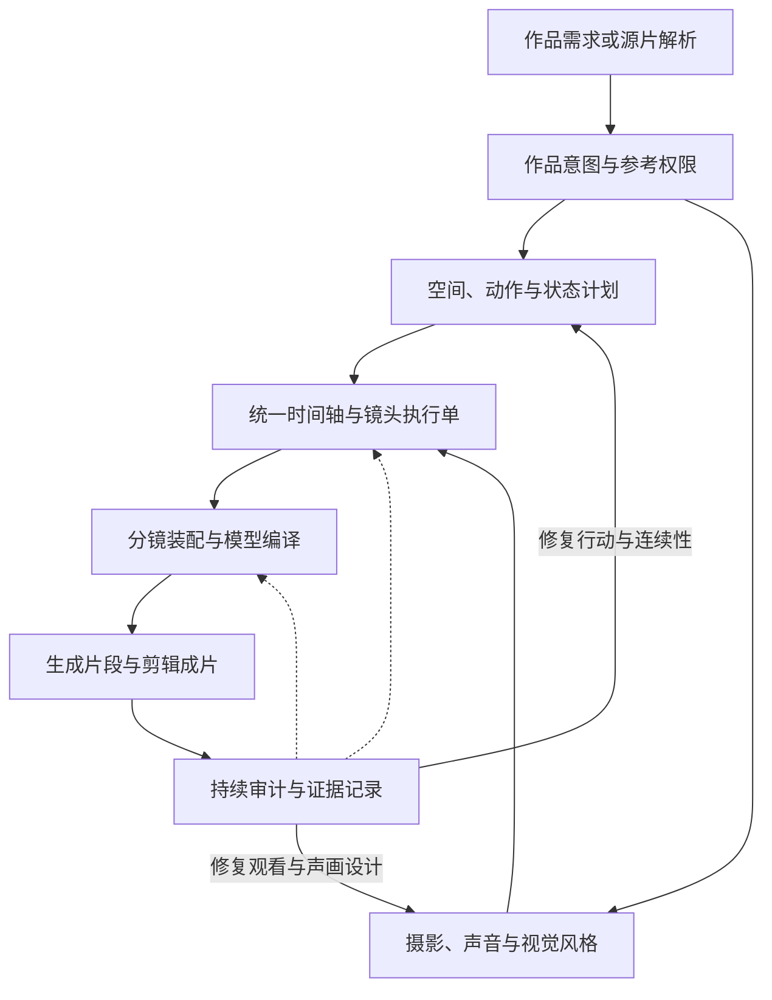

# 通用核心模块提炼：完整分析记录

**归档日期：** 2026-11-04（America/Los_Angeles）

**文档状态：** archived-analysis；完整保存上一轮模块提炼分析，作为后续框架与开发计划的依据。

**案例基线：** `35658d3615d02c6aa6e4221fb223d73b86aa6875`。

**阅读说明：** 下文保留上一轮分析的完整结构、模块说明、示例、边界与引用；本文件的数字引用 [1]—[14] 独立于开发文档的 [S01]—[S19] 编号。通用核心的实现仍处于计划阶段。

---

## 核心结论

**建议将这个项目提炼为 12 个通用核心模块，共用一份“镜头执行计划”，同时服务于影视剧和音乐 MV 的提示词编排与审计。**

你提出的摄影、动作链、动作与镜头同步、连续性、自检，已经覆盖了主要执行环节。根据案例全文，还应补上几个前置和连接环节：**作品意图与段落功能、素材参考权限、空间调度、声音设计、分镜与剪辑组织、模型格式适配。**

这些模块之间应共享：**主体与道具编号、空间关系、事件时间、起止状态、素材依据和检查结果。** 这样，一次修改才能传递到相关镜头，例如音乐时间改变后，重新检查动作峰值、摄影机到位时间和切点。

### 本次分析范围

以已合并的 `35658d3` 版本为基线，重点覆盖：

- **15 个 10 月案例**，当前该版本没有 11 月及之后的案例。
- 全部 **15 份 README.md、2 份 methodology.md、14 份 prompt.md**。
- 动作链库的主要正文不叫 `prompt.md`，因此补读了 **2,767 行的 `dance-motion-chain-h3.md`**。
- 结合上一轮创建的案例技能、冲突修订和验证记录，并用 H3 官方指南校准格式与参考绑定规则。[1][4][13][14]

下面的 **12 模块是对这些材料的架构归纳**。原案例已经提供了大量可复用方法，但还没有形成这一套统一的模块接口。

**关键词：** 导演意图、参考权限、空间调度、动作事件、摄影机几何、音画时序、状态连续性、分镜剪辑、模型编译、持续审计。

---

# 一、建议提炼的 12 个通用核心模块

| 编号 | 通用模块 | 主要解决的问题 | 应交付的中间产物 |
|---|---|---|---|
| **M1** | **作品意图、叙事／情绪与段落功能** | 这一段为什么存在？观众应获得什么信息、感受什么变化？ | 作品简报、段落任务、情绪／能量曲线、动作或视觉母题 |
| **M2** | **素材解析、资产绑定与参考权限** | 每份图片、视频、音频究竟决定什么？允许继承和改变哪些属性？ | 资产清单、主体绑定、参考权限矩阵、证据标记 |
| **M3** | **场景空间、人物站位与交互调度** | 谁在哪里，朝向谁，沿什么路径移动，与谁接触或遮挡？ | 空间关系表、走位与队形图、交互和避让规则 |
| **M4** | **人物表演、动作链与物理因果** | 动作如何开始、发生、完成，并进入下一动作？ | 动作事件链、支撑与接触关系、起态／出态 |
| **M5** | **机位、景别、构图、焦点与运镜** | 观众从哪里看？必须看清什么？摄影机为什么、如何移动？ | 摄影机计划、构图与可见性要求、运镜路径 |
| **M6** | **声音、音乐、对白与歌词关系** | 谁在发声？声音来自哪里？音乐、对白和画面怎样分工？ | 声音分层表、说话者绑定、音乐窗口、歌词使用策略 |
| **M7** | **统一时间轴与动作—镜头—声音协同** | 各事件何时发生？哪些提前、同步、滞后或跨切延续？ | 事件时间表、同步关系、局部／全局时间映射 |
| **M8** | **主体、道具、场景与跨镜状态连续性** | 什么保持不变？什么已经改变？下一镜应该继承什么？ | 状态记录、变化原因、跨镜交接条件 |
| **M9** | **分镜组织、转场、剪辑与生成分段** | 哪些内容属于同一镜头？在哪里切？怎样拆分生成与装配？ | 分镜表、切点表、关键帧需求、生成与裁剪清单 |
| **M10** | **视觉风格、光线、色彩与材质** | 整部作品怎样保持视觉统一，同时允许有目的的变化？ | 风格基线、光色规则、材质要求及作用范围 |
| **M11** | **模型协议编译与运行参数适配** | 如何把创作计划变成当前后端实际接受的提示词和参数？ | 完整生成提示词、素材映射、运行参数与任务清单 |
| **M12** | **持续审计、问题归因与反馈修复** | 哪里存在冲突或缺证据？修改后哪些内容必须重新检查？ | 审计报告、问题定位、修复记录、媒体验收结果 |

这 12 项可以按三层理解：

- **作品与素材层：M1—M2**，确定目标和依据。
- **镜头与声画层：M3—M10**，把作品目标变成可观察、可听见的事件。
- **执行与审计层：M11—M12**，负责生成输入、检查与反馈。其中 M12 贯穿整个流程。

---

# 二、各模块应该提炼到什么程度

## M1：作品意图、叙事／情绪与段落功能

这是整个系统的上层入口。

十八段剑舞的方法论已经要求先明确作品定位、参考图权限和每段功能；十三段武侠舞则进一步讨论了动作母题的首次建立、变奏、局部保留和最终回收。这说明案例的价值已经超过“为每段挑几个动作”：它包含整部作品如何发展的组织方法。[2]

建议每个段落至少回答四个问题：

1. **这一段要发生什么变化？**
2. **观众此刻必须看见或理解什么？**
3. **这一段与前后段是什么关系？**
4. **什么结果可以表明这一段完成了任务？**

两种片型使用不同的内容填写这四项：

| 影视剧 | 音乐 MV |
|---|---|
| 人物想达到什么目标 | 段落处于什么情绪与能量位置 |
| 哪个行动、信息或反应推动情节 | 哪个动作、视觉母题或音乐变化推动段落 |
| 观众何时知道关键事实 | 观众何时感受到铺垫、爆发或收束 |
| 本场结束后关系或局势怎样改变 | 本段结束后动作主题怎样发展 |

**需要补充的能力：** 现有案例对 MV 的情绪与段落功能支持充分；影视剧所需的目标、阻碍、选择、后果、潜台词和人物知识状态，还需要更多剧情样本支撑。

## M2：素材解析、资产绑定与参考权限

这个模块应当先于“一致性控制”。

因为首先要确定：**到底要求哪些东西一致，以及一致性的依据是什么。**

“半身身份参考”案例把面部身份、体型服装、环境、开场姿态分别分配权限；“下山”案例让不同图片分别负责正面服装、脸部和背部结构；动作迁移案例则分别安排图片、视频和音频的职责。[6][8][12]

建议统一成下面的参考权限矩阵：

| 素材 | 绑定对象 | 提供什么 | 允许改变什么 | 生效范围 |
|---|---|---|---|---|
| 人物定妆照 | 角色 A | 面部、体型、服装 | 按任务允许改变姿势、表情 | 指定镜头或全片 |
| 场景参考图 | 场景 X | 空间结构、材质、固定陈设 | 摄影机位置、人物活动 | 发生在该场景的镜头 |
| 动作参考视频 | 角色 A 的动作 | 支撑、运动路径、节奏 | 参考人物的身份与服装 | 指定动作区间 |
| 故事板／关键帧 | 指定镜头 | 构图、站位、帧状态 | 由任务明确 | 指定镜头或时间点 |
| 音频 | 音轨或说话者 | 节奏、音色、对白或完整信号 | 取决于复制／参考方式 | 指定声音区间 |

这里需要单独记录几个容易混淆的用途：

- **身份参考**与**实际首帧**。
- **动作参考**与**整段原视频编辑**。
- **音色参考**与**复制原始录音**。
- **场景结构参考**与**保持原图摄影机位置**。

H3 官方指南也明确区分了这些关系，并允许一个主体由多份资产共同定义、一份资产提供多个主体内容。[13]

如果任务来自源视频逆向解析，还应保存“实际观察、作者报告、推测补全、尚未确认”的区别。动作库本身就对一些单帧或未入镜动作使用了推测标记，这一点值得保留到通用系统中。[4]

## M3：场景空间、人物站位与交互调度

这是摄影与动作之间的重要连接模块。

四人队形案例反复涉及主体身份、队形位置、中心交叉、前后换层、不同人物的运动任务。它说明：仅写“保持四人一致”“变成某种队形”，不能完整表达空间变化。[5]

通用模块应分别记录：

- **场景关系：** 门、桌、墙、台阶、道路等固定对象的位置关系。
- **主体位置：** 谁在前后左右，处于哪个高度或景层。
- **移动路径：** 从哪里到哪里，经过谁的前方或后方。
- **交互关系：** 看向谁、接触谁、递给谁、避让谁。
- **可见性：** 哪些主体必须入画，哪些可以暂时被遮挡或位于画外。

还应区分三种方向：

| 方向体系 | 示例 |
|---|---|
| 场景中的方向 | 靠门的一侧、柜台内侧、舞台后方 |
| 人物自身的方向 | 角色的右手、左支撑腿 |
| 当前画面的方向 | 屏幕左侧、画面右前方 |

参考图中位于左侧的人可以被命名为角色 A，但角色 A 后续可以走到画面右侧。**身份编号与位置应分别记录。**

对于影视剧，这个模块还应扩展视线匹配、正反打关系、行动轴线与场景覆盖方案。这里不需要设立统一的人物数量上限；应检查实际人数、路径、接触和可见性是否清楚。

## M4：人物表演、动作链与物理因果

建议把它命名为“动作与表演事件链”，舞蹈、剑舞只是其中的专业子库。

案例中最可复用的结构是：

> **起始条件 → 发起与进入 → 运动／接触过程 → 主要结果 → 制动或回收 → 下一动作入口。**

十三段武侠舞的方法论明确要求支撑、轴线、动作发展、惯性和回收；白凤案例则把掌心承重、低位坐姿、旋转制动和恢复受阻写成连续过程。动作库还包含递物、拾取、承托、检视等可向剧情动作迁移的内容。[2][4][7]

建议每条动作事件至少包含：

| 字段 | 需要说明的内容 |
|---|---|
| 执行者与对象 | 谁对谁、或对什么物体行动 |
| 起始条件 | 当前姿态、位置、握持与支撑状态 |
| 过程 | 哪个部位启动，经过什么路径，发生什么接触 |
| 关键结果 | 观众必须看见的完成点或状态变化 |
| 结束状态 | 动作后人物、物体和接触关系是什么 |
| 后续入口 | 下一动作从哪里继续 |

例如，“拿起杯子”可以展开为伸手、接触、形成握持、杯子离桌、手臂回收；剑舞可以展开为支撑转换、转体传力、剑路展开、制动、回到下一动作入口。二者共享事件结构。

**泛化时需要保留动作差异。** 舞蹈中的某种“脚—重心—躯干—肩臂”动力顺序，适合相应动作；坐姿表演、眼神变化、手指操作和物件运动应有自己的启动机制。普通动作也不必机械地写满所有关节。

## M5：机位、景别、构图、焦点与运镜

你提出的这一模块成立，但内部最好进一步拆分变量。特别是，**机位和景别应分别建模。**

| 子项 | 回答的问题 |
|---|---|
| **机位** | 摄影机在哪里，离主体多远，处于什么高度和前后左右关系？ |
| **光轴与姿态** | 镜头朝向哪里，是否俯仰或倾斜？ |
| **景别** | 画面包含全身、半身、面部还是局部动作？ |
| **构图** | 主体、前景、背景和留白怎样组织？ |
| **焦点与景深** | 哪个对象必须清楚，哪些层次可以弱化？ |
| **运镜** | 摄影机从哪里出发，沿什么路径，如何加减速，到哪里结束？ |
| **观看目的** | 这次摄影选择要让观众获得什么信息？ |

物理机位库提供了位置、高度、距离、光轴、空间关系及可见结果的描述方法；运镜纪律库与高级运镜组合进一步提供了起点、路径、触发、终点和最终构图。[3]

这里最值得提升成通用规则的是：

**先确定观众必须看清什么，再选择景别和摄影机行为。**

例如：

- 需要看清支撑和落地，就保证相关脚部与地面关系可读。
- 需要看清递物，就保证双方手部和物体的接触关系可读。
- 需要看清心理反应，就让表情、目光和反应时机成为视觉重点。

剑舞方法论已经指出，脸部、全身、双脚、道具完整轨迹和远景不能在一个构图里毫无优先级地同时承担主要信息。[2]

“一镜一个主要运镜逻辑”适合作为默认设计策略；需要复合运动时，应说明各阶段的目的与转换路径。源案例中的“禁止角度数字”“摄影机只能因舞者动作移动”等，应保留适用情境，不能升级成全部影视创作的硬限制。

## M6：声音、音乐、对白与歌词关系

这一模块负责声音的内容、来源和用途；M7 再负责声音与其他事件的时间关系。

建议至少分成五类：

| 声音／语言内容 | 核心检查 |
|---|---|
| **对白与人物演唱** | 谁发声、说什么、何时发声、是否需要口型 |
| **画外音与旁白** | 声音归属、画内人物是否同时发声 |
| **环境声** | 场景空间与跨镜接续是否成立 |
| **动作声** | 声音是否对应实际接触、碰撞或操作事件 |
| **配乐与原始音轨** | 使用哪个窗口，是复制、重新生成还是仅参考 |

歌词还要有独立策略：用作节奏锚、情绪依据、剧情再现、字幕内容，或者由人物实际演唱。

白凤案例要求保留歌曲、舞者不唱歌；下山案例又有不同的歌词与面纱表演设定。它们说明这些选项应由作品决定。[7][8]

因此，“歌词不能产生画面实体”“不得口型”“不加对白”都应当是**当前作品的选择**。故事型 MV 完全可以明确授权歌词内容进入画面。

影视剧方向需要进一步补齐：对白轮次、听者反应、停顿、打断、跨镜对白和声纹绑定。H3 官方指南提供了说话者编号与跨镜声音的语法依据，但完整表演策略还需要剧情案例支撑。[13]

## M7：统一时间轴与动作—镜头—声音协同

**这是最值得单独建设的核心模块之一。**

现有案例有很丰富的同步经验，也存在不能同时执行的规则：

- 摄影机提前到位，等待动作峰值。
- 摄影机与动作同步响应。
- 摄影机有意迟滞、过冲后重新找回主体。
- 摄影机固定，让人物进入画面。

这些模式在运镜纪律库、下山和半身舞蹈案例中都能找到依据。[3][6][8]

因此，通用模块应管理的是：

> **同一时间基准下，各事件之间明确的先后、重叠、偏移和触发关系。**

可以采用以下同步策略：

| 策略 | 典型用途 | 审计重点 |
|---|---|---|
| 提前到位 | 大动作、队形展开、信息即将出现 | 关键事件发生前，所需构图是否已建立 |
| 同相响应 | 随下沉降低机位、随移动跟拍 | 动作与摄影机的关键阶段是否对齐 |
| 延迟跟随 | 主观观察、迟疑、失衡感 | 延迟是否有意设计，随后能否重新捕获主体 |
| 固定观察 | 动作进入画框、稳定表演 | 摄影机是否保持所选观察位置 |
| 接触触发 | 触地换装、物件碰撞、关门 | 视觉接触、状态变化与声音是否对应 |
| 跨切延续 | 旋转匹配、动作匹配剪辑 | 切前切后的方向、阶段和速度关系是否成立 |

其中，“动作开始”“动作峰值”“摄影机开始移动”“摄影机到位”应该是不同事件。不能全部压缩成一个时间戳。

### MV 与影视剧的时间依据不同

- **MV** 经常以音乐拍点、乐句、歌词事件和音频窗口为依据。
- **影视剧** 可以由台词、目光、接触、决定和反应组织时间。
- **音乐节拍**与**戏剧节奏节点**应分别记录。后者不要求周期性，也不要求存在 BPM。

案例还明确要求区分全曲时间与片段局部时间，并承认拍点数据不完整时存在精度限制。[2][7][10]

## M8：主体、道具、场景与跨镜状态连续性

建议把“一致性”和“连续性”落实为三个层次。

| 层次 | 管理内容 | 示例 |
|---|---|---|
| **身份与设计属性** | 谁、什么物件、什么场景 | 同一角色、同一把剑、同一个柜台 |
| **当前动态状态** | 位置、姿态、握持、开合、湿润或损坏等 | 剑已出鞘、右手持剑、剑鞘为空 |
| **允许的变化及原因** | 哪个事件授权状态改变 | 拔剑使“入鞘”变为“持握”；切换场景由剪辑计划授权 |

剑舞方法论对这个问题的分析非常明确：参考图可以确定武器外观，但后续片段不能因为原图里剑未出鞘，就把已经发生的拔剑状态重置。[2]

跨镜交接至少应检查：

- 主体与道具身份。
- 当前位置、身体朝向与视线。
- 支撑点、持物手、接触关系。
- 动作阶段与运动方向。
- 服装、道具和环境变化。
- 当前镜头允许继承或改变的项目。

**连续性的判断必须服从剪辑意图。** 连续动作接力需要详细匹配；有意的时间省略、场景转换和蒙太奇，可以改变部分状态，但要有明确的变化依据。

还要保留两份记录：**计划末态**与**实际生成片段的观察末态**。真正接续时，应检查最终选用画格，不能只引用上一段提示词。[7][14]

## M9：分镜组织、转场、剪辑与生成分段

建议明确区分五种单位：

1. **动作阶段**：同一动作的发展过程。
2. **故事板画格**：用于表达某个时间点的视觉计划。
3. **镜头**：两次切镜之间的连续观察。
4. **生成任务**：模型一次实际执行。
5. **成片片段**：剪辑中最终采用的源片区间。

夏日水线案例提供了很清楚的例子：有的时间点是真正硬切，有的只是同一镜头从横移转为后退跟拍；同一水线镜头也可以分成多个推进阶段。[9]

这个模块还应先声明衔接方式：

| 衔接方式 | 需要保持的内容 |
|---|---|
| 连续动作接力 | 人物状态、动作阶段、动量与必要空间关系 |
| 动作匹配剪辑 | 选定动作的方向、相位、关键构图 |
| 遮挡与揭示 | 遮挡物、运动方向、遮挡区间和揭示结果 |
| 稳定姿态跳切 | 指定姿态或构图，以及允许改变的服装／背景 |
| 独立蒙太奇 | 主题、节奏或视觉联系；不必强制首尾姿态一致 |
| 叙事性时空转换 | 时间、地点变化及观众理解它的线索 |

剑舞方法论明确允许独立片段由后期视觉桥梁连接；水岸与白凤案例则强调动作接力和实际源片的匹配。它们对应不同的剪辑策略。[2][7][10]

**分段生成只是一种执行组织方式。** 它不应自动导致每段人物站直、动作归零、音乐重启，也不应自动要求所有独立片段伪装成无缝长镜头。

## M10：视觉风格、光线、色彩与材质

这个模块值得单列，但应有明确权限边界。

建议管理：

- 整体摄影或美术风格。
- 主光方向、光源动机与场景照明。
- 色彩与对比度基线。
- 肤质、布料、金属、水面等材质表现。
- 景深、反射和细节的可读性。
- 哪些段落允许风格变化，变化服务什么意图。

半身舞蹈、下山和海滩剑舞都有明确的光色与材质规则；夏日案例还暴露了整体调色描述与局部暖光描述需要分别判断的问题。[2][6][8][9]

三个模块的分工应当是：

- **M2** 规定哪些视觉属性已经由参考素材确定。
- **M10** 在允许设计的范围内制定风格。
- **M8** 检查镜头之间的继承与变化。

这样可以避免调色要求无意中改了服装颜色，或“氛围升级”顺带把场景重新设计。

## M11：模型协议编译与运行参数适配

前面的创作计划应尽量独立于具体模型；这一层负责转换为 H3 实际接受的输入。

H3 官方指南对基础模式与 Ref2VA 使用不同结构：

- T2VA、I2VA、FL2VA、L2VA 使用基础三字段。
- Ref2VA 使用六字段，并要求稳定的主体、图片、视频与音频引用关系。[13]

这个模块应该完成：

1. 根据素材用途选择模式。
2. 为本次生成装入正确资产。
3. 带入本段必需的身份、场景、状态和时间约束。
4. 生成符合模式的字段、标签和切点。
5. 核对实际后端的时长、帧率、输入容量及参数。
6. 分别输出生成正文与审计报告。

案例反复强调每段提示词必须独立可用。[2][8] 工程上可以采用：

> **中央维护规则和状态，按生成片段编译出自包含提示词。**

这能同时满足统一管理与独立生成。更换模型时，主要更换适配层；如果新模型的能力影响分段、参考方式或时长，还需要回到对应计划模块调整。

## M12：持续审计、问题归因与反馈修复

“连续自检”建议定义为：**每个阶段都有明确检查对象，修改后重新检查受影响的依赖，生成后继续检查实际媒体。**

剑舞方法论已经区分技术／连续性自检与作品级自检，并要求先定位错误属于身份、状态、时间、镜头还是场景，再进行局部修复。[2]

建议设置以下检查阶段：

| 阶段 | 检查对象 | 典型检查 |
|---|---|---|
| **输入检查** | 素材与用户要求 | 素材是否存在、参考用途是否明确、哪些信息只是推测 |
| **设计检查** | 动作、摄影、声音与状态计划 | 动作是否有前置条件、关键事件能否入画、状态与时间是否冲突 |
| **编译检查** | 提示词与运行参数 | 模式、字段、引用、切点、时长和实际参数是否一致 |
| **生成片检查** | 实际输出视频／音频 | 身份、接触、运动、切镜、音画关系是否实现 |
| **成片检查** | 剪辑后的完整作品 | 接缝、声音连续性、段落推进、风格和结束感是否成立 |

### 审计必须能定位到具体问题

例如：

- “动作不流畅”应进一步定位为：上一镜右脚承重，下一镜却无转换地变成左脚承重。
- “镜头没拍好”应定位为：递物发生时，构图裁掉了接触的两只手。
- “没有卡点”应定位为：实际动作完成时间与目标声音事件相差多少。
- “连续性失败”应定位为：已打开的道具在下一镜恢复关闭。
- “整段可独立使用”应检查：必要的身份与状态规则是否真的进入本次提交正文。

### 修改后按依赖重查

| 修改项 | 主要重查范围 |
|---|---|
| 替换音乐或移动音频窗口 | 拍点、动作峰值、摄影机响应、切点、总时长 |
| 修改动作终态 | 下一动作入口、下镜初态、持物和接触关系 |
| 更换角色或道具资产 | 身体尺度、握持、碰撞、遮挡、构图与参考权限 |
| 改变裁剪区间 | 实际入出画格、跨段接缝、声音偏移、成片时间 |
| 改变摄影机路径 | 关键动作可见性、主体遮挡、空间关系与镜头接续 |

每项结果都应记录**检查对象、结果和证据**。没有实际视频时，可以完成计划与文本检查；媒体相关项目继续保留为未核验。上一轮案例技能的静态验证也明确保留了这一区别。[14]

---

# 三、这些模块怎样真正联动

核心应当是一份共享执行记录。各模块负责其中不同字段，并读取其他模块已经确定的结果。

建议至少统一六类信息：

| 共享信息 | 作用 |
|---|---|
| **实体编号** | 角色、道具、场景、声音来源在所有模块中保持同一身份 |
| **空间关系** | 人物、道具、场景与摄影机的位置、方向、接触和遮挡 |
| **事件编号** | 同一个拔剑、接触、转身或发声事件只维护一份权威定义 |
| **时间映射** | 原始素材时间、生成片段时间、剪辑使用时间、成片时间 |
| **状态变化** | 每个事件改变什么，哪些属性保持，下一事件如何继承 |
| **证据与检查记录** | 哪些来自素材观察、原作者报告、设计推断或实际生成结果 |

关系可以组织为：

这里最关键的接口关系是：

**M4 定义发生什么，M7 定义何时发生，M8 记录发生后的状态，M5 决定观众怎样看见，M9 决定镜头怎样连接，M12 检查它们是否一致。**

例如，同一个拔剑事件如果在动作段落、时间表和道具状态表中各写一次，就可能出现三个不同的时间。统一事件记录可以让这三处由同一来源生成。原剑舞提示词中确实存在同段拔剑时点不一致的问题，这也是建立共享记录的直接依据。[2]

---

# 四、影视剧与 MV 怎样使用同一套核心

下面是模块迁移示例，属于架构演示，并非原案例的生成实测。

| 模块 | 影视剧：甲递信，乙迟疑后接下 | MV：舞者转体挥剑，在乐句末收势 |
|---|---|---|
| 作品意图 | 通过迟疑与接受改变两人关系 | 完成能量上升与一次明确收束 |
| 空间调度 | 两人站位、手臂路径、信件所在位置 | 支撑位置、转体范围、剑路和摄影机避让 |
| 动作链 | 伸手递出→乙看信→迟疑→接住→甲松手 | 预载→转体→剑路展开→制动→回收 |
| 摄影 | 先让交接清楚，再突出乙的反应 | 先让支撑与剑路清楚，再突出收势 |
| 时间协同 | 台词、停顿、目光与接触事件组织节奏 | 音乐拍点与乐句组织峰值和恢复 |
| 状态连续性 | 信件始终只有一份，持有关系随交接改变 | 同一把剑、同一持物手、出鞘状态连续 |
| 剪辑 | 接触或反应可以成为切点 | 动作峰值、制动或相位匹配可以成为切点 |
| 审计 | 观众能否理解谁递给谁、为何迟疑 | 观众能否看清动作完成、是否与音乐关系成立 |

两种应用共享的是**镜头与事件的组织能力**。上层策略需要分别建设：

### 影视剧重点补充

1. 人物目标、阻力、选择和后果。
2. 台词、潜台词、听者反应与关系变化。
3. 正反打、视线、行动轴线与场景覆盖。
4. 时间省略、平行事件、回忆等叙事组织。
5. 人物知道什么、观众何时知道等信息连续性。

### 音乐 MV 重点深化

1. 拍点、乐句和真实音频窗口。
2. 动作母题的重复、变奏和回收。
3. 动作密度、运动质地和技术动作预算。
4. 歌词与画面的关系策略。
5. 全曲能量变化、视觉记忆点与音乐结尾的收束。

这批案例对第二组积累明显更多。它们已经提供影视剧镜头编排的基础结构，但还不足以证明完整的剧情创作与对白导演能力。

---

# 五、提炼时需要保留的规则边界

原文中存在不同任务形成的不同拍法。进入通用模块前，应该给规则加上**适用条件、作用范围和检查方式**。

| 原案例中的规则或现象 | 提炼后的通用处理 |
|---|---|
| 同时存在“镜头提前到位”“全程同步”“故意迟滞” | 选择具体响应策略，保留共同时间轴 |
| 有的案例在动作收势处切，有的在旋转过程中切 | 先声明剪辑类型，再检查该类型的匹配条件 |
| 有的要求段尾绝对静止，有的要求动作跨段继续 | 按段落功能指定终态，分别管理人物、衣物和摄影机 |
| 有的图锁定人物与环境，有的只锁身份 | 参考权限按资产、属性和镜头分配 |
| 有的连续接力，有的独立蒙太奇 | 交接条件随剪辑模式变化 |
| 有的禁止歌词实体化或人物口型 | 作为作品策略，保留故事型 MV、演唱型 MV 等其他选择 |
| 原文给出固定机位、旋转次数、人数或步数 | 作为案例参数或设计预算，不设为通用硬上限 |
| 文本自检通过或作者报告有效 | 分别记录文本检查与媒体证据，不据此承诺生成成功率 |

这些边界可以在运镜纪律、动作库、四人队形、半身舞蹈、下山以及两篇方法论中直接找到依据。[2][3][4][5][6][8]

**通用性来自规则能适用于明确的条件，并能处理合法变化。** 规则的严格程度应落在身份、引用、事件、状态和已选策略的一致执行上。

---

# 六、怎样承接已经完成的 29 个案例技能

现有 29 个技能适合保留为**案例配方和专项能力入口**。进一步实现通用系统时，可以采用三层结构：

### 1. 一个总编排入口

负责识别任务属于影视剧情、舞蹈 MV、剑舞 MV、动作迁移或展示剪辑，建立共享计划，并决定调用哪些模块。

### 2. 十二个职责明确的通用模块

模块可以位于同一核心技能内部，也可以分成协作技能。**模块数量不要求等于独立 Skill 数量。** 重要的是接口统一、状态可追踪、职责不重复。

### 3. 现有案例作为具体配方

例如：

| 已有案例技能 | 可以提供给通用模块的内容 |
|---|---|
| 物理机位库、运镜纪律库、高级运镜组合 | M5 的摄影模板，M7 的响应策略 |
| 舞蹈动作链库 | M4 的动作单元、接续条件与失败诊断 |
| 四人队形 | M3 的多人调度，M8 的动态交接 |
| 半身身份参考、动作迁移 | M2 的权限分配与参考用途 |
| 十八段剑舞 | M1 的段落功能，M8 的道具状态，M9 的装配策略 |
| 白凤、水岸、下山 | 动作接力、音乐窗口、局部特写与跨段组织 |
| 触地换装、三造型展示 | 接触事件、状态切换和剪辑装配 |
| 夏日水线 | 特殊机位、镜内阶段与真实切点的区分 |

**工程上最值得优先统一的是：参考权限、事件时间、状态交接和审计证据这四类接口。** 它们统一之后，动作库、摄影库和各案例配方才能组合使用，并且在修改一项设计后准确找到受影响的其他部分。

这套架构的核心交付物可以定义为：

> **一份说明“谁，在什么空间和状态下，于何时完成什么事件；观众如何看见和听见；镜头怎样连接；哪些结论已经得到什么证据支持”的镜头执行方案。**

在这个共同基础上，影视剧由人物行动与信息推进组织，音乐 MV 由音乐结构、动作母题与视觉能量组织。

---

## 依据与原文入口

以下项目内链接均固定到本次分析的 `35658d3` 提交；各案例目录中的 README、methodology、prompt 按实际存在的文件阅读。

1. **范围与案例目录：** [全部案例目录](https://github.com/Nuos/H3-h3-prompt-journal/tree/35658d3615d02c6aa6e4221fb223d73b86aa6875/case-studies)。

2. **两篇主要方法论：** [十三段武侠舞 methodology.md](https://github.com/Nuos/H3-h3-prompt-journal/blob/35658d3615d02c6aa6e4221fb223d73b86aa6875/case-studies/2026-10-classical-wuxia-dance-13-segment/methodology.md)；[十八段海滩剑舞 methodology.md](https://github.com/Nuos/H3-h3-prompt-journal/blob/35658d3615d02c6aa6e4221fb223d73b86aa6875/case-studies/2026-10-kanzaki-beach-sword-dance-18-segment/methodology.md)。对应目录中的 prompt 用于核对方法与实际文本的一致性。

3. **摄影与运镜：** [物理机位库](https://github.com/Nuos/H3-h3-prompt-journal/tree/35658d3615d02c6aa6e4221fb223d73b86aa6875/case-studies/2026-10-physical-camera-position-library)；[运镜纪律库](https://github.com/Nuos/H3-h3-prompt-journal/tree/35658d3615d02c6aa6e4221fb223d73b86aa6875/case-studies/2026-10-camera-movement-discipline-library)；[高级运镜组合](https://github.com/Nuos/H3-h3-prompt-journal/tree/35658d3615d02c6aa6e4221fb223d73b86aa6875/case-studies/2026-10-advanced-camera-combinations)。

4. **动作与证据：** [舞蹈动作链主库](https://github.com/Nuos/H3-h3-prompt-journal/blob/35658d3615d02c6aa6e4221fb223d73b86aa6875/case-studies/2026-10-dance-motion-chain-library/dance-motion-chain-h3.md)。

5. **多人调度：** [四主体队形编排](https://github.com/Nuos/H3-h3-prompt-journal/tree/35658d3615d02c6aa6e4221fb223d73b86aa6875/case-studies/2026-10-four-subject-formation-choreography)。

6. **参考权限：** [仅身份参考的半身舞蹈六段](https://github.com/Nuos/H3-h3-prompt-journal/tree/35658d3615d02c6aa6e4221fb223d73b86aa6875/case-studies/2026-10-identity-only-half-body-dance-six-segment)。

7. **动作机制与手动匹配剪辑：** [白凤蒙尘六段](https://github.com/Nuos/H3-h3-prompt-journal/tree/35658d3615d02c6aa6e4221fb223d73b86aa6875/case-studies/2026-10-baifeng-mengchen-classical-dance-six-segment)。

8. **双图权限、段落策略与续动转场：** [下山面纱独舞十二段](https://github.com/Nuos/H3-h3-prompt-journal/tree/35658d3615d02c6aa6e4221fb223d73b86aa6875/case-studies/2026-10-xiashan-veiled-solo-twelve-segment)。

9. **特殊机位、光色与镜内阶段：** [夏日泳池海滩水线 MV 四段](https://github.com/Nuos/H3-h3-prompt-journal/tree/35658d3615d02c6aa6e4221fb223d73b86aa6875/case-studies/2026-10-summer-pool-beach-waterline-mv-4-segment)。

10. **单镜判断与跨段动作接力：** [水岸独舞双段](https://github.com/Nuos/H3-h3-prompt-journal/tree/35658d3615d02c6aa6e4221fb223d73b86aa6875/case-studies/2026-10-waterfront-solo-dance-two-segment)。

11. **接触切换与独立片段装配：** [抬腿触地换装](https://github.com/Nuos/H3-h3-prompt-journal/tree/35658d3615d02c6aa6e4221fb223d73b86aa6875/case-studies/2026-10-leg-lift-contact-cut-stocking-six-look)；[右侧入画三造型展示](https://github.com/Nuos/H3-h3-prompt-journal/tree/35658d3615d02c6aa6e4221fb223d73b86aa6875/case-studies/2026-10-sock-showcase-right-entry-three-shot)。

12. **动作参考与世界重建：** [H3 Motion Transfer](https://github.com/Nuos/H3-h3-prompt-journal/tree/35658d3615d02c6aa6e4221fb223d73b86aa6875/case-studies/2026-10-h3-motion-transfer)。

13. **H3 官方协议：** [官方技能入口](https://github.com/MiniMax-AI/MiniMax-H3/blob/199b7d0e1fd95e7b3eafa8c15eca692534142427/skills/h3-prompt-writing/SKILL.md)；[基础模式指南](https://github.com/MiniMax-AI/MiniMax-H3/blob/199b7d0e1fd95e7b3eafa8c15eca692534142427/skills/h3-prompt-writing/references/base-en.txt)；[Ref2VA 指南](https://github.com/MiniMax-AI/MiniMax-H3/blob/199b7d0e1fd95e7b3eafa8c15eca692534142427/skills/h3-prompt-writing/references/ref-en.txt)。

14. **已完成工作的验证范围：** [29 个案例技能创建与验证报告](https://github.com/Nuos/H3-h3-prompt-journal/blob/35658d3615d02c6aa6e4221fb223d73b86aa6875/docs/caseskill/_validation/validation-report.md)。其中明确区分格式、静态检查、离线任务与尚未进行的实际 H3 推理和媒体验收。
