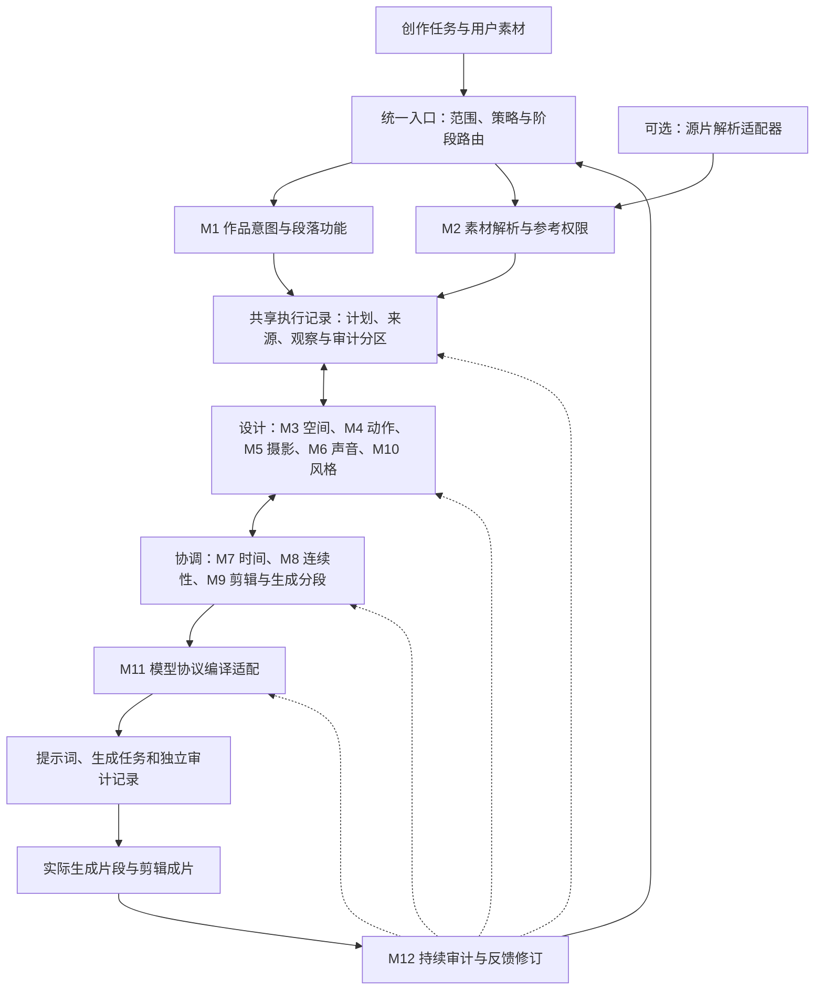

# AI 视频创作通用核心框架：编排、编译与持续审计

**文档状态：框架提案 / 待实现。**

**日期：2026-11-04（America/Los_Angeles）。**

**案例基线：`35658d3615d02c6aa6e4221fb223d73b86aa6875`。**

**适用目标：影视剧、音乐 MV，以及具有相同素材、动作、镜头和声音组织问题的 AI 视频创作。**

## 核心摘要

本框架建议以一份共享执行记录，连接 **12 个职责明确的核心模块**。记录中分别保存拍摄计划、编译结果、实际媒体观察和审计结论。模块分别负责作品意图、参考权限、空间调度、动作表演、摄影机、声音、时间、连续性、剪辑与生成分段、视觉风格、模型协议和审计。每个模块写入自己负责的数据，其他模块通过引用和修改请求协作，避免多个模块各自重写一份互相矛盾的提示词。

框架的基本工作单位是**主体、状态、事件、镜头、声音和明确的时间关系**。摄影词汇、舞蹈术语、剑舞动作、转场模板和案例技能都作为可选择的知识与策略使用。它们需要进入同一个拍摄计划，才能判断某个动作是否有支撑、某个机位是否看得见关键接触、某个切点是否发生在允许的状态边界。[S02][S03][S04][S05][S07][S08][S12][S14]

**统一时间基准不要求所有动作与摄影机零延迟。** 框架支持提前到位、同相响应、滞后追随、固定观察；支持连续接续、动作匹配切、蒙太奇和时空省略。连续性检查的目标是让变化符合创作意图、物理关系和已声明的编辑方式。[S05][S06][S08][S12][S13]

仓库中已经存在 29 个独立案例技能及其验证资料。本文件提出的是未来如何从这些案例中建设共享能力、统一接口和开发验收条件，**不表示 12 个通用模块已经实现，也不表示已建立完整源片逆向解析或视频自动验收系统**。[S01][S18]

## 关键词

AI 视频编排；拍摄计划；参考权限；动作因果链；机位与构图；多人调度；时间同步；状态连续性；影视剧；音乐 MV；模型适配；持续审计。

## 目录导航

1. 范围、证据与建设状态
2. 总体架构和工作顺序
3. M1—M12 模块合同
4. 共享数据对象与唯一写入责任
5. 跨模块联动规则
6. 影视剧与音乐 MV 的可选策略
7. 统一入口、共享模块与 29 个案例配方
8. 框架验收与交付边界
9. 引用说明

## 1. 范围、证据与建设状态

### 1.1 本框架解决什么问题

本框架服务于两个直接目标：

- **编排：** 将创作要求和素材组织成完整、可解释的拍摄计划，再生成目标模型需要的提示词与任务清单。
- **审计：** 检查计划、模型输入、生成片段和剪辑成片是否分别满足已声明的要求，并把问题定位到负责的模块。

优先研究对象是 2026 年 10 月案例中的 README、methodology、prompt 等文本，以及动作库等承担相同方法论职责的文件。此基线共含 29 个案例，其中 15 个为 10 月案例；没有据此虚构尚不存在的 11 月案例。本提案以这些案例和已有技能为基础，不把作者的效果描述直接当作本轮重新测得的成功率。[S01][S07][S18]

### 1.2 三类能力要分开标识

| 类型 | 在本框架中的处理 | 代表内容 |
|---|---|---|
| 案例反复提供的构成要件 | 提炼为通用数据和工作步骤，保留来源与适用范围 | 参考权限、动作链、机位几何、段内时间、状态交接、生成与剪辑分工 |
| 案例之间存在冲突或条件差异的规则 | 改写为可选择的策略和冲突检查，不叠加成全局禁令 | 提前与滞后运镜、动作进行时是否切镜、是否允许交叉走位、服装是否变化 |
| 影视剧适用需要增加的能力 | 标记为开发提案，补充规范和测试案例 | 对白反应、戏剧性镜头任务、完整正反打覆盖、叙事省略、声音空间 |

M1 的完整叙事能力、M6 的完整对白能力、M10 的影片级光色管理，以及 M12 的自动媒体检查仍需要补充样本和实现。不能仅凭现有舞蹈与展示案例，就宣称这些能力已经获得全面验证。[S02][S03][S08][S12][S16][S18]

### 1.3 规则使用原则

1. 用户明确要求是任务约束；发现互相冲突或不可满足时，记录具体冲突并提出最小调整。
2. 模型和工作流限制来自带版本的能力资料，不从单个案例的经验时长、人物数或镜头数推导。
3. 案例策略带有适用条件。例如“固定观察”适合某个镜头，不意味着整部作品不能运镜。
4. 不设统一人物数量、镜头数量、禁止口型、禁止走路、禁止歌词具象化等创作硬限制。
5. 写实、动画、幻想等作品可使用不同的物理表现策略；任何偏离都需要与该作品建立的规则相容。
6. 本框架的中间记录与审计条目不应直接混入交付给模型的提示词正文。

## 2. 总体架构和工作顺序

### 2.1 结构图

图中的模块是职责边界，不等同于独立进程、独立大模型或独立 skill。箭头表示数据依赖和修订关系；实际运行可以由同一个 agent 分阶段完成，也可以在共享计划和字段权限约束下分工处理。

### 2.2 一次任务的建议工作顺序

| 阶段 | 主要工作 | 形成的可审阅结果 |
|---|---|---|
| 任务整理 | M1 明确作品目的和段落作用；M2登记已知素材及未知项 | 创作任务表、素材和参考权限表；进入G0 |
| 事件与拍摄设计 | M3、M4、M5、M6、M10分别组织空间、表演、观看方式、声音和风格 | 动作事件、拍摄事件、声音事件及各自起止条件 |
| 统一协调 | M7统一时钟；M8检查状态；M9安排镜头、编辑边界和生成任务 | 可互相核对的时间表、状态表、镜头与生成清单；进入G1 |
| 协议编译 | M11依据实际模型和工作流能力生成输入 | 模式正确、引用可解析、参数已映射的任务包；进入G2 |
| 文本交付检查 | M12记录G0—G2检查结果；责任模块修订 | 具体通过项、阻塞项和未验证项 |
| 生成后与装配后检查 | 获得真实媒体后，M12核对实际结果；相关模块处理偏差 | G3生成片检查、G4全片检查及其证据 |

这不是不可回退的流水线。例如，M5发现关键接触被遮挡，可以向M3提出站位调整请求；M7发现一个动作链无法合理容纳在时长内，可以向M4或M9请求重新安排。修改由对应字段的责任模块完成，M12记录受影响范围并组织复核。

### 2.3 可选的源片解析适配器

用户要求从现有视频复刻、改编或提取方法时，入口可以接收源片解析结果，包括镜头边界候选、动作观察、主体与场景清单、声音事件、时间戳、来源帧及置信说明。

**解析器只提交带证据的观察结果和候选结论。** M2负责把结果登记为素材证据，并决定哪些信息获准进入目标作品；M3—M10再将所选信息转成创作计划。低阈值切镜候选需要逐帧判断，快速运动和光晕可能造成误报，同景同机位硬切也可能漏检。[S13][S15]

不使用源片时，可直接从剧本、音乐、用户要求和资产开始。该适配器是可选前置接口；本提案没有实现或承诺完整视频逆向、自动动作捕捉、全片分镜恢复或原始素材测量系统。

## 3. M1—M12 模块合同

下面的“通过条件”是未来实现与验收的合同，不代表现有代码已经执行这些检查。每个模块只对实际获得的数据作出结论；缺少媒体证据时保留未验证状态。

### M1. 作品意图与段落功能

**核心问题：这一段要让观众理解、期待或感受到什么，镜头为何需要存在？**

M1组织作品目标、叙事或音乐结构、主要信息、情绪变化、用户必须保留的事件与创作约束。影视剧可记录角色目标、阻力、选择、结果和信息揭示；MV可记录乐段功能、能量发展、主题意象和表演重心。案例中的段落标题、动作变化和镜头功能提供了部分基础，完整戏剧结构属于需要补充的能力。[S02][S03][S08][S12]

| 合同项 | 内容 |
|---|---|
| 输入 | 创作要求、剧本或情节梗概、音乐结构、目标时长、交付用途 |
| 输出 | `WorkBrief`：段落功能、必保事件、观众信息、情绪与能量走向、约束优先级 |
| 上下游 | 接收用户任务；向M3—M10提供设计目标，向M12提供验收依据 |
| 越权边界 | 不擅自替换用户角色、删掉关键动作、改写台词；不替M5决定全部机位或替M7编造真实拍点 |

**通过条件：** 每个段落有可说明的作用；必须保留的事件没有遗漏；影视剧的动作能服务情节，MV的变化能服务乐段或主题；无法兼容的目标被明确记录。

### M2. 素材解析与参考权限

**核心问题：每份素材具体决定什么，作用于谁、什么属性、何时以及哪个范围？**

M2登记素材、实际观察与来源，建立稳定主体标识以及参考权限矩阵。身份图、场景图、首尾帧、关键帧、动作视频、镜头参考、音色参考和完整音轨具有不同职责。一个文件可以支持多个主体；同一主体也可以有多个来源，但属性冲突必须裁决。仅作身份参考的图片不能自动获得首帧、背景和机位控制权。[S08][S09][S12][S14][S16][S17]

| 合同项 | 内容 |
|---|---|
| 输入 | 实际素材、用户描述、可选源片解析结果、素材用途和保留要求 |
| 输出 | `AssetRegistry`、`EntityRegistry`、`ReferenceMap`：资产ID、主体ID、观察状态、属性权限、作用范围和证据 |
| 上下游 | 向M3、M4、M5、M6、M8、M10分配可用信息；向M11提供引用来源 |
| 越权边界 | 不把“未检查素材”写成“已观察事实”；不让动作参考越权替换角色，不假设视频内声音已成为独立音频输入 |

**通过条件：** 每个被引用资产真实存在或明确标成待提供；每个参考用途可追溯；冲突有明确决定；独立生成任务所需的参考在任务清单中具体列出。

### M3. 空间与多人调度

**核心问题：谁在什么位置，朝向哪里，如何与其他主体、道具和摄影机发生关系？**

M3管理坐标系、可行动区域、路径、层次、交叉、接触区和遮挡关系。必须区分世界位置、人物自身左右和画面左右；稳定的角色ID不等于固定画面槽位。多人调度需要写清各自路径、到达时机和交互对象，而非仅写“排成队形”。[S05][S08][S12]

| 合同项 | 内容 |
|---|---|
| 输入 | 主体清单、场景结构、段落目的、动作空间需求、摄影可见性要求 |
| 输出 | `SpatialPlan`：坐标约定、站位、路线、层次、交叉和遮挡权限、场景可达关系 |
| 上下游 | 与M4协调动作空间，与M5协调观看方向；M7安排路线占用时间，M8检查跨镜空间状态 |
| 越权边界 | 不设统一人数上限；不禁止一切过中线或遮挡；不将参考图中的左右顺序当作永久站位 |

**通过条件：** 空间方向可辨；关键交叉有路径和时序；相遇、避让、视线和接触关系不互相矛盾；摄影机与人物的路径不会在写实方案中无解释地穿越实体。

### M4. 动作表演因果链

**核心问题：动作怎样从起始状态发生，经何种过程，产生什么可见结果？**

M4把动作名称转成可执行的事件序列。一般动作、舞蹈、剑舞、打斗、表情、视线和道具操作可使用不同子库，但共享起始条件、支撑与发力、运动路径、接触、结果、恢复和下一动作入口。戏剧情绪需要落实为与角色目标相符的可见表演，而不是只堆叠情绪形容词。[S02][S03][S07][S08][S12][S14]

| 合同项 | 内容 |
|---|---|
| 输入 | M1事件目标、M2动作参考权限、M3空间、M8当前状态 |
| 输出 | `ActionPlan`：执行者、对象、前置条件、过程、接触、动作结果、后续条件、领域策略 |
| 上下游 | 向M5提供必须看清的动作；向M6提供潜在声音事件；向M7提交事件依赖；向M8提交状态变化请求 |
| 越权边界 | 不用摄影机运动代替人物动作；不把“无慢走凑数”推广为禁止剧情走路；不擅自增加超出世界设定的力量或运动 |

**通过条件：** 动作从现有状态可进入；支撑、接触和持物关系清楚；关键过程没有被一句结果跳过；每个动作有出态或持续条件；用户指定的动作没有被修订过程悄悄删去。

### M5. 摄影机、景别、构图与焦点

**核心问题：摄影机怎样使观众看清此刻最重要的信息？**

M5分别描述机位、光轴与机身姿态、景别和取景、构图与可见性、焦点与景深，以及运镜路径。**机位不等于景别，仰俯角不等于摄影机高度，绕光轴滚转不等于人物身体倾倒。** 特殊视角需要说明产生该视角的空间条件；普通镜头无需机械堆叠所有几何字段。[S04][S05][S06][S12]

| 合同项 | 内容 |
|---|---|
| 输入 | 段落观看任务、主体与场景几何、动作链、关键接触、视觉风格 |
| 输出 | `CameraPlan`：位置与高度、距离、光轴、景别、主体占画、焦点、可见区域、运镜起止与触发 |
| 上下游 | 与M3/M4协调空间与动作可读性；由M7落实时间关系；由M9安排镜头边界；由M10协调光色 |
| 越权边界 | 不把所有镜头强制写成手持或低机位；不为追求构图改写角色身份；不把固定观察等同于人物和环境全部冻结 |

**通过条件：** 关键动作在必要时可见；位置、光轴、景别和构图互相成立；复合运镜有清楚的主路径和转换条件；镜头视场、焦点及景深的缺失不会使关键动作的可读性无法判断。

机位与运镜在案例中已有较多方法。完整焦点、景深和镜头视场策略需要另行补充摄影样本与测试，不能据现有位置模板直接宣称已经覆盖所有光学问题。

### M6. 声音、音乐与对白

**核心问题：观众在何时听到什么，声音来自谁或何处，如何与画面共同构成事件？**

M6区分对白、旁白、非语言发声、环境声、物理音效和非画内配乐。音乐参考、音色参考、音频局部借用和完整音轨复制是不同策略。对白还需要稳定说话者、台词原文、声源位置、表演方式及跨镜连续性。现有案例主要支持音乐时间和参考权限，对完整对白工作流应补充剧情验证样本。[S08][S12][S13][S14][S17]

| 合同项 | 内容 |
|---|---|
| 输入 | 台词、音频资产及用途、角色与声音绑定、动作声事件、段落情绪 |
| 输出 | `SoundPlan`：声源、台词、声音策略、音轨窗口、声画事件对应、音乐连续性 |
| 上下游 | M2提供音频权限，M4提供动作声事件；M7安排时间；M9处理跨切延续；M11映射模型语法 |
| 越权边界 | 不把歌唱音轨自动变成画面人物口型；不把“完整复制音轨”与“额外合成声音”同时设为无条件要求；不虚造说话者来源 |

**通过条件：** 每个发声事件有可追溯的声源；台词与说话者绑定一致；音轨复制和新增声音的策略不冲突；切镜不造成未经设计的音乐重启或对白中断。

### M7. 时间同步

**核心问题：动作、摄影机、声音和剪辑如何共享时钟，并形成明确的先后、同相或偏移关系？**

M7管理源素材时间、作品时间、生成片段局部时间和最终编辑时间的映射，给事件安排起止、持续、触发与允许误差。BPM、首拍偏移、拍点、乐句和对白事件都可成为时间依据；不能仅凭BPM推断一切真实声音事件。[S05][S08][S11][S12][S13][S14]

| 合同项 | 内容 |
|---|---|
| 输入 | 各模块提交的事件、先后关系、音乐/对白测量、片段和编辑边界、帧率资料 |
| 输出 | `TimingMap`：时钟转换、事件时段、偏移关系、拍点与帧映射、容差及未确定项 |
| 上下游 | 汇总M4/M5/M6/M9事件；向M8提供状态检查时刻，向M11提供统一时间表达 |
| 越权边界 | 不让所有镜头自动逐拍移动；不把共享时间线等同零延迟；不以错误压缩动作或改台词解决时长冲突 |

**通过条件：** 时间单位和时钟来源明确；计划覆盖必要时段；事件先后与持续时间成立；提前、同步、滞后或固定观察均被显式选择；需要精确到帧的事件记录实际帧率与映射误差。

### M8. 状态连续性

**核心问题：什么应持续，什么可以改变，改变由什么事件或编辑方式解释？**

M8维护连续性策略和状态账本。身份、外观、道具、接触、身体朝向、运动方向、环境和声音可以具有不同的持续范围。连续接续检查前镜终态与后镜初态；蒙太奇、换场和时间省略则检查允许变化清单、必要提示和应继续保持的属性。[S03][S08][S10][S11][S12][S13][S14]

| 合同项 | 内容 |
|---|---|
| 输入 | M2身份与权限、M3空间、M4动作变化、M6声音状态、M7时刻、M9边界类型 |
| 输出 | `ContinuityPolicy`、`StateLedger`：不变项、允许变化、计划起止状态、计划变更原因，以及对M12媒体观察的引用 |
| 上下游 | 向动作和镜头模块提供有来源标记的当前状态；接受其变更请求；向M9提供接缝条件，向M12提供计划对照依据 |
| 越权边界 | 不把整部影片锁在同一场景和服装；不把预期末态冒充已生成末态；不在蒙太奇边界强行要求所有物体位置不变 |

**通过条件：** 每项变化符合权限或有明确事件；连续接续的身体、道具和空间状态可以对上；实际媒体尚未获得时，只确认计划一致性；已观察状态与计划不一致时，后续段落不会静默沿用旧假设。

M8维护计划状态；实际生成媒体的观察由M12写入独立的`MediaObservationLedger`。M8可以引用该记录来建议接续、重生成或修改计划，但不能覆盖原观察，也不能在生成失败后悄悄改写原计划来制造“通过”。若决定改变目标，须形成新的计划版本并保留原计划及其失败记录。

### M9. 分镜、剪辑与生成分段

**核心问题：哪些属于同镜过程，在哪里切镜，怎样分配独立生成任务和最终使用片段？**

M9区分动作阶段、镜头、分镜格、生成任务和剪辑片段。它负责剪辑拓扑、源片选窗、切镜理由、转场意图、需要保留的运动相位、任务拆分和装配方式；M7负责这些选择的时间域换算、统一排时与同步约束。一个镜头可含多个动作阶段；一次生成可含多个镜头；生成片段也可在后期裁剪、组合或接续。[S03][S08][S12][S13][S14][S15]

| 合同项 | 内容 |
|---|---|
| 输入 | 段落功能、动作与镜头方案、时间关系、连续性策略、模型能力资料 |
| 输出 | `ShotEditGenerationPlan`：镜头ID、阶段归属、切镜事件、转场类型、生成任务、裁剪窗口和装配顺序 |
| 上下游 | 向M7请求时间安排，向M8声明边界类型；向M11提供生成任务；向M12提供成片检查点 |
| 越权边界 | 不把时间块自动变成硬切；不把每次姿态变化变成新镜头；不把剪辑使用时长直接等同后端生成时长；不另建一套覆盖M7的权威时间表 |

**通过条件：** 所有切镜有明确位置和设计理由；同镜运镜转换未被误标为切镜；生成任务可以承载相应内容；每个装配边界说明连续接续、匹配剪辑、蒙太奇或时空省略策略。

### M10. 视觉风格与光色

**核心问题：作品如何在不同镜头、场景和生成任务中保持可识别的视觉表达，同时允许必要变化？**

M10制定材质与画面质感、光源方向与性质、色彩基调、对比、曝光倾向、环境效果等策略，并区分全片规则、场景规则和镜头例外。光源偏暖与全片冷中性调色不是同一字段；某个角色湿发也不等于允许改变发色或发型身份。[S02][S03][S10][S11][S12]

| 合同项 | 内容 |
|---|---|
| 输入 | 作品意图、视觉参考权限、场景条件、摄影机方案、可接受风格变化 |
| 输出 | `LookPlan`：全片/场景/镜头风格层级、光源与调色分工、材质、效果、例外和继承关系 |
| 上下游 | 为M5提供可见性与光色条件，为M8提供视觉持续范围；M11转写到相应模型字段 |
| 越权边界 | 不用风格词替代具体动作；不为统一色调重设计角色；不把一个MV的冷色、低饱和等偏好设为全局默认 |

**通过条件：** 全片和局部风格没有互相覆盖不明的问题；光源、调色、材质和特效的职责可区分；关键可见信息没有被光效遮蔽；跨场景差异与作品意图相容。

### M11. 模型协议编译适配

**核心问题：已确认的拍摄计划怎样成为当前模型与实际工作流能够接收的输入？**

M11读取带版本的能力资料，按素材用途、任务要求和后端支持情况选择模式，生成字段、引用标签、时间表达和调用参数。H3的基础模式与Ref2VA具有不同字段结构；模式选择不能仅凭图片数量。该模块还必须区分提示词中表达的要求与真正传给工作流的时长、分辨率、帧率和素材参数。[S16][S17][S19]

| 合同项 | 内容 |
|---|---|
| 输入 | 已协调的共享计划、生成任务、素材清单、目标模型和工作流版本 |
| 输出 | `CapabilityProfile`、`CompilationResult`：能力依据、模式、纯提示词、引用映射、参数映射和编译诊断 |
| 上下游 | 向M9提供可规划的能力边界；消费M2—M10计划；由M12核查编译保真性 |
| 越权边界 | 不擅自删动作、换角色或改台词以迎合格式；不把案例经验写成模型硬限制；不声称文本通过代表工作流已运行 |

**通过条件：** 字段与模式相符；引用可解析；时间表达与计划一致；能力限制有版本依据；参数与提示词不互相矛盾；输出中没有未替换占位符、内部审计记录或开发说明。

遇到后端能力冲突，M11生成具体诊断并回传M9/M7，由它们提出分段、选窗或排时调整；涉及导演意图的变化再回到M1及相关创作模块。M11不得以“编译优化”为名自行改变故事、动作、声音或镜头任务。

H3语法属于适配层。上游的动作、空间、状态和剪辑计划应尽量保持模型无关；未来支持其他模型时，需要新适配器与相应验证，不能只替换产品名称就宣称兼容。

### M12. 持续审计

**核心问题：当前阶段到底检查了什么，凭什么通过，发现问题后应回到哪个责任模块？**

M12贯穿全流程，维护检查合同、证据、问题级别、修复请求、复核范围和结果。它既检查模块内部矛盾，也检查模块间引用、时序和状态关系。已有29个案例技能的格式验证、静态审计与离线试用可作为起点；完整的视频内容检查和迭代反馈仍是未来建设项。[S13][S14][S15][S16][S18]

| 合同项 | 内容 |
|---|---|
| 输入 | 用户要求、计划版本、模块输出、编译产物、实际媒体、人工判断和工具测量 |
| 输出 | `AuditLedger`、`MediaObservationLedger`、`ChangeSet`：检查范围、独立媒体观察、通过/失败/未验证、责任模块、修改及复核依赖 |
| 上下游 | 读取M1—M11及实际交付结果；将问题路由至相应模块；向入口报告当前可交付状态 |
| 越权边界 | 不直接覆盖其他模块的专业字段；不把缺证据标成通过；不把提示词中的“自行检查”当作真实执行的验收程序 |

**通过条件：** 结论与检查范围对应；每个阻塞问题有具体位置和原因；修改后复核了真实受影响项；没有将文本审计、工作流执行、生成片检查和成片检查混为一种“全部通过”。

## 4. 共享数据对象与唯一写入责任

### 4.1 共享拍摄计划

建议未来以一份共享执行记录组织以下逻辑对象，其中`ProjectPlan`为计划分区，`CompilationResult`为编译分区，`MediaObservationLedger`为媒体观察分区，`AuditLedger`为审计分区。分区通过稳定ID和版本相互引用，计划值与实际观察值分开保存。这里定义的是接口合同，**不声称已经存在相应程序、JSON Schema或已安装技能**。

| 对象 | 唯一写入责任 | 关键内容 | 主要读取方 |
|---|---|---|---|
| `WorkBrief` | M1 | 创作目的、段落功能、必保事件、约束优先级 | M2—M12 |
| `AssetRegistry`、`EntityRegistry`、`ReferenceMap` | M2 | 资产、稳定主体ID、用途、来源、观察状态、属性权限 | M3—M12 |
| `SpatialPlan` | M3 | 坐标系、空间布局、路线、层次、交互区 | M4、M5、M7—M9、M12 |
| `ActionPlan` | M4 | 动作事件、身体过程、接触与预期状态变化 | M5—M9、M11、M12 |
| `CameraPlan` | M5 | 机位、景别、构图、焦点、路径与观看任务 | M3、M7—M11、M12 |
| `SoundPlan` | M6 | 声源、台词、音乐和音轨策略、声音事件 | M7—M9、M11、M12 |
| `TimingMap` | M7 | 时钟、事件起止、时序关系、偏移与容差 | M3—M12 |
| `ContinuityPolicy`、`StateLedger` | M8 | 持续范围、允许变化、计划状态、交接条件、观察记录引用 | M3—M7、M9、M11、M12 |
| `ShotEditGenerationPlan` | M9 | 镜头/阶段归属、剪辑拓扑、选窗、转场意图、生成与装配结构 | M5—M8、M10—M12 |
| `LookPlan` | M10 | 风格层级、光源、调色、材质、效果及例外 | M5、M8、M11、M12 |
| `CapabilityProfile`、`CompilationResult` | M11 | 模型能力证据、模式、字段、素材标签、参数与文本 | M9、M12及实际执行方 |
| `AuditLedger`、`MediaObservationLedger`、`ChangeSet` | M12 | 独立媒体观察、检查证据、问题、责任人/模块、变更及复核记录 | 全部模块与统一入口 |

“唯一写入”指语义责任。多个agent可协作分析，但只由责任模块接受并写入该字段的最终决定。它不意味着其他模块不能提出修改。

### 4.2 派生数据不得变成第二份事实来源

- M3拥有空间方案；M8可以在某一时刻记录由M3推导的计划位置，但必须保留来源引用，不能另造一套站位。
- M4拥有动作事件及其变化请求；M8记录经过权限与连续性检查的状态结果，不重新创作动作。
- M4的动作语义、M5的摄影事件、M6的声音语义使用统一的事件ID空间；不同事件各有独立ID，触发和对齐通过引用建立，不把动作起点、摄影机到位和声音出现强并为同一事件。M7通过这些ID登记权威时间和同步约束，不让自然语言段落各自保留不同版本的事件时间。
- M5决定相机行为；M7安排该行为的时间关系，不能因套用拍点而自行增加推拉或摇移。
- M9决定剪辑拓扑、选窗和转场意图；选窗使用来源明确的源时间或源帧范围。M7负责映射到生成与成片时间、统一排时以及同步约束。镜头表引用事件ID，不在多个表中手工维护互相不同的权威切点。
- M6拥有说话者与声音的语义绑定；M11只根据模型协议生成标签和字段，不重新分配角色音色。
- M11拥有生成请求中的素材顺序与序列化标签；项目主体ID、资产ID保持稳定，不能从最终标签编号反推角色身份。
- M8拥有计划状态；M12拥有生成媒体的观察证据。观察记录必须绑定媒体ID、被核对的计划版本、时间范围、观察或测量方法、覆盖范围和结果。后续修改生成新的计划版本，不改写原有观察来消除失败。
- M12记录问题和建议修改；真正的专业字段修订回到相应模块完成。

### 4.3 每条记录应具有的共同元数据

| 记录项 | 作用 |
|---|---|
| 稳定ID与对象类型 | 区分主体、资产、动作、镜头、声音、生成任务和编辑片段 |
| 版本与上游版本 | 防止使用修改前的旧镜头、旧拍点或旧主体绑定 |
| 证据类型与来源 | 区分用户明确要求、来源文本、实际观察、测量、推断和待确认假设 |
| 作用范围 | 指定全片、场景、段落、镜头、事件或时间窗口 |
| 责任模块 | 让修订请求回到唯一写入方 |
| 状态 | 区分草稿、计划已检查、已编译、已生成、已观察、需修订等阶段 |
| 未解决项 | 记录缺素材、缺测量、冲突和阻塞原因 |

这些状态不形成一个可以偷换含义的总分。“计划已检查”只说明所检查的计划条件成立；“已编译”只说明已形成相应模型输入；只有获得实际媒体并完成相应检查，才能写入“已观察”的媒体结果。

## 5. 跨模块联动规则

### 5.1 共用时钟，选择不同响应关系

| 时序策略 | 关系 | 典型用途 | 审计重点 |
|---|---|---|---|
| 提前到位 | 摄影机先到目标构图，关键动作随后完成 | 群舞展开、重要动作或道具揭示 | 到位时间、等待状态、提前移动有无理由 |
| 同相响应 | 指定动作与观看变化在同一时段或强调点协同 | 起身随升、接触声与视觉事件 | 对齐的是启动、峰值、接触还是结束，不能混称“同步” |
| 滞后追随 | 摄影机在动作开始后响应，可能经过修正重新找到主体 | 主观观察、迟疑、受限注意力 | 延迟和修正是否有界、主体是否仍可读 |
| 固定观察 | 摄影机不移动，动作在构图中完成或进入画面 | 踢腿、入画、对峙、固定几何展示 | 动作范围、可见区域、是否无故漂移 |

这些策略在案例中具有不同来源或实例。共同时间线使差异可计算、可解释，不要求它们变成同一种节奏。[S05][S06][S08][S14]

### 5.2 事件必须有阶段，重要结果必须可见

以触地触发状态变化为例，M4描述抬脚、下落、接触、保持和再次抬脚；M7安排这些阶段；M5保证触地可见；M9把变化指定为相应编辑事件；M8确认允许变化的属性及其余持续状态；M6安排声音；M12检查是否把触地和下一次抬脚压缩成同一不可辨认动作。[S14]

同一结构可以用于取物、交接、开门、挥剑、着地和对白中的转头回应。具体动作、表演动机和时长仍由任务决定，不机械套用某一案例的数值。

### 5.3 连续性按边界类型检查

| 边界类型 | 要求继承的内容 | 可以改变的内容 |
|---|---|---|
| 同镜连续过程 | 身份、空间与动作因果、摄影机可达路径 | 有过程支持的姿态、位置、焦点和构图变化 |
| 连续动作接续 | 必要的支撑、持物、朝向、运动方向和相位 | 新机位、景别或有依据的观看关系 |
| 动作匹配剪辑 | 已指定的动作相位、方向、关注对象 | 场景、服装或时间，取决于设计权限 |
| 蒙太奇 | 主题、角色身份或其他明确选择的连接要素 | 非连续空间、不同动作、不同时间和场景 |
| 时空省略 | 叙事因果与省略后仍应成立的事实 | 时间推进、地点变化、合理完成的状态变化 |

M8不能对所有边界使用“前后所有属性相等”。M9必须先声明边界类型，M1说明此边界的段落作用，M8才能决定检查哪些属性。

### 5.4 四套时间不得互相替代

1. **源素材时间：** 引用原视频或音频的哪个区间。
2. **作品计划时间：** 事件在作品结构中的位置。
3. **单次生成局部时间：** 当前生成任务从零起算的事件位置。
4. **最终编辑时间：** 裁剪、插入保持、变速等编辑操作之后的成片位置。

单纯连续、不变速且无裁剪的片段，可使用起始偏移建立映射。存在裁剪、保持或变速时，必须记录实际映射，不能继续把几个时间轴当作同一组数值。生成帧率与最终输出帧率也分别记录；声画“同帧”只能在明确帧率和允许误差后验收。[S12][S13][S14][S15]

### 5.5 变更后的复核按依赖扩散

| 上游变更 | 必须检查的典型下游 |
|---|---|
| 替换角色或改变参考权限 | 动作适配、空间占用、外观连续性、镜头可见性、引用编译 |
| 替换音乐或改变拍点 | 动作事件时间、摄影机响应、切点、音轨窗口、生成与编辑映射 |
| 改变动作或道具接触 | 空间、摄影可见性、接触声、状态变化、剪辑边界 |
| 改变机位或运镜 | 屏幕方向、遮挡、关键动作可见性、接缝构图、焦点 |
| 改变镜头或生成任务边界 | 初末状态、素材重传、局部时间、音轨切片和实际后端参数 |
| 改变模型或工作流 | 模式、能力限制、引用与字段、参数映射、需要重新验证的媒体表现 |

这张表是复核依赖的起点。实现时需要根据实际引用关系确定范围；不要求每个小改动都重做全部工作，也不能在上游已改变后继续沿用失效的通过记录。

## 6. 影视剧与音乐 MV 的可选策略

### 6.1 共用模块，选择不同主导因素

| 维度 | 影视剧常见选择 | 音乐 MV 常见选择 | 共同底座 |
|---|---|---|---|
| 段落功能 | 目标、冲突、选择、揭示与反应 | 乐段发展、主题、能量和表演变化 | M1明确段落为何存在 |
| 动作组织 | 行动及其结果、表情、视线、道具操作 | 动作链、舞句、剑舞、队形、生活方式表演 | M3/M4明确空间和过程 |
| 时间依据 | 对白、反应、因果事件、必要停顿 | 音乐拍点、乐句、动作强调和歌词策略 | M7统一时钟并允许偏移 |
| 摄影任务 | 信息分配、人物关系、主观性与场面覆盖 | 表演可读性、能量、几何与视觉变化 | M5使关键内容可见 |
| 剪辑策略 | 连续剪辑、反应、时空省略、交叉组织 | 动作匹配、卡点、主题蒙太奇、连续长镜 | M9声明边界，M8按类型检查 |
| 声音 | 对白、环境声、物理音效和配乐共同组织 | 母轨、演唱、音效、环境声的不同组合 | M6明确声源和使用策略 |
| 连续性 | 角色和叙事事实、道具、动作、空间 | 身份、舞句、动量、声音和选定的视觉要素 | M8区分不变项与允许变化 |

这不是对创作类型的强制划分。剧情片可以精确卡点，MV可以有复杂对白、完整叙事和时空省略；模块以具体任务为准。

### 6.2 可选策略必须携带适用条件

建议策略至少记录：名称、目标、适用条件、默认值、允许覆盖项、冲突项和证据来源。例如：

- **连续舞句策略：** 用于需要保持舞蹈动量的段落；要求链间交接，不自动禁止剧情性停顿。
- **固定机位展示策略：** 用于依靠主体变化传达信息的镜头；不把人物冻结作为相机静止的前提。
- **角色身份保留策略：** 保留指定身份属性；是否继承服装、姿势、背景和机位由M2单独决定。
- **音乐母轨策略：** 使用完整母轨或精确窗口；新增声音须与该策略相容。
- **主观滞后观察策略：** 用有界延迟与修正表达观察者状态；不能退化为无目的摇晃。
- **时空省略策略：** 允许时间或地点跳变；需要保留叙事事实并说明相关状态变化。

## 7. 统一入口、共享模块与 29 个案例配方

### 7.1 建议组织方式

| 层 | 建议职责 | 建设状态 |
|---|---|---|
| 一个统一入口 | 识别任务类型、当前阶段、所需模块、缺失信息和交付方式 | 未来开发项，名称与安装方式待实现时确定 |
| 共享核心模块 | 提供M1—M12合同、知识路由、统一对象、检查与修订流程 | 本文件定义的提案 |
| 案例配方 | 将某个案例的策略、参数、例外、来源和测试任务映射到共享模块 | 可从现有29个案例技能抽取；尚未完成统一适配 |
| 模型适配器 | 将共享计划编译为特定模型输入与参数 | H3规范可作首个基线；通用适配接口待开发 |
| 检查工具与评估任务 | 执行确定性检查、记录真实试用、定位失败与回归 | 现有案例已包含部分工具和记录；通用化仍需实施 |

**12个模块不等于必须创建12个skill。** 模块数量来自职责划分；skill数量由实际触发方式、安装粒度和维护需要决定。可以先由一个入口skill按需读取模块资料和调用确定性脚本，只有具有独立任务入口、稳定合同和独立验收价值的能力，再考虑拆成独立skill。[S19]

### 7.2 案例配方的建议内容

每个案例配方提供以下映射，而不是重复写一套通用规则：

- 对应的创作任务与适用条件。
- 启用哪些模块、使用哪些策略。
- 哪些属性必须继承、哪些可以变化。
- 动作、机位、时序和剪辑的案例参数。
- 与通用默认不同的例外及其理由。
- 已知失败方式、修复分支及证据。
- 能验证该方法的代表任务和实际执行状态。

例如，触地切换配方重点调用M4、M5、M7、M8和M9；多人队形配方重点调用M2、M3、M4、M7和M8；夏日水线配方重点调用M2、M5、M8、M9和M10。其他模块仍按任务需要参与，配方不能绕开模型协议和审计。[S08][S12][S14]

### 7.3 与已有案例技能的关系

现有29个案例技能是已经交付的独立资源。未来提炼可以从这些资源读取案例方法和验证证据，再建立对共享合同的映射。采用共享源文件维护时，发布的独立案例包仍须包含本包所需公共文件和可满足的运行依赖，保持单目录复制能力；完整集合包可引用共同核心，但不能将未随独立包提供的兄弟目录作为其唯一依赖。具体依赖展开、版本校验和双包方案按开发路线的P7冻结并验证。[S01][S18][S19]

共享化的目标是减少规则冲突和维护重复，不应抹掉案例之间有价值的差异，也不能把所有案例强行改写为一种摄影、动作或音乐风格。

## 8. 框架验收与交付边界

### 8.1 统一使用G0—G4审计关卡

| 关卡 | 需要验证的事实 | 不能据此宣称 |
|---|---|---|
| G0 输入与证据 | 素材、用途、来源、缺失与推测足以支持当前编排 | 已核验未提供的素材，或已经生成视频 |
| G1 设计与跨模块一致性 | 动作、空间、摄影、声音、时间、状态和剪辑组成可追溯、自洽的计划 | 视频一定正确执行 |
| G2 编译与运行契约 | 模式、字段、标签、参数、引用和时间范围符合实际后端契约，关键创作要求未丢失 | 工作流已经执行或生成稳定 |
| G3 生成片验收 | 实际视频与音频中，被观察或测量的身份、动作、声音和镜头条件实现 | 所有模型、素材、时长和场景都同样有效 |
| G4 全片验收 | 最终编辑作品的接续、叙事/音乐组织、时间和交付条件满足要求 | 未检查部分也已通过 |

G0—G2支持文字编排的最小版本；G3—G4必须有真实媒体。静态工具是关卡使用的检查手段，不是自动证明所有语义、物理和画面效果的额外等级。关卡保留`pass`、`fail`、`unverified`等明确状态，不从上一关卡通过自动推导下一关卡通过。

框架文档本身还需确认模块合同完整、对象可引用、字段责任一致，但文档通过审阅不表示对应软件已经实现或自动运行。

### 8.2 代表任务必须覆盖差异与冲突

未来评估至少应同时包含：

1. 固定观察和提前/同步/滞后运镜各自成立的任务。
2. 同镜多阶段、单次多镜、跨生成接续、蒙太奇和时空省略。
3. 单主体与多主体，角色换槽位、交叉、遮挡及道具交接。
4. 身份参考与首帧不同、动作参考与人物外观分离的任务。
5. 完整音轨复制、音乐节奏参考、对白及新增物理声音的不同组合。
6. 允许服装或场景变化，但必须保持角色身份和叙事事实的任务。
7. 缺素材、错误时间基准、状态冲突、字段错误等应被识别的失败任务。

应先验证接口和计划，再选择代表任务做编译和实际媒体试做。现有案例的编写场景数量、静态检查通过数量与真实生成试验数量分别统计，不能互相替代。[S18]

### 8.3 面向用户的实际交付

正式编排任务最终可按需要交付三个分离的结果：

- **模型输入：** 可直接使用的提示词正文及真实资产绑定，不混入规范说明和审计意见。
- **制作任务清单：** 生成任务、参考文件、参数、音轨窗口、裁剪与装配安排。
- **审计记录：** 检查范围、具体证据、已修复问题、未验证部分以及必要的下一步。

用户只要求纯提示词时，入口应按请求交付正文；内部仍维护必要计划与检查。用户要求方案、审计或开发计划时，再呈现对应资料。不能让内部模块结构成为每个成品都必须携带的大段说明。

## 9. 引用说明

正文引用编号统一对应本目录 `03-source-evidence.md` 的集中来源表、精确文件位置与证据说明：

集中入口：[03-source-evidence.md](03-source-evidence.md)。

- [S01] 案例与目录基线。
- [S02] 武侠舞蹈方法；[S03] 剑舞方法。
- [S04] 物理机位；[S05] 动态运镜纪律；[S06] 高级运镜组合。
- [S07] 动作链库；[S08] 四人队形；[S09] 身份参考半身舞。
- [S10] 白凤蒙尘；[S11] 下山；[S12] 夏日水线；[S13] 水岸双段。
- [S14] 触地切换；[S15] 三造型独立镜头；[S16] 动作迁移。
- [S17] MiniMax H3 官方资料；[S18] 已有案例技能及验证记录；[S19] Agent Skills 规范。

本文件提出的数据对象、唯一写入责任、模块合同和未来评估合同属于框架设计推论。来源证明相应案例、规则或问题确实存在；它们不自动证明本提案尚未实现的全部机制已经有效。
