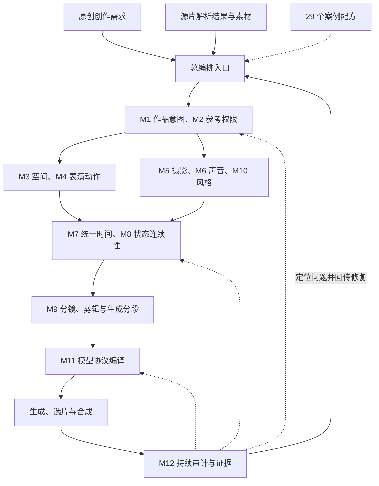

# 通用核心框架：用户确认内容完整登记

**登记版本：** v0.1.1

**登记日期：** 2026-11-04（America/Los_Angeles）

**记录性质：** archived-confirmation；完整保存用户本次选中的上一轮答复。新通用核心实现状态仍为 `planned`。

**历史基线：** `196ebed12d74505f18146a75d82480a5b5f06ed4`。

## 核心摘要

本文件逐项登记用户确认的完整框架说明，包括十二模块的“模块／主要职责／核心输出与审计重点”三个维度、工作流主干与分支、九类共享对象、五条责任边界、影视剧与音乐 MV 对照、G0–G4 持续审计、P0–P9 开发路线，以及原答复的交付说明和核验结果。

## 关键结论与归档规则

1. 下方归档正文保存原答复的全部六大部分、表格、列表、说明和参考链接；本段登记说明不替代原文。
2. 用户选中文本夹带的 Mermaid 渲染 CSS 属于聊天界面样式，已还原为原答复的 Mermaid 源码，保留全部 12 个节点、16 条有向关系、实线／虚线和修复回路；没有将样式代码当作业务规则。
3. 原答复中的提交号 `196ebed`、“6 个文件、2,298 行”等是上一轮交付时的历史记录，在正文中原样保留；本次增补后的文件与校验信息以当前 `README.md`、`validation-record.json` 及对应 Git 提交为准。
4. 原答复的 Markdown 链接继续保留；其中指向 `main` 的文档会随仓库更新。需要复现原交付时应使用文末的固定基线链接。
5. 主干与分支的逐路由触发、输入、回传、失败归属和复验范围由 `05-workflow-routing.md` 补充展开；`01-core-framework.md` 的字段责任和 `02-development-roadmap.md` 的开发退出条件继续有效。

**关键词：** 完整归档、十二模块、三维表、主干路由、共享契约、影视剧、音乐 MV、持续审计、开发路线。

## 目录导航

| 原文部分 | 完整登记内容 |
|---|---|
| 一、通用核心模块的完整框架结构 | 总体组成、完整 Mermaid、十二模块三维表、四项职责区分 |
| 二、让这些模块能够协作的共享结构 | 九类共享对象、五条边界及例子 |
| 三、影视剧与音乐 MV 如何共用这套核心 | 六维对照、条件化规则、证据缺口 |
| 四、持续审计：五个关卡与修复闭环 | G0–G4、完整修复顺序、文字与媒体证据边界 |
| 五、完整开发提炼路线 | P0–P9 十阶段、建设内容、阶段成果及工程顺序 |
| 六、已提交的完整文档 | 历史六文件清单、来源覆盖、核验结果、实现状态 |

<!-- BEGIN ARCHIVED ANSWER -->

## 一、通用核心模块的完整框架结构

建议将项目组织为：

**一个总编排入口＋12 个职责模块＋一套共享数据契约＋影视剧／音乐 MV 两套创作策略＋五个审计关卡＋29 个案例配方。**

完整分析、框架和开发计划已提交到 GitHub 的 **[`main/docs/skillplan/`](https://github.com/Nuos/H3-h3-prompt-journal/tree/main/docs/skillplan)**，提交为 **[`196ebed`](https://github.com/Nuos/H3-h3-prompt-journal/commit/196ebed12d74505f18146a75d82480a5b5f06ed4)**。本次发布的是完整设计与开发计划，新通用核心的实现状态明确标为 `planned`。

### 1. 总体结构与模块关系

框架围绕一份共享的“镜头执行方案”组织：**谁在什么空间和状态下，于何时完成什么事件，观众怎样看见和听见，镜头怎样连接，以及这些判断由什么证据支持。**

这里的箭头表示主要依赖和反馈关系。创作过程中，动作、摄影、声音和剪辑可以联合调整，但必须同步更新共享计划及受影响的检查结果。

**12 个职责模块不要求打包成 12 个独立 Skill。** 技能如何拆包，应取决于调用场景、依赖关系、上下文开销和独立复用需求。完整职责与接口定义已写入 [01-core-framework.md](https://github.com/Nuos/H3-h3-prompt-journal/blob/main/docs/skillplan/01-core-framework.md)。

### 2. 十二个核心模块

| 编号 | 模块 | 主要职责 | 核心输出与审计重点 |
|---|---|---|---|
| **M1** | **作品意图、叙事／情绪与段落功能** | 明确作品目标、人物目标、信息变化、情绪发展和段落作用，为其他模块确定优先级 | 作品简报、段落任务、情绪／能量曲线、动作与视觉母题；检查每段是否承担明确功能 |
| **M2** | **素材解析、资产绑定与参考权限** | 消费素材及解析结果，明确每份参考提供哪些属性、绑定哪个实体、在哪些镜头生效 | 资产清单、实体绑定、属性继承范围、来源证据；检查身份、首帧、姿态、场景、摄影和声音参考是否混用 |
| **M3** | **场景空间、人物站位与交互调度** | 建立空间关系、人物走位、队形、屏幕方向、接触、避让与遮挡条件 | 空间与调度计划；检查动作是否有执行空间、人物关系是否清楚、关键互动是否被遮挡 |
| **M4** | **人物表演、动作链与物理因果** | 将动作、舞蹈、剑舞及戏剧表演拆成有起态、过程、结果和出态的事件 | 动作／表演事件链；检查支撑、重心、接触、动作承接、触发与反应、道具操作是否成立 |
| **M5** | **机位、景别、构图、焦点与运镜** | 根据观看目的设计摄影机位置、光轴、景别、构图、焦点和运动路径 | 摄影计划；检查关键动作是否可见，摄影机运动是否具有明确目的，空间与方向是否可读 |
| **M6** | **声音、音乐、对白与歌词关系** | 组织说话者、对白、歌词、音乐结构、环境声和动作声，明确复制或参考方式 | 声音分层计划、说话者绑定、音乐与歌词关系；检查声源、内容、用途和视觉事件是否对应 |
| **M7** | **统一时间轴与动作—镜头—声音协同** | 为动作、摄影、声音及剪辑建立统一时序，管理先后、重叠、偏移和事件触发 | 权威时间表与时间域映射；检查同步关系、时间容量、持续时长和跨片时间换算 |
| **M8** | **主体、道具、场景与跨镜状态连续性** | 管理固定属性、动态状态、允许变化、入态／出态和跨镜交接条件 | 计划状态与交接记录；检查服装、持物、位置、朝向、接触、场景等变化是否有依据 |
| **M9** | **分镜组织、转场、剪辑与生成分段** | 区分动作阶段、故事板、镜头、生成任务及成片使用区间，规划切点和装配关系 | 分镜表、生成分段、转场意图、裁剪与装配表；检查片段边界是否破坏动作或叙事 |
| **M10** | **视觉风格、光线、色彩与材质** | 统一作品视觉基线，并明确局部变化的范围与原因 | 风格、光色和材质计划；检查视觉连续性及风格变化是否服务段落目的 |
| **M11** | **模型协议编译与运行参数适配** | 将冻结后的共享计划转换为具体模型支持的提示词、素材绑定和运行参数 | 自包含提示词、资产映射、参数与生成任务；检查模式、字段、引用和后端能力是否匹配 |
| **M12** | **持续审计、问题归因与反馈修复** | 在输入、设计、编译、生成片和成片阶段记录问题、证据、责任模块及修复影响 | 审计报告、问题记录、媒体观察与复验记录；检查结论有无依据、修复是否解决原问题并引入新冲突 |

其中，几个最容易混淆的职责已经明确分开：

- **M4 定义发生什么，M7 定义何时发生，M8 管理发生后的状态。**
- **M5 定义怎样看见，M9 定义镜头怎样连接。**
- **M11 将计划编译为模型输入；能力冲突需要返回规划模块处理。**
- **M12 记录发现和证据，并把修订交还相应字段的责任模块。**

---

## 二、让这些模块能够协作的共享结构

模块化能否成立，关键在于它们是否使用同一组实体、事件、时间和状态记录。框架已经规定共享对象及字段归属，避免各模块分别写出相互矛盾的版本。

### 1. 共用的数据对象

| 共享对象 | 必须表达的内容 |
|---|---|
| **项目与段落计划** | 创作目标、片型、场景／段落功能、约束、优先级、版本 |
| **资产与参考权限** | 素材来源、目标实体、提供属性、生效镜头／时段、可访问性 |
| **空间与交互计划** | 场景关系、世界／身体／屏幕方向、走位、接触、遮挡与避让 |
| **动作、摄影与声音事件** | 各自独立的事件编号、执行者、对象、条件、过程、结果及相互引用 |
| **摄影与风格计划** | 机位、光轴、景别、构图、焦点、摄影机路径、光色和材质 |
| **统一时间与装配映射** | 源素材时间、生成片段局部时间、裁剪／变速／定格关系、成片时间 |
| **状态与交接记录** | 固定属性、可变状态、计划入态／出态、允许变化及变化原因 |
| **生成编译清单** | 模型模式、后端版本、素材顺序、提示词、参数和编译来源 |
| **审计与证据记录** | 检查层级、结论、证据、观察对象、责任模块、失效与复验状态 |

这些对象是拟建设的内部契约；具体字段定义及权威写入责任见 [完整框架文档](https://github.com/Nuos/H3-h3-prompt-journal/blob/main/docs/skillplan/01-core-framework.md)。

### 2. 必须固定的五条边界

**第一，角色身份与镜头中的位置分别记录。**

同一角色换位、转身、出入画面后，实体身份保持稳定；站位、朝向、持物和姿态属于动态状态。

**第二，参考权限按属性划分。**

一张图片可以只提供人物身份，也可以提供首帧、服装、姿态或场景。具体继承哪些属性，应由任务明确授权，不能自动全部继承。

**第三，动作、摄影和声音使用共同时间轴，但保留独立事件。**

例如人物起跳、摄影机上摇、音乐重音是三个不同事件，可以通过同步关系关联。同步方式允许提前、同相、滞后、固定观察和事件触发。

**第四，剪辑意图与权威时间映射分别管理。**

M9 管理镜头选择、切点意图和装配关系；M7 管理实际排时与时间映射。这样，修改裁剪或变速时，可以确定哪些动作、声音和状态检查需要重新执行。

**第五，计划状态与实际媒体观察分开保存。**

M8 管理计划中的状态；M12 将实际观察到的视频与音频结果绑定到媒体版本、计划版本、时间位置和观察方法。生成结果偏离计划时，保留偏差证据，再决定调整计划还是重新生成。

---

## 三、影视剧与音乐 MV 如何共用这套核心

两种创作使用同一组模块和共享记录，通过不同的策略确定模块优先级、事件组织方式和验收标准。

| 维度 | 影视剧策略 | 音乐 MV 策略 |
|---|---|---|
| **段落依据** | 人物目标、冲突、信息变化、关系变化 | 音乐结构、乐句、情绪与能量发展 |
| **表演事件** | 行动、对白、目光、停顿、听者反应 | 动作母题、舞蹈／剑舞动作链、运动质地 |
| **空间与摄影** | 互动关系、视线、叙事信息与表演覆盖 | 动作可读性、队形变化、视觉母题与运镜 |
| **时间组织** | 事件先后、表演时长、对白与反应节奏 | 实际音乐窗口、拍点、乐句与动作完成时间 |
| **剪辑策略** | 连续剪辑、反应镜头、信息延迟、时间省略 | 连续接力、相位匹配、表演蒙太奇、段落转换 |
| **重点验收** | 观众能否理解人物行动和关系变化 | 动作是否完成、声画关系是否成立、段落是否有发展与收束 |

因此，案例中的固定人数、固定机位、旋转预算、无口型、歌词处理方式等，都保留其适用条件。对白、口型、走位、切镜、时间省略和蒙太奇，可以根据任务启用。

当前案例证据对舞蹈、动作链、摄影和 MV 更充分；影视剧路线已经单列需要补充的动机、对白、反应、视线、道具交接与时间跳跃样本。具体证据和缺口记录在 [03-source-evidence.md](https://github.com/Nuos/H3-h3-prompt-journal/blob/main/docs/skillplan/03-source-evidence.md)。

---

## 四、持续审计：五个关卡与修复闭环

“连续自检”应覆盖整个工作流，并区分每种检查能够证明什么。

| 关卡 | 检查对象 | 可以形成的结论 |
|---|---|---|
| **G0：输入与证据** | 素材、用途、来源、缺失项与推测 | 当前输入是否足以支持编排 |
| **G1：设计与跨模块一致性** | 空间、动作、摄影、声音、时序、状态与剪辑 | 计划是否自洽，语义判断是否有依据 |
| **G2：编译与运行契约** | 模式、字段、素材引用、标签、参数与时间范围 | 已检查的提示词和配置是否符合契约 |
| **G3：生成片验收** | 实际生成的视频与音频 | 被观察或测量的媒体条件是否实现 |
| **G4：全片验收** | 最终剪辑作品 | 跨片接续、叙事／音乐组织和成片要求是否满足 |

修复闭环包括：**发现问题 → 保存证据 → 定位责任模块 → 确定受影响项 → 局部修订 → 重新编译或生成 → 执行相关复验。**

首个文字编排版本主要覆盖 G0–G2。G3–G4 需要真实媒体，未执行时保留 `unverified`，不能由文本检查通过推导为视频质量通过。

---

## 五、完整开发提炼路线

开发路线已经细化为 **P0–P9**，每阶段均写明产物、进入条件、退出条件和主要风险。

| 阶段 | 建设内容 | 阶段成果 |
|---|---|---|
| **P0** | 冻结案例、既有技能、官方规范和证据基线 | 可追溯的来源与范围 |
| **P1** | 定义共享对象、字段归属、标识符与版本规则 | 模块之间的数据契约 |
| **P2** | 分类规则、建立样例与审计接口 | 有作用域的规则和可执行检查边界 |
| **P3** | 实现素材、空间、动作、声音和风格基础模块 | M2／M3／M4／M6／M10 的基础产物 |
| **P4** | 实现摄影、时间、状态和分镜协同 | M5／M7／M8／M9 的联合约束 |
| **P5** | 接通总编排、作品意图、模型编译和修复路由 | 首个端到端文字工作流 |
| **P6** | 运行文字 MVP 与两类试点 | MV 复用样例及影视剧补充样例 |
| **P7** | 逐步迁移 29 个案例配方 | 可追溯、可复用且保持独立使用能力的案例体系 |
| **P8** | 执行发布候选检查与分层回归 | 可审阅的版本、能力说明和验收记录 |
| **P9** | 接入真实媒体与全片验证 | 生成片与成片层面的实际证据 |

工程顺序优先建立共享契约和证据规则，再贯通模块。这样，后续新增舞蹈、剑舞、对白场景或其他案例时，可以复用接口，并准确定位差异应放在哪个模块。详细任务与退出条件见 [02-development-roadmap.md](https://github.com/Nuos/H3-h3-prompt-journal/blob/main/docs/skillplan/02-development-roadmap.md)。

---

## 六、已提交的完整文档

本次新增 **6 个文件、2,298 行**，全部位于 `docs/skillplan/`。上一轮分析全文保存在独立文档中，包含 12 模块展开、示例、联动方式、规则边界和原有参考来源。

| 文件 | 保存内容 |
|---|---|
| [README.md](https://github.com/Nuos/H3-h3-prompt-journal/blob/main/docs/skillplan/README.md) | 总览、完整框架入口、模块主表、开发顺序与当前状态 |
| [00-analysis-full.md](https://github.com/Nuos/H3-h3-prompt-journal/blob/main/docs/skillplan/00-analysis-full.md) | 上一轮完整分析归档，保留六大部分、十二模块展开和十四组原始参考来源 |
| [01-core-framework.md](https://github.com/Nuos/H3-h3-prompt-journal/blob/main/docs/skillplan/01-core-framework.md) | 完整架构、模块输入输出、字段归属、接口、验收条件及两类创作流程 |
| [02-development-roadmap.md](https://github.com/Nuos/H3-h3-prompt-journal/blob/main/docs/skillplan/02-development-roadmap.md) | P0–P9 开发计划、依赖、测试、案例迁移、版本与发布条件 |
| [03-source-evidence.md](https://github.com/Nuos/H3-h3-prompt-journal/blob/main/docs/skillplan/03-source-evidence.md) | 案例覆盖、模块映射、规则冲突、证据分类、影视剧缺口和固定版本来源 |
| [validation-record.json](https://github.com/Nuos/H3-h3-prompt-journal/blob/main/docs/skillplan/validation-record.json) | 本次实际执行的文档检查、覆盖统计与文件哈希 |

### 提交核验结果

- 重点材料覆盖 **15 个十月案例的 31 个 `README.md`、`methodology.md`、`prompt.md` 文件**，另补充动作链资料，共 **32 个文件、12,385 行**。
- 已核对 M1–M12、G0–G4、P0–P9 的一致性，以及来源编号、相对链接、固定版本仓库路径和行号引用。
- 已通过暂存差异检查；GitHub 端确认仅新增上述六个文件，内容与本地校验版本一致。
- 新通用核心的代码、Schema、可安装技能及 H3 实片回归，作为后续开发产物列入路线图。本次完成的是完整分析归档、框架设计、开发计划和证据记录。

核验详情见 [校验记录](https://github.com/Nuos/H3-h3-prompt-journal/blob/main/docs/skillplan/validation-record.json)，发布内容见 [本次提交](https://github.com/Nuos/H3-h3-prompt-journal/commit/196ebed12d74505f18146a75d82480a5b5f06ed4)。

<!-- END ARCHIVED ANSWER -->

## 本次登记对应关系

| 用户本次强调的内容 | 本文件完整登记位置 | 进一步细化的文档 |
|---|---|---|
| 十二个核心模块的模块／主要职责／核心输出与审计重点 | 第一部分第 2 节，12 行 × 3 个内容维度；编号独立保留 | `01-core-framework.md` 第 3 节的逐模块合同 |
| 总体结构、工作流主干、分支与回传路由 | 第一部分第 1 节，完整 Mermaid、节点、边及反馈说明 | `05-workflow-routing.md` 的主干、路由矩阵、适用分支与失败回路 |
| 共享结构及责任边界 | 第二部分的九类共享对象、五条边界及全部例子 | `01-core-framework.md` 第 4–5 节 |
| 影视剧与音乐 MV 共用核心 | 第三部分完整六维对照、规则作用域与证据缺口 | `01-core-framework.md` 第 6 节；`05-workflow-routing.md` 的片型路由 |
| 持续审计、修复闭环和证据边界 | 第四部分 G0–G4、七步修复闭环及 `unverified` 条件 | `01-core-framework.md` 第 8 节；`05-workflow-routing.md` 的关卡与修复路由 |
| 完整开发与提炼路线 | 第五部分 P0–P9、建设内容、成果及工程顺序 | `02-development-roadmap.md` 的阶段条件、测试、迁移与发布要求 |
| 其他细节、注意事项、历史交付和来源 | 第一至六部分全部说明、条件、例子、链接、历史文件与统计 | `00-analysis-full.md`、`03-source-evidence.md`、当前 `validation-record.json` |

## 固定历史来源与现行文档入口

- 原答复来源：本项目当前会话中，用户本次完整选中的上一轮答复；不为其编造外部会话 URL。
- [上一轮固定提交](https://github.com/Nuos/H3-h3-prompt-journal/commit/196ebed12d74505f18146a75d82480a5b5f06ed4)。
- [上一轮固定目录](https://github.com/Nuos/H3-h3-prompt-journal/tree/196ebed12d74505f18146a75d82480a5b5f06ed4/docs/skillplan)。
- [上一轮固定校验记录](https://github.com/Nuos/H3-h3-prompt-journal/blob/196ebed12d74505f18146a75d82480a5b5f06ed4/docs/skillplan/validation-record.json)。
- [当前计划入口](README.md)。
- [主干与分支完整路由](05-workflow-routing.md)。
- [逐模块合同](01-core-framework.md)。
- [开发与提炼路线](02-development-roadmap.md)。
- [来源与证据](03-source-evidence.md)。
- [当前核对记录](validation-record.json)。
