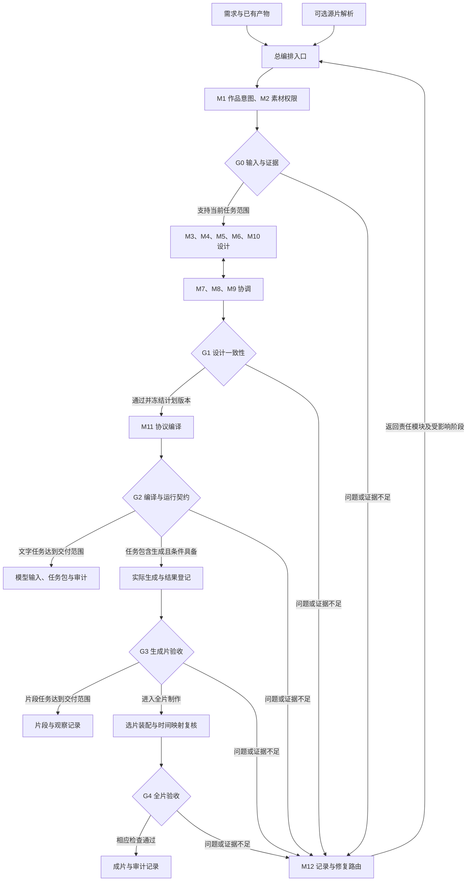
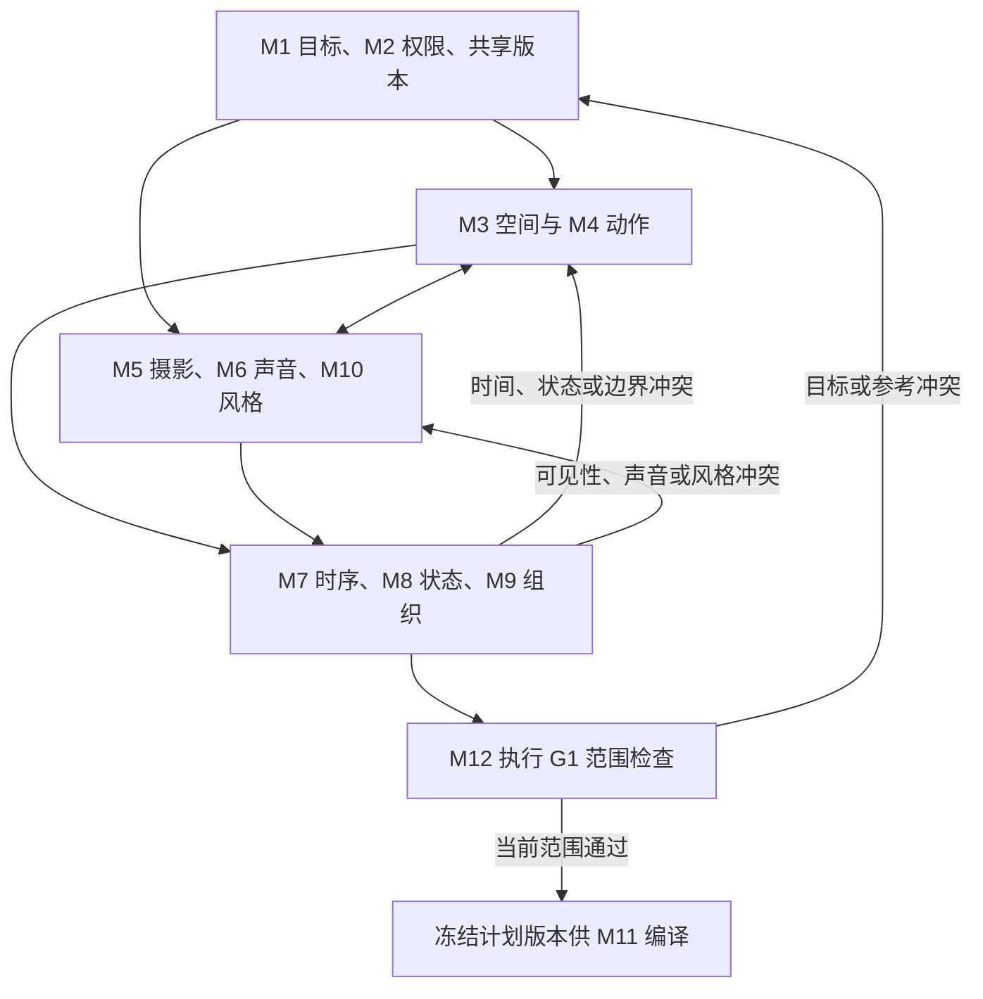

# 通用核心完整工作流：主干、分支路由、共享契约与审计回流

**版本：** v0.1.1

**日期：** 2026-11-04（America/Los_Angeles）。

**文档状态：** planned。本文补齐工作流的路由设计与验收合同；不表示调度器、共享 Schema、模型调用或媒体检查已经实现。

**文档基线：** `196ebed12d74505f18146a75d82480a5b5f06ed4`；原案例与既有技能的证据基线仍为 `35658d3615d02c6aa6e4221fb223d73b86aa6875`。

## 核心摘要

完整框架由**一个总编排入口、M1—M12 十二个职责模块、一套共享数据契约、影视剧与音乐 MV 两类策略、G0—G4 五个审计关卡，以及现有 29 个案例配方来源**组成。每次运行根据任务目标决定进入哪个阶段、启用哪些专业分支、需要什么证据、在哪里交付以及失败后返回何处。主干管理任务推进；专业模块写入各自负责的字段；M12 保存问题与证据，再将修订请求交回字段责任模块。

本文把原框架中的箭头细化为**触发条件、输入、权威输出、返回位置、未就绪处理及变更依赖**。这些路由属于 D 类架构设计，不是案例原文已经实现的引擎。案例事实、已有技能和实际执行结果仍按 `03-source-evidence.md` 的 F／D／I／U 分类追溯。

## 关键结论

1. 总编排入口负责范围、阶段、策略组合、调用顺序和版本协调；M1 负责作品意图。两者不能因实现于同一个 Skill 而混为一个字段权限。
2. 每个职责都先判定适用性。合法省略需要理由；缺少素材、后端证据或检查能力属于未验证，不能伪装成“不适用”。
3. M3／M4／M5／M6／M10 的设计与 M7／M8／M9 的协调允许反复往返。G1 通过后冻结供本次编译引用的计划版本；后续修改产生新版本。
4. M11 可以提前提供后端能力预查，正式编译以已协调的计划为输入。能力冲突回到规划责任模块，不由适配器静默删动作、改台词或改变作品目标。
5. M9 拥有剪辑拓扑、选窗和转场意图；M7 拥有统一排时与时间域映射。M8 拥有计划状态；M12 拥有独立的实际媒体观察。
6. G0—G2 的文字结果、G3 的片段结果和 G4 的成片结果分别保存。没有真实媒体时，生成片和成片检查保持未验证。
7. 运行流程、P0—P9 开发顺序和技能安装单元是三个不同维度。十二个职责不要求拆成十二个独立 Skill；既有案例独立包继续保持完整依赖与单目录复制能力。

**关键词：** 工作流主干、条件路由、模块协作、共享记录、字段责任、版本冻结、影视剧、音乐 MV、持续审计、局部修复、案例配方。

## 目录导航

1. 入口与任务范围
2. 工作流主干与返回关系
3. 十二模块的调用、输入、输出与返回
4. 共享结构及五条责任边界
5. 影视剧与音乐 MV 的共用主干和分支
6. G0—G4 持续审计与问题回流
7. 变更传播、失效范围与复验
8. 案例配方、资源读取与独立打包
9. 与 P0—P9 开发提炼路线的关系
10. 路由完整性验收与引用

## 1. 入口与任务范围

### 1.1 同一入口支持不同任务

入口先登记用户目标、当前已有产物、允许调整项、实际素材、目标后端和本次交付范围。任务可以从原创设计开始，也可以从既有提示词、镜头表、生成片或成片开始。进入较后阶段时，必须核对该阶段依赖的上游记录；缺失项只影响其所支持的结论，不虚构一条已经完成的历史流程。

| 任务入口 | 初始资料 | 主要路由 | 本次可以交付的范围 |
|---|---|---|---|
| 原创编排 | 剧本、音乐、创作简报或文字需求 | 入口 → M1／M2 → G0 → 设计与协调 → G1 → M11 → G2 | 拍摄计划、模型输入、制作任务清单、已执行的文字审计 |
| 源片改编或方法提取 | 视频／图像／音频，以及已有或新取得的解析结果 | 可选解析适配器 → M2 登记证据和用途 → M1 决定保留／改编目标 → 汇入主干 | 有来源依据的改编计划；未观察部分保留缺口 |
| 既有提示词审计 | 提示词、素材绑定、目标模式、可取得的创作要求 | M12 建立审计范围 → M1／M2 补齐目标与来源 → 相关专业模块 → G1／G2 | 具体问题、引用位置、责任模块、修订及复核记录 |
| 局部修订 | 原计划版本、变更要求、已有编译与审计记录 | 入口 → M12 影响分析 → 字段责任模块 → 受影响的协调与关卡 | 新版本及可追溯差异；不重写无关对象 |
| 生成片复核 | 实际片段、音轨、生成配置及可用计划 | M12 登记媒体与检查目标 → G3 → 相应修复路由 | 已观察范围内的片段结论；缺原计划时不宣称全部忠实实现原意 |
| 成片复核 | 完整成片、装配版本、作品目标及可用片段记录 | M12 核对范围 → G4，必要时回查 G3 和计划 | 全片及接缝问题；片段与上游证据不足分别登记 |

审计保留所接收的提示词、原始素材、来源文件和既有报告；修订另存新版本。由既有提示词逆向整理的计划属于带来源的候选解释，不能在缺少证据时冒充用户原始意图或已经完成的生成配置。

“源片解析适配器”是可选前置接口，可能由外部工具、独立流程或人工观察提供。它提交观察、时间戳、来源帧和候选解释；M2 登记其证据与用途，M1—M10 再决定如何用于目标作品。它的存在不证明本框架已经具备完整视频逆向、自动动作捕捉或全片分镜恢复能力。

### 1.2 分支适用性与检查状态

以下状态表达拟采用的语义，具体枚举和序列化格式在 P1 冻结。

| 判定 | 使用条件 | 记录要求 | 对推进的影响 |
|---|---|---|---|
| 适用并执行 | 当前任务包含该对象或依赖 | 输入版本、产物、所用规则、实际检查方法 | 由相关检查结果决定下一步 |
| `pass` | 当前有效交付范围内的必需条件已核对，且没有未解决的相关阻塞项 | 范围、覆盖、输入／产物版本、方法、证据和结果 | 只支持已检查条件的结论，不自动传递为其他关卡通过 |
| `not_applicable` | 任务明确不存在该条件，且没有其他模块依赖该分支 | 对象／规则、理由、作用范围、判定依据 | 省略该分支；不能省略仍相关的共同检查 |
| `unverified` | 需要该条件，但缺素材、测量、后端证据或实际检查 | 缺项、受影响结论、可继续完成的范围 | 可以继续无依赖的工作；不得标成相应就绪或通过 |
| `fail` | 已发现违反当前有效约束的具体证据 | 期望、实际、位置、责任模块、修复方向 | 阻止受影响的交付声明，返回修复 |
| `stale` | 既有结果依赖的对象或版本已经改变 | 原检查、变更 ID、失效依据、待复核范围 | 原结果保留为历史，当前版本重新检查 |

例如，无对白任务可以不进入对白轮次子流程，但声音策略仍需要明确；固定机位任务仍需 M5 的构图与可见性计划；单镜任务仍需 M9 定义镜头和生成任务的关系；没有音频的卡点任务属于拍点未验证。没有演员动作的场景可以省略舞蹈或剑舞子库，不能据此假定所有环境状态都静止。

静音是当前作品明确选择的声音策略，需要记录如何在生成或装配中落实；缺少音频文件不等于选择静音。计划生成的定妆照、故事板、关键帧或其他参考资产可以先登记为待生成／草稿，并写明未来用途，但在实际产物到达前不能声称已经观察或完成真实引用绑定；这类缺项对相应生成任务的 G2 就绪判断仍然有效。

## 2. 工作流主干与返回关系

### 2.1 完整主干图

G0—G4 的检查由 M12 组织记录，具体专业判断由相应模块、检查工具或实际审阅者提供。图中把问题集中连到 M12，便于显示回流；M12 并非只在流程末尾参与。设计阶段发现的局部冲突可以当场回传责任模块，无须等待整份计划完成。

此图表示包含生成和装配的完整任务范围。纯文字任务在 G2 对应范围交付；只评估片段的任务可以在 G3 对应范围交付。没有实际运行或没有相应媒体的后续关卡保存为未执行／未验证，不把流程图中的节点存在当作节点已经完成。

### 2.2 主干的输入、输出与退回点

| 主干环节 | 进入条件与输入 | 必须形成的结果 | 汇合、返回或终止位置 |
|---|---|---|---|
| 任务登记 | 用户要求、已有文件或媒体、现阶段目标 | 任务类型、作品／审计范围、必保要求、允许调整项、已知缺口 | 派发 M1／M2；已有产物审计也先建立最小范围记录 |
| 意图与素材整理 | 创作信息及实际可取得的资料 | `WorkBrief`、资产／实体清单、`ReferenceMap`、证据和未知项 | 进入 G0；来源不清或目标冲突返回 M1／M2 |
| 能力预查 | 已指定或候选的模型／工作流信息 | 带版本的 `CapabilityProfile` 及未确定项 | M11 向 M2、M7、M9 提供规划边界；这里不生成正式请求、不代改意图 |
| G0 输入审计 | 上述记录及本次检查范围 | 已确认、未确认、不适用与阻塞项 | 可支持的任务继续；缺输入的相关任务保留草稿 |
| 专业设计 | 已登记目标、权限、空间／动作需求和策略 | M3 空间、M4 表演、M5 摄影、M6 声音、M10 视觉方案 | 按依赖协作；提出对其他字段的修改请求，不直接覆盖 |
| 统一协调 | 事件、空间、摄影、声音、风格和候选边界 | M7 权威时间、M8 状态与交接、M9 镜头／编辑／生成结构 | 与设计模块往返，直到当前范围内关键冲突得到处理 |
| G1 计划审计与版本冻结 | 同一版本的共享计划及生效规则 | 有范围、有证据的计划结论；供编译引用的冻结版本 | 失败返回责任模块；成功进入 M11；新修改建立新版本 |
| M11 编译与 G2 审计 | 冻结计划、真实资产绑定、后端能力和任务拆分 | 自包含模型正文、素材顺序、真实参数、编译诊断、独立审计记录 | 纯格式问题回 M11；能力或语义冲突返回 M9／M7／相应创作模块 |
| 实际执行与 G3 | 任务要求生成，输入、后端和运行条件具备；取得真实输出 | 输出媒体与配置记录、实际观察、逐片段检查及残留问题 | 可以交付所需片段；或选片装配；失败按证据决定重生成、改计划或改选片 |
| 装配与 G4 | 选中媒体、剪辑意图、源区间和有效时间映射 | 实际装配版本、成片、接缝与全片检查记录 | 编辑问题回 M9／M7／M6；需要改变素材或内容时回相应更早阶段 |
| 范围内交付 | 本任务所要求的检查已有实际结果 | 模型输入、制作任务和审计记录按请求分别交付；需要媒体时增加相应媒体 | 保存版本和未验证范围，不把开发说明或内部审计混入模型正文 |

“冻结”表示本次编译引用一个可追溯的计划版本。后续发现新证据或修改要求时，保留旧版本、建立新版本并失效相关结果，不能原地改写历史来抹去失败。

## 3. 十二模块的调用、输入、输出与返回

### 3.1 模块路由合同

下表固定 M1—M12 编号。每个模块负责专业语义；总编排入口协调调用，不拥有替代各模块判断的第二套字段。模块可以由同一个 Agent 分阶段执行，也可以并行分工；共享版本和字段责任不因执行者数量变化。

| 模块 | 进入条件与主要输入 | 权威产物 | 主干／分支返回位置与必要回流 |
|---|---|---|---|
| **M1 作品意图、叙事／情绪与段落功能** | 新任务、段落目标变化、信息顺序或创作约束变化；读取需求、剧本／音乐结构与必保事件 | `WorkBrief`：段落功能、人物目标或音乐情绪发展、观众信息、约束优先级 | 初次返回 G0；向 M3—M10 提供目的，向 M12 提供验收目标。涉及删改关键事件、对白或总目标的冲突返回 M1 裁决 |
| **M2 素材解析、资产绑定与参考权限** | 引用、替换、复用任何素材或接收解析观察；读取真实资产、用途和来源 | `AssetRegistry`、`EntityRegistry`、`ReferenceMap`：稳定 ID、观察状态、属性权限与生效范围 | 初次返回 G0；向 M3／M4／M5／M6／M8／M10 分发允许使用的信息，向 M11 提供绑定。缺素材不虚构；权限冲突返回相关目标记录 |
| **M3 场景空间、人物站位与交互调度** | 任务包含场景几何、走位、交互、遮挡或观看方向；读取 M1／M2 及动作与摄影需求 | `SpatialPlan`：坐标、站位、路线、交互区、交叉和可达关系 | 与 M4／M5 协作，交 M7 排时、M8 记录派生状态、M9 组织镜头。空间冲突请求调整动作或观察方案 |
| **M4 人物表演、动作链与物理因果** | 任务包含动作、表情、视线、舞蹈、剑舞或道具操作；读取目标、参考权限、空间和当前计划状态 | `ActionPlan`：事件 ID、执行者、对象、前提、过程、接触、结果及持续／结束条件 | 必须可见的结果交 M5，潜在声音交 M6，事件依赖交 M7，状态变化请求交 M8，分段需求交 M9 |
| **M5 机位、景别、构图、焦点与运镜** | 任何需要设计或核查视觉呈现的镜头；读取观看任务、空间、动作、声音线索与视觉风格 | `CameraPlan`：机位、光轴、景别、构图、焦点、路径、触发与关键可见条件 | 摄影事件交 M7，镜头覆盖与边界交 M9，空间／遮挡冲突返回 M3／M4。固定机位仍需本模块 |
| **M6 声音、音乐、对白与歌词关系** | 需要音乐、对白、环境声、动作声或明确静音策略；读取资产权限、台词、声源与动作事件 | `SoundPlan`：声音类别、说话者、内容、复制／引用／生成策略、源区间和事件对应 | 声音事件交 M7，跨切延续交 M9，持续条件交 M8，协议语义交 M11。台词或音轨目标改变返回 M1／M2 |
| **M7 统一时间轴与动作—镜头—声音协同** | 存在时长、先后、重叠、触发、拍点、裁剪或变速关系；读取各事件、M9 选择和实际时间依据 | `TimingMap`：统一排时、时间域映射、偏移、帧率与允许误差、未确定项 | 将权威时间返回 M4／M5／M6／M8／M9／M11。容量冲突提出动作、声音或分段调整请求，不自行删动作或改对白 |
| **M8 主体、道具、场景与跨镜状态连续性** | 任何需要保持或改变属性、状态与跨镜事实的任务；读取权限、事件结果、时间和边界类型 | `ContinuityPolicy`、`StateLedger`：计划状态、不变项、许可变化、原因和交接条件 | 向 M3—M6 提供带来源的当前状态，向 M9 提供接缝条件，向 M12 提供对照。实际偏差引用 M12 的观察，不改写观察 |
| **M9 分镜组织、转场、剪辑与生成分段** | 需要镜头、分镜格、生成任务或最终片段的组织；读取目标、事件、摄影、状态与能力边界 | `ShotEditGenerationPlan`：剪辑拓扑、选窗、转场意图、镜头与任务映射、装配顺序 | 边界类型交 M8，排时与映射请求交 M7，生成结构交 M11，成片检查点交 M12。单镜也要明确其与生成任务的对应 |
| **M10 视觉风格、光线、色彩与材质** | 需要指定、继承、改变或核查画面风格；读取 M1 意图、M2 权限、场景与摄影条件 | `LookPlan`：全片／场景／镜头规则、光源、调色、材质、效果与例外 | 与 M5 协调可见性，向 M8 提供持续范围，向 M11 提供编译语义；权限冲突回 M2，意图冲突回 M1 |
| **M11 模型协议编译与运行参数适配** | 规划需要能力预查，或冻结计划需要正式编译；读取带版本能力、共享计划、生成任务和真实素材 | `CapabilityProfile`、`CompilationResult`：模式、字段、素材标签、正文、参数与诊断 | 能力预查返回 M2／M7／M9；正式产物进入 G2。序列化错误回本模块；能力冲突回 M9／M7，涉及创作变更再回 M1 及相关模块 |
| **M12 持续审计、问题归因与反馈修复** | 入口检查、模块交付、关卡、版本变化、实际媒体到达或用户请求审计 | `AuditLedger`、`MediaObservationLedger`、`ChangeSet`：检查范围、证据、独立观察、问题、责任和复验依赖 | 向入口报告当前可交付范围；把修复交回唯一字段责任模块；按受影响依赖重检。媒体未到达不填写媒体通过 |

### 3.2 设计分支与协调分支如何汇合

首次规划先登记目标、资产和有来源的初态，由 M3 建立最小空间条件、M8 登记初态候选、M9 提出候选边界，再进入动作、时间、状态与镜头的往返协调。后续事件的结果不能倒填为未经解释的初态；尚未知晓的初态保留未确定项，身份参考图也不能自动决定初始姿态。

M3、M4、M5、M6、M10 可以在共享的 M1／M2 基础上开展独立部分，但相互依赖的决定必须汇合后才能冻结。例如，M5 先提出一个摄影候选方案，不代表它已经确定了动作可见性；待 M4 的接触过程和 M3 的站位明确后，M5 才能检查具体结果是否可见。

以上往返通过修改请求进行。修订包含问题对象、期望与当前值、证据、影响范围和接受后的新版本；不要求每个模块分别生成一份完整提示词后再拼接。

## 4. 共享结构及五条责任边界

### 4.1 共享记录分区

| 分区 | 保存什么 | 谁写入 | 其他模块如何使用 |
|---|---|---|---|
| 计划分区 `ProjectPlan` | 目标、参考、空间、动作、摄影、声音、时间、状态、剪辑和风格 | M1—M10 分别写入各自权威对象 | 通过稳定 ID、版本和来源读取；提出修改请求 |
| 编译分区 `CompilationResult` | 所选模式、协议字段、素材顺序、模型正文、参数及诊断 | M11 | 执行方读取任务包，M12 对照计划检查保真性 |
| 媒体观察分区 `MediaObservationLedger` | 真实视频／音频中观察或测量到的结果 | M12 登记实际观察者或工具的结果 | M8 可引用它调整后续计划，其他模块定位偏差；原观察保留 |
| 审计分区 `AuditLedger` 与 `ChangeSet` | 检查范围、状态、证据、问题、修复与复验依赖 | M12 | 入口据此推进、交付或安排修复；责任模块接受修改请求 |

对象名是拟采用的内部合同，不是 MiniMax API 请求体，也不是已经存在的实现类。每条记录至少带对象 ID、类型、版本、上游版本、来源／证据性质、作用范围、责任模块、当前状态和未解决项。检查结论绑定它所检查的版本。

### 4.2 五条不可混淆的边界

1. **身份与位置分离。** `EntityRegistry` 管理稳定身份；位置、朝向、入出画、持物和姿态由空间、事件及状态记录表达。角色换槽位或交叉后仍是同一角色。
2. **参考按属性授权。** 同一素材提供身份、服装、首帧、姿态、场景、运镜或声音中的哪些信息，由 `ReferenceMap` 指定。只作身份参考的图片不自动继承姿势和背景；动作参考不自动替换外貌。
3. **共享时间，事件独立。** 动作、摄影、声音使用统一事件 ID 空间，但不同事件保留不同 ID。关联通过触发、同步、先后与偏移引用表达；不能将人物起跳、摄影机上摇和音乐重音合并为一个事件后丢失各自起止条件。
4. **剪辑选择与时间映射分离。** M9 决定用什么区间、如何连接、何种转场；M7 决定这些选择对应哪些计划、生成和成片时刻。镜头表引用权威时间，不自行维护另一套切点时间。
5. **计划与观察分离。** M8 写入计划状态；M12 的媒体观察绑定媒体 ID、计划版本、时间范围、观察／测量方法、覆盖范围和结果。后续接受实际末态、改计划或重生成都要留下变更记录，不能覆盖原计划和失败证据来制造通过。

### 4.3 四个时间域与同步策略

| 时间域 | 具体含义 | 权威记录要求 |
|---|---|---|
| 源素材时间 | 引用原视频、原音频的区间或源帧 | 保留素材版本、时间／帧单位及区间来源 |
| 作品计划时间 | 事件在作品或段落结构中的位置 | 关联作品与事件 ID，标明设计值或测量依据 |
| 单次生成局部时间 | 每个生成任务从其局部起点计算的时刻 | 绑定生成任务；不能机械复制上一段的首拍相位 |
| 最终编辑时间 | 裁剪、插入、保持、变速和装配后的成片位置 | 保留所用源区间、转换方式、输出帧率与必要容差 |

简单不变速片段可以用偏移映射；裁剪、变速、定格或其他编辑要求相应映射。精确到帧的声画判断必须注明实际帧率、量化方法与容差。只有 BPM 而没有实际音频依据时，不能宣称全部真实拍点已经测得。

时序策略可以选为提前到位、同相响应、滞后追随、固定观察或事件触发。每次关联应指明对齐的是启动、峰值、接触、到位还是结束；“同步”一词不能代替这个选择。

### 4.4 连续性按边界类型路由

| M9 声明的边界 | M8 重点继承什么 | 允许的变化如何进入计划 |
|---|---|---|
| 同镜连续过程 | 身份、物理空间、动作因果与相机可达关系 | 由具体动作、光线或摄影事件解释变化 |
| 连续动作接续 | 必要的支撑、持物、方向、动作相位和接触关系 | 新机位或景别由 M5／M9 记录，不自动重置人物状态 |
| 动作匹配剪辑 | 选定动作相位、运动方向和关注对象 | 衣物、场景或时间变化按 M1／M2／M8 的许可处理 |
| 蒙太奇 | 作品指定的身份、主题、视觉或声音连接要素 | 允许非连续空间和事件，保留选择理由与必要事实 |
| 时空省略 | 叙事因果、身份和省略后仍成立的事实 | 记录时间／地点跳跃及合理的状态发展 |

因此，连续链的前后态条件仅对声明为连续的关系生效；并行事件按各自对象与依赖检查。三次状态转换形成四个状态时间区间，后一区间可以回到先前的同一状态值。道具交接可以包含临时共同抓握，检查重点是接触、持有与释放的过程是否明确，是否出现无依据的归属变化、重复或消失。

## 5. 影视剧与音乐 MV 的共用主干和分支

### 5.1 策略决定重点，不替换底层合同

| 维度 | 影视剧分支 | 音乐 MV 分支 | 汇入共同主干的位置 |
|---|---|---|---|
| 段落功能 | 人物目标、冲突、信息揭示、选择和关系变化 | 音乐结构、乐句、情绪能量、主题与表演变化 | M1 的同一 `WorkBrief` |
| 表演事件 | 行动、对白、目光、停顿、听者反应、道具操作 | 动作母题、舞蹈／剑舞链、重心与运动质地 | M3 的空间、M4 的事件、M6 的声音 |
| 摄影任务 | 叙事信息、互动关系、视线对应和表演覆盖 | 动作可读性、队形、动作强调和视觉变化 | M5 的观看任务与摄影事件 |
| 时间依据 | 因果先后、对白轮次、反应和必要停顿 | 实际音乐窗口、拍点、乐句和动作完成时间 | M7 的统一排时与映射 |
| 剪辑组织 | 连续剪辑、反应镜头、信息延迟、时空省略 | 连续接力、相位匹配、表演蒙太奇、段落转换 | M9 的边界类型，继而由 M8 检查 |
| 验收目标 | 人物行动、信息与关系变化是否可理解 | 动作、声画关系、段落发展和收束是否成立 | M12 的同一关卡与证据结构 |

影视剧可以有精确卡点，MV 可以有对白、完整剧情、时间省略和细微反应。一个项目也可以混合两类策略；各段落记录其有效条件及优先级，冲突由对应模块处理。

### 5.2 专项分支的触发与返回

| 专项分支 | 触发条件 | 调用关系与主要结果 | 返回主干时必须核对 |
|---|---|---|---|
| 戏剧动机、信息与反应 | 有人物目标、观众／角色知识差或因果推进要求 | M1 确定信息顺序 → M4 表演和反应 → M5 观察顺序 → M7 排时 | 反应是否由已到达的信息触发；观看顺序是否符合叙事目标 |
| 对白与画外声音 | 有对白、打断、旁白、画外说话者或跨镜延续 | M2 声音来源 → M6 说话者与台词 → M3 声源空间／M4 反应 → M7／M9 协同 | 说话者绑定、声源、反应时机、跨切连续；口型是否由任务明确要求 |
| 交互与道具交接 | 发生接触、持有变化、拒收、遮挡或共同操作 | M3 空间 → M4 接触过程 → M8 状态 → M5 关键可见性 → M7 排时 | 入出态、持物手、共同抓握、放手与最终归属；画外部分按声明处理 |
| 音乐结构与卡点 | 有实际音乐或明确的音乐时间依据 | M6 音轨策略 → M1 乐段功能 → M4 动作强调 → M5 摄影响应 → M7 排时 → M9 选点 | 拍点来源、首拍偏移、动作容量、时间域映射；不用 BPM 替代实际测量 |
| 舞蹈、剑舞与运动链 | 有具体身体机制、动作母题、道具运动或队形要求 | M2 参考权限 → M3 空间 → M4 专项动作 → M5 可见性 → M7／M8／M9 协调 | 起态、支撑、发力、接触、结果与接续；案例动作预算保留适用条件 |
| 身份保留或资产替换 | 有指定角色、道具、场景或音色参考 | M2 按属性分权 → M3／M4 适配 → M5／M10 检查 → M8 状态 → M11 实际绑定 | 不将源片主体外观随动作一并继承；不将参考图姿态自动变为首帧 |
| 固定观察、提前或滞后运镜 | 观看任务或案例配方选择某种摄影响应 | M5 设计观看行为 → M7 明确触发／偏移 → M4／M9 配合 | 相机固定不意味着人物冻结；提前和滞后均需覆盖其观看任务 |
| 蒙太奇、换场或时间省略 | 创作目标允许非连续时间／空间或属性变化 | M1 说明目的 → M9 声明边界 → M8 选择持续属性 → M7 映射 | 合法变化不被误拒绝；应持续的身份与叙事事实仍然检查 |

上述分支为开发设计，不声称全部已有实片验证。当前案例对舞蹈、摄影、动作链和 MV 的支持更充分；影视剧的动机、对白、反应、视线、叙事地理和长篇状态样本按开发路线补充。

### 5.3 通用化必须保留的策略边界

人物数量、画幅、镜头数量、固定机位、旋转预算、是否行走、对白、演唱口型、歌词视觉化、字幕、切镜和蒙太奇均按实际任务确定。案例规则带来源、条件、例外和作用范围，不叠加成所有作品的统一禁令。歌词中的人物或物体是否进入画面由视觉授权决定；音乐中有人声也不自动要求画面角色对口型。

## 6. G0—G4 持续审计与问题回流

### 6.1 五个关卡的证据与返回合同

| 关卡 | 检查对象与所需证据 | 通过可以说明什么 | 未通过或缺证据时回到哪里 |
|---|---|---|---|
| **G0 输入与证据** | 任务目标、素材、用途、来源、实际可访问性、后端资料及未知项 | 当前范围具有相应输入依据，已知与未知清楚 | M1 处理目标冲突；M2 处理来源／权限；M11 处理能力资料；继续可做的无依赖工作 |
| **G1 设计与跨模块一致性** | 同一计划版本的事件、空间、摄影、声音、时间、状态、剪辑、风格与有效规则 | 已检查范围内的计划自洽、例外明确、专业判断有依据 | 回相应字段责任模块；更新后复核相关依赖，再冻结新版本 |
| **G2 编译与运行契约** | 计划、模型模式、字段、素材引用、实际参数、后端版本及正文 | 所检查模型输入符合契约并忠实表达计划 | 绑定／格式回 M11；时间／分段回 M7／M9；素材回 M2；创作取舍回 M1 及专业模块 |
| **G3 生成片验收** | 实际媒体、生成配置、对应计划、具体观察／测量方法与覆盖范围 | 本片被观察或测量的条件是否实现 | M12 保存偏差；责任模块决定局部重生成、改选片或新计划。媒体改变则复验新媒体；仅计划、检查范围或方法改变时，可以复核同一媒体，另建检查记录并保留原证据 |
| **G4 全片验收** | 完整装配版本、实际全片、作品目标、声音与跨片接续证据 | 本片已检查的段落、叙事／音乐组织和交付条件是否成立 | 编辑／选窗回 M9，时间映射回 M7，声音回 M6；内容或片段问题继续返回其责任阶段 |

关卡结论需要列出范围与覆盖。某项静态检查的 `pass` 不自动覆盖语义、物理或画面效果；G3 的片段通过不自动证明 G4 的全片叙事与音乐成立。未观察区域、未测量条件和未执行关卡保持相应状态。

当前交付所必需的条件仍有失败或缺证据时，相应整体关卡不能标为通过。部分检查结果可以独立报告，但不能缩小检查范围后继续宣称原任务已经全部满足。

### 6.2 从问题到责任模块

| 问题类型 | 首要责任与必要协作 | 最小修复方向与复核范围 |
|---|---|---|
| 段落无功能、信息提前泄露、必保事件丢失 | M1；协作 M4／M5／M6／M9 | 修正事件与观看目的，重检相关因果、声音、时间和剪辑 |
| 身份串线、参考越权、错误资产绑定 | M2；若仅序列化错误则 M11 | 修正源权限或标签映射；核对相关动作适配、状态、风格与编译 |
| 路径冲突、坐标混用、接触空间不成立 | M3；协作 M4／M5／M7 | 修正具体站位／路径／时序；检查动作可进入性与关键可见性 |
| 动作缺过程、支撑不明、道具归属突变 | M4；协作 M3／M8／M5 | 补齐或修正相关事件；检查接触、状态、时间容量与镜头覆盖 |
| 关键动作不可见、机位与景别冲突、焦点不当 | M5；协作 M3／M4／M10 | 调整观看方案；重检屏幕方向、遮挡、运动时间与接缝构图 |
| 台词与说话者不符、音轨策略冲突 | M6；协作 M2／M7／M9／M11 | 修正声音语义、区间或装配策略；核对轮次、同步、引用和参数 |
| 时间不一致、拍点漂移、生成与成片时长混用 | M7；协作 M4／M5／M6／M9 | 回到有效时间依据和事件 ID 重算；不通过静默压缩动作解决容量冲突 |
| 未许可重置、相邻入出态冲突、合法蒙太奇被误拒 | M8；协作 M2／M4／M9 | 核对边界类型、变化许可和事件原因；重检实际关联的前后镜 |
| 动作阶段被误作镜头、切点破坏表演、生成任务不自包含 | M9；协作 M7／M8／M11 | 修正对象映射、边界或分段；重新形成时间映射与局部上下文 |
| 风格越权、光源与调色混用、光效遮挡信息 | M10；协作 M2／M5／M8 | 修正作用层级和局部例外；重检可见性与视觉连续性 |
| 字段、标签、参数或模式错误 | M11；能力冲突协作 M2／M7／M9 | 修复编译映射；若要求本身无法承载则返回规划，不改变导演意图 |
| 没有证据却标通过、结果版本错配、观察被覆盖 | M12；入口协调，必要时全部受影响模块 | 撤销当前错误就绪声明、保留历史、补充证据或正确标未验证，重检受影响范围 |

“首要责任”根据实际缺陷定位。例如身份错误可能源自 M2 的参考绑定，也可能是 M11 的标签序列化，或仅发生在真实生成片中。不得因为表现相似，就在没有证据时把所有问题统一归咎于提示词或模型。

### 6.3 修复记录的最小内容

每项修复保存：问题 ID、关卡、对象与版本、有效要求、具体证据、期望与实际、责任模块、修订请求、受影响对象、执行动作、新产物、复验方法和结果。修复循环为：**发现问题 → 保存证据 → 定位责任 → 确定依赖 → 局部修订 → 重新编译或按任务需要重新生成／装配 → 相关复验**。

重复失败时检查规则是否适用、输入是否充分和方法能否判定。循环次数与资源预算由具体任务决定；达到任务边界后保留未解决项，不用重复自评代替新证据。

## 7. 变更传播、失效范围与复验

| 变更起点 | 至少考虑的影响链 | 当前版本需要更新的结果 |
|---|---|---|
| 更换角色或改参考权限 | M2 → M3 空间占用／M4 动作适配／M5 可见性／M8 状态／M10 风格 → M11 | 相关计划、引用、编译与关卡；既有媒体保留但不冒充新资产结果 |
| 改动作、支撑脚、持物手或接触过程 | M4 → M3 空间／M5 观察／M6 动作声／M7 时序／M8 状态／M9 边界 | 相关动作及相邻交接，不扩散到无引用关系的其他角色 |
| 更换音乐、对白或音频偏移 | M6 → M1 段落关系（若改变）／M4 表演关系／M5 响应／M7 时间／M9 装配 | 实际受影响的声画关系、编译和装配；身份不因换音乐自动改变 |
| 改机位、景别、焦点或运镜 | M5 → M3 视线和遮挡／M7 到位时间／M8 接缝／M9 覆盖／M10 可见性 | 相关摄影计划及检查；动作目标只有真实冲突时才提出修订 |
| 改切点、源区间、变速、定格或生成边界 | M9 → M7 映射／M6 声音延续／M8 交接／M11 局部输入和参数 | 相应时间表、任务包、接缝和成片检查；原始媒体不被改写 |
| 改作品目标或信息顺序 | M1 → 所有关联段落的 M3—M10 → M11／M12 | 按段落依赖决定范围；目标未改变的片段可继续复用其有效结果 |
| 改后端或工作流 | M11 → M2 输入要求／M7 时间预算／M9 分段 → 相应检查 | 新能力与编译检查，必要的真实媒体回归；旧后端结果仍绑定旧版本 |
| 新媒体观察与原计划不符 | M12 记录 → M8 对照 → 实际原因对应模块 | 接受新末态须建立新计划；重生成须新增媒体与观察；不覆盖原失败记录 |

失效按真实引用关系传播。未受影响、输入版本未改变的结果可以保留，并注明复用依据；被改变的条件不能继续使用旧通过标记。若只是调整文档展示名称，应核对索引与包装，不要求重新运行无关生成任务。

## 8. 案例配方、资源读取与独立打包

### 8.1 配方如何接入主干

现有 29 个案例技能提供已经保存的案例方法、来源、参数、例外及部分格式／静态验证。未来将其映射为共享配方时，入口根据任务条件选择；每个配方声明启用模块、参数、适用范围、例外、来源和验证状态，再把结果写入同一共享契约。

| 配方方向 | 主要分支 | 汇合与共同检查 |
|---|---|---|
| 触地切换 | M4 动作阶段、M5 接触可见性、M7 触发时序、M8 状态、M9 编辑事件 | 汇入 G1；独立任务编译进入 G2；真实触地／切换结果在 G3 观察 |
| 多主体队形 | M2 身份、M3 槽位与路线、M4 各自动作、M7 时序、M8 交接 | 身份与位置分别检查，人数按任务；M5 的实际可见性仍须参与 |
| 连续剑舞 | M4 专项动作、M5 观看重点、M7 运动时间、M8 剑与鞘状态、M9 边界 | 连续接续与许可蒙太奇分别检查，不能无条件套用同一种拔刀规则 |
| 风格与场景型 MV | M1 段落、M2 参考、M5 摄影、M6 音乐、M8 状态、M9 装配、M10 光色 | 在相同关卡核对段落功能、参考权限、时间映射及局部变化 |

配方没有绕开 M11 协议核对或 M12 审计的特殊权限。案例中的参数和经验不自动成为通用模型限制；同一原始来源被多个案例引用，也不因此增加独立效果证据。

### 8.2 知识资源与输出路由

未来 Skill 入口按任务读取所需模块合同和知识。详细规则、案例来源和模型规格进入 `references/`；确定性计算与重复检查可由 `scripts/` 承担；需要复制加工的模板可放入 `assets/`。这些目录是组织选择，安装入口与实际打包按 Agent Skills 规范验证；本文件不创建或安装这些资源。

一个模块返回的是其负责的计划对象或诊断。M11 在编译时展开本生成任务必需的身份、状态、空间、动作、声音和风格，使每段模型输入自包含。共享维护并不意味着生成模型能自动读取未提交的上一段提示词、兄弟文件或内部账本。

最终交付分为模型正文、制作任务清单和审计记录。用户只要纯提示词时按其范围交付正文；内部计划、规则、开发说明和审计条目不机械追加到生成正文。

### 8.3 保留独立案例技能的使用方式

共享规则可以集中维护，但发布的每个独立案例包仍需包含其实际需要的公共文件与可满足依赖，保持单目录复制能力。可以在发布时展开依赖，也可以同时提供集合包和独立包；具体方案在 P7 冻结。不能把未随包提供的兄弟目录作为独立包唯一依赖。迁移记录保留一案一映射、原文来源、案例差异、实际验证和尚未迁移项。

## 9. 与 P0—P9 开发提炼路线的关系

本文件定义的是任务运行后的职责路由；开发工作仍按以下阶段逐步建立这些能力。进入某个开发阶段不意味着任何任务的 G0—G4 自动通过。

| 阶段 | 开发与提炼工作 | 对本工作流提供什么 | 必须保留的退出边界 |
|---|---|---|---|
| **P0** | 冻结案例、既有技能、官方规范与证据 | 可追溯来源、范围和能力缺口 | 已有成果与新计划分别登记 |
| **P1** | 定义共同对象、ID、版本、单位、坐标、时间与省略条件 | 模块输入输出、责任与状态语义 | 契约可表达同一任务，未知与不适用可区分 |
| **P2** | 分类规则、裁决冲突、建立正反例与 M12 接口 | 条件分支、检查合同和失败路由 | 每条规则有来源或设计依据、条件、反例及可检查范围 |
| **P3** | 实现 M2／M3／M4／M6／M10 基础模块 | 素材、空间、动作、声音和视觉设计产物 | 使用同一契约，产物可追溯，缺项与冲突可定位 |
| **P4** | 实现 M5／M7／M8／M9 协同模块 | 摄影、时间、状态和分镜的汇合与往返 | 事件关联、边界、时间映射及计划／观察职责成立 |
| **P5** | 总编排入口、M1、M11、M12 修复路由及两类策略 | 从输入到文字任务包的端到端流程 | 影视剧与 MV 共用契约；模型正文忠实于计划 |
| **P6** | 文字 MVP 与两类试点回归 | G0—G2 的实际文字产物、检查和修订记录 | 正反例按预期响应，未验证项保留；不替代媒体测试 |
| **P7** | 迁移 29 案配方与兼容打包 | 有来源、有条件的案例路由 | 一案一映射、案例例外与独立复制能力得到核对 |
| **P8** | 候选发布、分层回归、版本及交付核验 | 可审阅的可用范围与发布包 | 发布内容与审阅内容一致，声明与实际检查一致 |
| **P9** | 真实生成片与整片验证 | G3／G4 的实际媒体证据和反馈 | 记录输入、配置、输出、观察、失败和修复；不外推未测任务 |

P0 → P1 → P2 为先行基础。P3 内可并行开发，M1 策略设计和 M11 能力映射可以提前研究，但集成验收仍依赖共同契约与协同模块。P5／P6 先形成代表任务闭环，再进入 P7 批量迁移。P9 在真实素材、后端和运行条件具备时启动，可与后续迭代并行，独立报告媒体结果。

## 10. 路由完整性验收与引用

### 10.1 后续实现需要逐项验证的条件

1. 十二个职责均能判定适用性，适用模块有明确输入、权威输出、下游和修复返回位置。
2. 原创、源片改编、既有提示词审计、局部修订、片段复核和全片复核可以进入同一共享记录，不虚构缺失历史。
3. 影视剧、MV 和混合策略共享身份、事件、空间、时间、状态与审计合同；专项规则携带条件，不越权覆盖其他策略。
4. M3—M10 的并行部分与相互依赖部分可区分；同一字段只有一个权威写入方，修改产生可追踪的新版本。
5. M11 的能力预查与正式编译分开；发生能力冲突时能返回规划责任模块，模型正文不泄入内部开发和审计说明。
6. G0—G4 分别记录检查范围、输入版本、方法、证据和结果；缺素材／缺媒体不会被写成不适用或通过。
7. 上游修改使真正依赖它的检查失效，并触发相关复验；无关结果可以有依据地复用。
8. 媒体观察独立于计划保存；接受偏差、重生成或重新装配均保留历史，下一段不静默沿用已被否定的末态。
9. 文字、生成片与成片任务各有清楚交付出口；工作流图不触发超出当前任务范围的实际生成或装配。
10. 29 个案例配方保留完整来源、条件和差异；独立包所需依赖完整，已编写样例与已执行结果分别登记。

这十项是待实现的路由验收合同。本文的文档结构或链接检查通过，只能说明相应文档条件已经核对，不能报告上述运行合同已全部执行。

### 10.2 文档与来源入口

以下链接集中提供本文件的框架依据和证据入口。新增主干表、分支路由表和回流细化属于架构设计；源案例及已执行结果以固定基线资料为准。

- [README.md](README.md)：框架总览与当前交付状态。
- [01-core-framework.md](01-core-framework.md)：M1—M12 合同、共享对象、唯一写入责任、时间与边界策略。
- [02-development-roadmap.md](02-development-roadmap.md)：P0—P9 依赖、产物、退出条件、试点、迁移与发布。
- [03-source-evidence.md](03-source-evidence.md)：十五案覆盖、F／D／I／U 证据性质、来源冲突、影视剧缺口及 S01—S19 固定来源。
- [00-analysis-full.md](00-analysis-full.md)：最初完整分析与方法展开。
- [04-framework-confirmation-full.md](04-framework-confirmation-full.md)：用户本轮引用内容的完整登记记录，保留十二模块的三个维度及原工作流节点和关系。
- [既有 29 个案例技能索引](../caseskill/README.md)：保留独立案例使用入口。
- [既有验证报告](../caseskill/_validation/validation-report.md)：格式、静态检查和离线试用的既有证据边界。
- [本次补充之前的开发计划版本](https://github.com/Nuos/H3-h3-prompt-journal/tree/196ebed12d74505f18146a75d82480a5b5f06ed4/docs/skillplan)：供比较路由细化与原框架。
