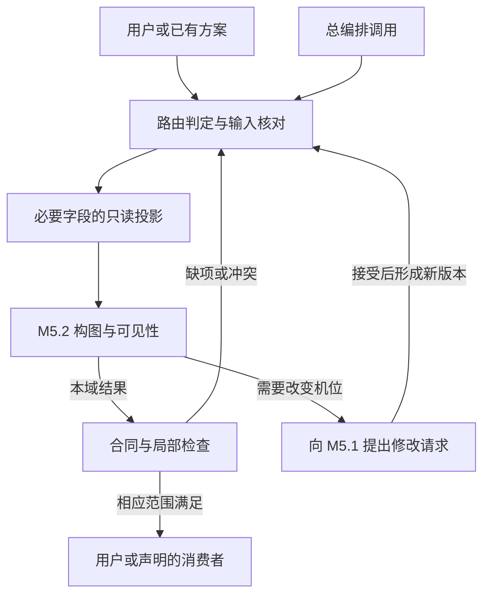

# 全部模块与子模块的强制架构规范

**版本：** v0.1.2

**日期：** 2026-11-04（America/Los_Angeles）。

**要求状态：** 已确立的强制开发要求。

**实现状态：** planned。本文登记要求、初始拆分提案和验收合同，不表示相应子模块、运行路由、Schema 或独立技能已经实现。

**文档基线：** `ec576f117d45a96fb38ee2a5f66a8ffa1e52ff90`；案例与既有技能来源基线仍为 `35658d3615d02c6aa6e4221fb223d73b86aa6875`。

## 核心摘要

用户补充要求：**“所有十二个模块以及每一个子模块必需遵循高内聚、低耦合、模块化、路由信息设计原则。”** 本文件将其作为 M1—M12 及任意深度子模块的共同开发约束，并落实到职责、数据、字段权限、调用、资源读取、错误返回、版本变化和验收。

模块围绕明确的专业任务组织，通过公开、带版本的最小合同交换信息。总编排入口负责范围与调度，专业模块负责领域决定；共享执行记录提供一致事实，但每次调用只读取所需字段和来源。子模块继承父模块约束，通过明确的字段委派或提案提交机制协作。路由定义与实际调用记录分别保存，技术重试与创作修订分别处理。

## 关键结论

1. 四项原则适用于全部十二模块、本文初始提案中的 41 个子模块，以及未来新增、拆分、合并或迁移的全部职责单元；子模块未列入初始清单不构成例外。
2. 高内聚依据专业目的、约束和共同变化原因划界；不按固定函数数量、文件数量或固定子模块数量机械拆分。
3. 低耦合通过明确的输入输出、必要字段、依赖和版本实现；数据依赖不自动要求重新执行上游模块。
4. 模块及子模块必须有可独立调用和验证的职责合同；安装包、进程、Agent 和模型数量分别决定，不强制一一对应。
5. 路由必须回答何时进入、交给谁、传什么、按什么版本处理、返回哪里、失败怎样处理、变更后复验什么。
6. 同一字段、作用范围与有效版本只有一条权威提交路径；M9／M7、M8／M12 等既有责任边界递归保持。
7. 本次可以核对文档与登记完整性；独立调用、兼容替换、路由运行和媒体效果须在实施后取得各自证据。

**关键词：** 高内聚、低耦合、模块化、信息路由、递归合同、字段权限、只读投影、子模块、独立使用、版本兼容、持续审计。

## 目录导航

1. 适用范围、效力与递归覆盖
2. 四项原则的强制条款
3. 模块与子模块的公共合同
4. 共享数据、父子权限与独立使用
5. 路由定义、调用记录与失败处理
6. 十二模块的初始子模块设计清单
7. 独立调用与组合调用示例
8. 递归验收、开发阶段与完成判定
9. 文档更新与来源

## 1. 适用范围、效力与递归覆盖

### 1.1 强制范围

M1—M12 的职责划分保持不变。其下每个子模块、进一步拆分的子模块，以及实际承担这些职责的适配器、规则执行单元和辅助流程，都必须继承本规范。共享合同、总编排入口与资源路由也应满足相同的边界和依赖要求，以保证模块之间能独立协作。

普通内部函数可以作为所属模块的实现细节，不要求每个函数都注册成独立 Skill；当某项能力具有独立职责、输入输出和协作边界，实际构成子模块时，不能通过改名为 helper、脚本或插件免除登记与验收。

### 1.2 效力与证据

这四项原则来自用户明确要求，是后续设计、实现、迁移和发布必须满足的条件。本文的具体合同、路由记录和初始子模块清单属于 D 类设计细化；不能据此声称案例作者已实现这些结构。

历史分析和已确认答复归档保持原文；现行架构要求由本规范及关联框架、路线图执行。约束无法满足时登记缺口、冲突与修改任务，不把“暂时省事”写成架构验收通过。既有 29 个案例技能保留原有状态，接入新通用核心时按 P7 对照新合同验收。

### 1.3 递归覆盖登记

实施前维护模块树：稳定 ID、父 ID、职责、合同版本、实现与验证状态。每个节点都能追溯适用的 HC／LC／MD／RT 条款和对应检查；新增节点同时登记依赖、字段归属及路由，合并或停用节点保留旧 ID 的迁移关系，不让原引用静默失效。

父模块通过不替代子模块通过。规范定义全树覆盖规则；实际覆盖率只能依据当时真实登记的节点和执行记录计算，不能只检查十二个父节点后报告全部子模块合格。

## 2. 四项原则的强制条款

### 2.1 高内聚（HC）

| 条款 | 必须满足 | 具体判断方式 |
|---|---|---|
| **HC-01 专业职责一致** | 模块的目标、输入、规则、输出和局部检查围绕同一专业结果组织，明确负责与不负责的事项 | M5 的摄影方案可以包含机位、构图、焦点和路径；不能顺便重写角色身份、台词或作品目的 |
| **HC-02 变化原因一致** | 子模块按专业决策与变化原因划界；聚合器、领域决定、协议转换和证据记录各有清楚职责 | M1 决定作品意图；总编排器决定任务路由；M11 编译已确定语义；M12 记录检查与修订要求 |
| **HC-03 合理拆分粒度** | 拆分能形成明确输入、结果和独立检查价值；相互紧密约束的内容通过父合同协调 | 舞蹈、剑舞、影视剧、MV 可以作为策略或知识；需要独立合同和验收时再形成更深子模块，不把每个形容词或规则拆成模块 |

### 2.2 低耦合（LC）

| 条款 | 必须满足 | 具体判断方式 |
|---|---|---|
| **LC-01 公开最小合同** | 只依赖公开的字段含义、类型、单位、来源和兼容版本；每次传入满足本任务的必要数据 | 不依赖其他模块的内部变量、私有提示词、未登记文件路径、隐含对话记忆或输出段落顺序 |
| **LC-02 共享记录按需读取** | 共享计划按声明字段提供只读投影或版本快照；输出本职责内的结果、增量或修改请求 | M5.2 构图检查读取相关人物、动作、机位和遮挡信息，无需取得全片所有对象的任意写入权 |
| **LC-03 数据来源可替代** | 契约兼容的用户资料、已有项目或外部工具结果可以满足输入，不强制调用指定上游生产者 | 用户已经提供空间与动作，M5 可以直接工作；来源与未知项必须保留，不能把外部候选解释当作已核验事实 |
| **LC-04 依赖显式且可隔离** | 声明必需、可选依赖与缺项行为；局部故障和变更沿真实依赖影响对应结果 | 无关模块不被自动启动或全部失效；必需依赖缺失仍如实阻塞其对应结论，不能伪装为不适用 |
| **LC-05 后端与领域分离** | 模型字段和运行协议位于 M11 适配层；其他模块读取带版本的能力资料作为规划条件 | 更换后端主要替换适配实现和能力资料；若能力确实影响时长、素材或分段，再回对应模块调整，不仅替换产品名就宣称兼容 |

### 2.3 模块化（MD）

| 条款 | 必须满足 | 具体判断方式 |
|---|---|---|
| **MD-01 独立职责合同** | 每个模块及子模块都有身份、父节点、版本、输入、输出、边界、依赖、调用及局部检查合同 | 能提供兼容的最小输入并单独调用／验证该职责；不要求每个子模块都是可供终端用户安装的独立包 |
| **MD-02 可组合与可替换** | 独立结果可被公开消费者接收；实现替换不改变未声明的字段语义或依赖 | 使用另一实现或受控测试替身时仍按合同工作；对照字段语义、约束与结果范围，不要求随机生成文本逐字相同；真实生成质量和替身验证分开记录 |
| **MD-03 唯一字段责任** | 父子通过明确的提案提交或作用域委派协作；同一字段、范围和有效版本只有一个语义决定及权威提交路径 | 父模块聚合检查不另写竞争值；子模块越出范围时请求责任方修订，不无条件覆盖 |
| **MD-04 资源与兼容边界** | 知识、脚本、模板、运行环境和版本依赖明确；发布独立包时提供或满足全部所需依赖 | 不依赖未随包提供的兄弟目录；合同破坏性变化提供新版本、影响清单和迁移说明，不能静默改变字段含义 |

### 2.4 路由信息设计（RT）

| 条款 | 必须满足 | 具体判断方式 |
|---|---|---|
| **RT-01 路由信息完整** | 路由定义明确触发、目标、输入映射、前置条件、输出、返回、失败与修复位置 | 用稳定模块／子模块 ID 和兼容合同定位；只写“调用摄影模块”不足以作为完整路由定义 |
| **RT-02 调度与专业决定分开** | 路由器依据任务、证据和合同派发；领域取舍由责任模块决定 | 不能以选择分支、回退或编译优化为由删除必保事件、改台词或修改参考权限 |
| **RT-03 信息与资源按需传递** | 只加载本任务所需规则、素材角色、字段和资源，并保留版本与来源 | 单独构图检查可以读取摄影规则，不需要完整运行动作创作；模型正文只接受其需要的最终描述，不混入内部路由与审计信息 |
| **RT-04 失败与修复显式** | 缺项、冲突、不兼容、执行失败、语义修订和复验各有明确返回点；反馈回路有任务范围和终止条件 | 允许有版本的创作往返；禁止隐含无界递归互调、重复自评制造通过或使用兜底分支掩盖未满足要求 |
| **RT-05 重试匹配操作效果** | 技术重试与创作修订分开，按操作效果、任务预算和重复执行风险决定重试 | 纯读取或可安全重复的检查可按约定重试；生成、上传和外部写入需核对操作身份与已有结果，不能因超时盲目重复产生效果 |
| **RT-06 调用与变更可追溯** | 实际调用记录对应的路由／合同版本、输入输出、状态和证据；变更按真实引用关系标记失效与复验 | 定义了路由不表示已经运行；旧结果保留历史，关联条件改变后不能继续使用旧通过标记 |

## 3. 模块与子模块的公共合同

### 3.1 每个职责节点必须登记的信息

下表是合同设计要求，具体序列化格式在 P1 冻结。它不要求每次调用都把整份登记表放入模型上下文；稳定定义可以通过 ID 和版本引用，本次输入按需展开。

| 信息组 | 必须明确的内容 |
|---|---|
| 身份与层级 | 稳定模块／子模块 ID、父 ID、名称、公开或内部调用范围、合同版本 |
| 专业目标 | 负责的结果、职责边界、不负责的领域、适用任务 |
| 最小输入 | 必需／可选字段、类型、单位、坐标／时间域、允许的外部来源及未知项表达 |
| 输出与结果 | 产物或诊断类型、字段语义、消费者、完成范围、未验证部分 |
| 数据访问 | 必要只读字段、来源版本、拥有的写入字段／对象范围及修改请求方式 |
| 父子责任 | 子模块提案或委派方式、聚合与提交位置、冲突裁决责任 |
| 依赖与资源 | 合同依赖、知识文件、脚本、模板、工具能力及版本要求；必需／可选分别声明 |
| 路由接口 | 进入条件、调用标识、输入映射、返回对象、失败类型、修复目标和后续检查 |
| 操作效果 | 纯计算／读取、计划修订、媒体生成或外部写入；操作身份、可重试性和结果确认方式 |
| 兼容与迁移 | 支持的合同版本、破坏性变化、替代实现、迁移或停用关系 |
| 验收与证据 | 局部通过条件、独立／组合代表任务、缺项与冲突任务、实际执行状态和证据 |

### 3.2 合同完整不代表所有输入都已取得

任务可以只处理某个镜头、某条动作或某个子模块。契约列出完整的要求集合，实际调用根据适用范围选择必要字段。无关字段可以不提供；相关未知字段要保留未知状态，不能自动补成事实。

示例：M5.2 已有摄影机位置与动作资料时，可以直接检查构图；如果没有镜头视场或场景尺度，只能交付相应范围内的方案和待核对项。缺少资料不等于构图一定失败，也不等于精确可见性已经通过。

## 4. 共享数据、父子权限与独立使用

### 4.1 共享计划提供一致事实

`ProjectPlan` 是逻辑一致记录，不是要求每个模块读取或改写全部内容的全局上下文。调用得到必要字段的只读视图、对象 ID、版本和来源；结果通过本域增量或修改请求进入责任方的接受流程。跨对象关联修订应成组登记，确保接受后的版本能够解释其整体影响。

同一计划版本表示可追溯快照中各对象版本相容，不要求所有对象的修订号相等。

提交时校验基准版本。相同范围出现竞争修改时，记录差异并交责任方协调，不采用“最后写入就覆盖”的隐含规则。对象或字段的版本粒度在 P1 冻结；失效传播依据真实引用关系，不因无关展示名称改变而自动重做全片生成。

### 4.2 父子协作采用明确的权威提交方式

| 方式 | 子模块做什么 | 父模块做什么 | 必须保持的边界 |
|---|---|---|---|
| 子提案、父接受 | 返回负责字段的候选值、理由和证据，或范围明确的修改请求 | 核对组合约束与版本后接受／退回，并形成权威结果 | 接受过程不悄悄重写子模块专业决定；需要改变语义时回到相应责任方 |
| 显式作用域委派 | 在明确授权的字段、对象范围和版本中形成专业结果 | 保持对外合同、聚合和一致性核对 | 父模块不同时维护该范围的另一套竞争值；委派变化必须有版本与来源 |

两种方式可以按不同字段选择，但同一范围的方式和责任必须唯一。物理写文件者可以是统一提交程序，不因此成为第二个语义决定者。跨父模块的子模块之间使用公开合同和路由，不直接读写对方私有状态。

### 4.3 递归保持既有语义边界

| 边界 | 必须保持 |
|---|---|
| 动作与时间 | M4 及其子模块定义动作事件；M7 及其子模块决定统一排时，时间容量冲突返回动作／声音／剪辑责任方 |
| 剪辑与时间映射 | M9 及其子模块拥有编辑选择、选窗与转场意图；M7 拥有权威时间换算与同步关系 |
| 计划与观察 | M8 及其子模块维护计划状态；M12 及其子模块保存实际媒体观察，互相引用但不覆盖历史 |
| 身份与后端标签 | M2 拥有稳定主体、资产和权限；M11 生成后端素材顺序与标签，不从标签编号反推身份 |
| 领域决定与调度 | 专业模块决定其领域内容；父聚合器或总编排器只在声明的调度／接受权限内工作 |

### 4.4 独立能力与独立安装分别验收

每个模块和子模块都必须能在其合同范围内接受兼容输入，完成对应职责并形成可组合结果。外部直接提供的输入必须经过必要的适用性、来源和版本核对，不必先运行所有上游。

一个职责可以作为统一 Skill 内部能力，也可以有独立入口。若声明“只复制此目录即可使用”，则该安装包必须提供或满足所需规则、脚本、模板和运行依赖。能力独立不要求安装包数量与子模块数量相同；仅有 `SKILL.md` 或一张职责表也不构成独立运行的证据。

## 5. 路由定义、调用记录与失败处理

### 5.1 路由定义的信息合同

| 路由信息 | 必须回答的问题 |
|---|---|
| 路由身份与版本 | 这是哪条路由，支持哪些目标合同版本？ |
| 触发与适用性 | 什么任务、输入或状态触发；什么条件下不适用？ |
| 发起与目标 | 由用户入口、总编排器、父模块或哪个已声明的消费者发起；进入哪个模块／子模块？ |
| 输入投影与映射 | 读取哪些字段，来自哪个对象与版本，如何映射单位、ID 和来源？ |
| 前置条件 | 必需资产、上下文、能力和证据是否具备；哪些工作可以在部分输入下继续？ |
| 输出与权限 | 返回什么类型，只允许形成哪些字段的结果或修改请求？ |
| 成功返回点 | 返回父聚合器、专业消费者、关卡或用户交付中的哪一位置？ |
| 缺项与冲突 | 哪些情况形成未验证、失败或不兼容诊断，交给谁处理？ |
| 分支竞争 | 多条路线同时匹配时如何依据任务优先级和合同解决；仍不明确时如何保留候选与缺口？ |
| 修复与失效 | 哪个责任方修改，哪些依赖失效，修订后重新进入哪里？ |
| 操作与重试 | 本路由有什么效果，如何确认已执行结果，何时可安全重复，何时转修订或结束？ |
| 资源与证据 | 需要读取哪些规则和工具资料；实际执行保存哪些结果与证据？ |

不能只依赖模块名称、编号顺序或一个泛化关键词决定全部路由。自然语言触发需要结合任务范围、已有产物和实际输入判定；未知条件保留未知，不通过更换分支扩大或缩小用户的要求后宣称满足。

### 5.2 实际调用记录

实际运行时记录调用 ID、父调用／任务关联、路由和合同版本、输入对象与版本、目标模块、适用性依据、实际读取资源、起止与执行状态、输出引用、错误、操作身份、修订和复验关联。可重用的定义由 ID 引用，调用记录只保存本次事实与必要证据。

合同中存在返回点不代表调用已经执行；有调用记录不代表领域结论通过。`pass`、`fail`、`unverified`、`not_applicable` 和 `stale` 保留原有语义，技术执行状态与专业审计结果分别记录。缺少本任务必需证据时，整体结论不能标为通过。

### 5.3 修复反馈与循环控制

动作、空间、摄影、时间和状态可以反复协调。每轮反馈明确问题、责任方、输入版本、预期变化、受影响范围和退出条件；新增创作修订形成新版本，再核对相关依赖。禁止隐藏的递归互调和没有任务边界的自动循环。

技术重试须符合操作合同与任务预算。只读或可安全重复的计算按其声明策略重试；可能重复产生效果的操作先确认已有执行状态和结果。媒体生成不是天然可安全重复的纯函数：超时后应先确认任务是否已提交或已有结果。语义冲突需要回责任方修订，不能原样多跑几次就改变通过状态。具体重试次数、成本和时间预算由任务定义，不设跨作品通用数值。

### 5.4 自检与总审计的分工

模块及子模块执行自身局部检查，随本模块产物返回范围明确的结果；需要全局审计时，由 M12 接受并关联到审计记录，汇总需要的跨模块、阶段与媒体证据。一次局部自检无需自动完整运行全部其他模块，但其结论也不覆盖未检查的上下游条件。知识规则可以按需复用，是否需要实际调用生产模块由输入缺口和任务范围决定。

## 6. 十二模块的初始子模块设计清单

下表是用于递归登记的初始拆分提案，共 **41 个子模块**。它不代表已有 41 个实现或安装包，具体边界须在 P1 合同设计及后续试点中核对。编号是设计身份，不是执行顺序；任何进一步拆分都必须继承第 2—5 节要求。

| 父模块 | 初始子模块与主要产物 | 必须保留的职责边界 |
|---|---|---|
| **M1 作品意图、叙事／情绪与段落功能** | **M1.1 意图与约束整理**：创作目标、必保事项、约束优先级；**M1.2 段落功能与信息结构**：段落任务、人物目标、信息揭示关系；**M1.3 情绪能量与母题**：情绪／能量发展意图、动作与视觉母题 | M1 负责作品语义，总编排入口负责派发与阶段推进；实际拍点和事件时刻交 M7 |
| **M2 素材解析、资产绑定与参考权限** | **M2.1 资产登记与来源状态**：资产标识、来源、可访问性和待提供／已观察状态；**M2.2 主体身份与资产绑定**：稳定主体标识及对应资产；**M2.3 属性权限与引用范围**：权限矩阵、生效范围和权限冲突决定 | 来源与观察作为证据；完整源片逆向能力另行验证；后端标签与素材排序由 M11 处理 |
| **M3 场景空间、人物站位与交互调度** | **M3.1 空间坐标与场景拓扑**：坐标约定、可达区、空间关系；**M3.2 站位与移动路线**：站位、路径、层次和队形；**M3.3 交互区域与遮挡约束**：接触区、交叉、避让及允许遮挡关系 | M3.3 对站位提出修改请求，由 M3.2 承接；路线占用的实际时间由 M7 确定 |
| **M4 人物表演、动作链与物理因果** | **M4.1 表演事件与前提**：事件标识、执行者、对象、目标和前置条件；**M4.2 动作机制与交互过程**：支撑、发力、运动路径、接触和道具操作；**M4.3 结果与动作接续**：可见结果、持续／结束与后继条件、状态变化请求 | M4 拥有动作语义；绝对排时由 M7 管理，权威计划状态由 M8 管理 |
| **M5 机位、景别、构图、焦点与运镜** | **M5.1 观察机位与光轴**：位置、距离、高度、朝向和位姿；**M5.2 取景、构图与可见性**：景别、主体占画、画面关系和关键可见条件；**M5.3 焦点与景深策略**：焦点对象、变化及清晰范围要求；**M5.4 摄影机运动与触发**：路径、起止机位引用、触发条件和响应策略 | 位姿、取景、焦点与路径分别授权；相机事件与人物动作独立编号；同步偏移和实际时刻交 M7 |
| **M6 声音、音乐、对白与歌词关系** | **M6.1 声源与说话者绑定**：声源、说话者、声音身份关联；**M6.2 对白与发声事件**：台词原文、发声事件和表演方式；**M6.3 音乐与音轨使用策略**：音乐结构依据、源音轨窗口及复制／参考／生成策略；**M6.4 环境与动作声音**：环境声、动作声、对应事件及延续条件 | M6 定义声音语义；M7 排时，M9 组织编辑，M11 生成标签；歌词不自动变为视觉实体或口型要求 |
| **M7 统一时间轴与动作—镜头—声音协同** | **M7.1 时间依据与单位归一**：时钟、单位、帧率、测量依据及未知项；**M7.2 事件排时与同步约束**：起止、先后、重叠、偏移和容量冲突；**M7.3 时间域映射与帧量化**：源素材／作品／生成局部／成片时间映射及容差 | 消费事件与编辑决定；不能为排时自行删动作、改台词或增加运镜；变速和定格意图来自 M9 |
| **M8 主体、道具、场景与跨镜状态连续性** | **M8.1 连续性策略与变化许可**：持续范围、不变项、允许变化及边界规则；**M8.2 计划状态与转换登记**：有版本和来源的计划状态与转换原因；**M8.3 边界交接与接续检查**：入出态对照、接缝要求、诊断和修订请求 | M8.3 读取状态形成交接结果，状态修订由 M8.2 承接；实际媒体观察仍归 M12 |
| **M9 分镜组织、转场、剪辑与生成分段** | **M9.1 镜头、分镜格与事件归属**：镜头／分镜格标识和动作阶段映射；**M9.2 剪辑拓扑、选窗与转场**：区间选择、切镜理由、转场意图和装配关系；**M9.3 生成任务划分**：任务标识、内容分配、上下文和边界要求 | M9 拥有编辑选择与任务结构；M7 拥有时间换算和排时；M11 编译模型正文与参数 |
| **M10 视觉风格、光线、色彩与材质** | **M10.1 风格层级与继承**：全片／场景／镜头风格及例外；**M10.2 光源与照明设计**：光源方向、性质、位置和照明要求；**M10.3 色彩与调色策略**：色彩基调、对比、曝光倾向和调色关系；**M10.4 材质与视觉效果**：材质、质感和效果条件 | 身份与参考权限由 M2 决定，视觉持续范围交 M8；影响关键动作可见性时与 M5 协调 |
| **M11 模型协议编译与运行参数适配** | **M11.1 后端能力与版本资料**：`CapabilityProfile`；**M11.2 模式选择与素材序列化绑定**：模式、素材顺序和标签；**M11.3 提示词字段编译**：模型正文及字段诊断；**M11.4 运行参数与任务包导出**：参数映射、任务包和一致性诊断 | 能力、模式绑定、正文和参数分区授权；不得改创作意图，编译成功不等于模型运行成功 |
| **M12 持续审计、问题归因与反馈修复** | **M12.1 审计范围与检查计划**：目标、适用性、方法和证据要求；**M12.2 检查结果与证据汇总**：范围明确的结论和证据引用；**M12.3 媒体观察与测量登记**：独立 `MediaObservationLedger`；**M12.4 问题归因、变更与复验路由**：责任归属、`ChangeSet`、失效范围和复验要求 | M12 保存检查与观察，专业字段由对应模块修订；G0—G4 是检查策略与范围，不必机械成为五个子模块 |

数量核对：M1、M2、M3、M4、M7、M8、M9 各 3 个，共 21 个；M5、M6、M10、M11、M12 各 4 个，共 20 个。**41 是本提案的清单数量，不是子模块数量限制。** 每个子模块的完整独立合同、具体字段委派和代表任务需要在实施前继续登记，不能用本表替代已执行的验证。

## 7. 独立调用与组合调用示例

### 7.1 单独使用 M5.2 检查构图

用户提供主体、场景、动作、机位和观看目标后，入口选择 M5.2，并只传入相关输入与版本。M5.2 输出取景／构图结果、关键动作可见条件和缺项，不要求先运行 M1—M4 或 M5.1；如果实际缺少某项资料，按本任务的必要程度形成待核对项。

图中的返回需要记录具体缺项或修订，不代表一出现问题就无界自动重试。用户只要求审查时，可以交付问题与证据；需要修改机位时由 M5.1 承接对应字段。修订影响动作可见性或时间到位条件时，再通知真正相关的消费者。

### 7.2 专项策略与更深子模块

M4.2 可以按任务读取舞蹈、剑舞或道具操作规则。选择剑舞规则不自动读取全部音乐、摄影和模型协议资料；所需动作参考、空间与持剑状态通过明确输入提供。

若后续将剑舞机制拆为 `M4.2.1` 等更深职责节点，必须同时登记其合同、字段归属、父返回点和验收，而不是只增加一个目录名。这里的 ID 是递归示例，不计入第 6 节当前 41 项初始清单，也不表示该更深节点已经创建。

## 8. 递归验收、开发阶段与完成判定

### 8.1 必须覆盖的验收任务

| 验收项 | 需要观察的行为 | 未满足时的处理 |
|---|---|---|
| 职责内聚 | 输入、规则、产物和检查服务同一专业任务，越界需求返回对应责任方 | 重划职责或调整路由 |
| 最小独立输入 | 只提供声明的必要外部输入即可执行该职责，无关模块未被隐式启动 | 补齐合同或消除隐藏依赖 |
| 只读与写入范围 | 输入投影不被静默改写，输出只涉及授权范围，版本冲突有明确处理 | 阻止不合规提交并修正权限 |
| 父子组合 | 子结果能经父合同聚合，父子无重复权威，缺项不会被聚合掩盖 | 明确委派、提案与接受责任 |
| 兼容替换 | 合同兼容的另一实现或受控替身可替代输入生产者／模块，不依赖私有实现 | 修正公开合同及适配层；替身不证明真实生成质量 |
| 缺项与不兼容 | 缺必要素材、字段、单位或版本时返回准确诊断和可继续范围 | 必需项保持阻塞，禁止假通过 |
| 路由与反馈 | 正向、失败、冲突、修复和返回点符合定义，回路有退出条件 | 修正路由及证据记录 |
| 重试与操作身份 | 技术失败不会无依据重复产生生成或写入效果，语义修订形成新版本 | 核对既有执行结果并选择正确恢复路径 |
| 变更失效 | 相关结果失效并复验，无关且仍有效的结果可有依据地复用 | 修正依赖与版本记录 |
| 独立包与证据边界 | 声明独立的包依赖完整；文档、静态、语义、运行、媒体结果分别报告 | 不发布不实独立／兼容／媒体通过声明 |

这些是应实施的行为验收要求，不是本次已运行的测试。节点数、文件数或代码行数只能帮助登记，不能代替高内聚或低耦合的专业判断；不设缺少任务依据的统一耦合阈值。

### 8.2 与 P0—P9 和 G0—G4 的关系

| 建设位置 | 本规范要求的产物与退出条件 |
|---|---|
| P0 范围与基线 | 登记用户强制要求、现有模块、来源与未实现范围 |
| P1 共同合同 | 递归模块清单、必要字段、父子责任、依赖版本、路由合同和未知项表达 |
| P2 规则与审计 | 四项原则的检查合同、正反例、错误类型、回流和证据记录 |
| P3／P4 专业与协同模块 | 每个实际实现节点有独立任务、组合任务及越界／缺项处理证据 |
| P5／P6 集成与文字试点 | 入口和子路由按合同运作，范围与版本一致，实际执行结果可追溯 |
| P7 配方迁移 | 案例依赖和例外有来源，独立包依赖完整，不重复维护冲突的公共规则 |
| P8 发布 | 发布包与已审阅合同、资源及验证记录一致，子模块覆盖无未声明空缺 |
| P9 媒体验证 | 实际生成与成片分别形成证据，不从架构检查推导视频效果 |

G0 检查当前任务的输入与依赖依据，G1 检查专业计划及跨模块关系，G2 检查编译和运行契约，G3／G4 检查真实媒体。架构审阅和独立包验证作为相应开发阶段与任务关卡的检查内容，不另造一个能替代全部关卡的“总通过”。

### 8.3 当前完成情况

本次完成：用户四项强制要求的规范登记；全层级适用规则；初始 41 子模块提案；共享、权限、合同、路由与验收设计；关联框架和路线图的约束更新。

后续仍需实际完成：各子模块的具体合同文件、实现与资源、代表任务运行、独立包和组合验证、真实媒体及全片试验。本规范中的“必须”规定开发条件，不将这些尚未执行的工作写成已实现能力。

## 9. 文档更新与来源

本文的直接要求来源为本项目会话中用户的补充指令。四项原则的具体合同与初始分解基于既有模块职责作出设计细化，不以通用架构词汇代替实际接口和证据。

- [README.md](README.md)：现行计划入口、强制要求与版本。
- [01-core-framework.md](01-core-framework.md)：十二模块合同、共享对象和语义责任。
- [02-development-roadmap.md](02-development-roadmap.md)：阶段退出条件、递归验收、迁移与发布。
- [05-workflow-routing.md](05-workflow-routing.md)：主干、分支、路由信息合同与修复。
- [03-source-evidence.md](03-source-evidence.md)：案例证据与 F／D／I／U 分类；本次新增架构细化属于设计。
- [04-framework-confirmation-full.md](04-framework-confirmation-full.md)：此前用户确认答复的历史全文。
- [此前固定计划基线](https://github.com/Nuos/H3-h3-prompt-journal/tree/ec576f117d45a96fb38ee2a5f66a8ffa1e52ff90/docs/skillplan)：对比本次新增要求。
- [Agent Skills 官方规范镜像](../caseskill/_standards/agent-skills/specification.mdx)：技能包的文件格式依据；不以格式通过代替架构与行为验收。
- [validation-record.json](validation-record.json)：本轮实际执行的文档核对与未执行范围。
