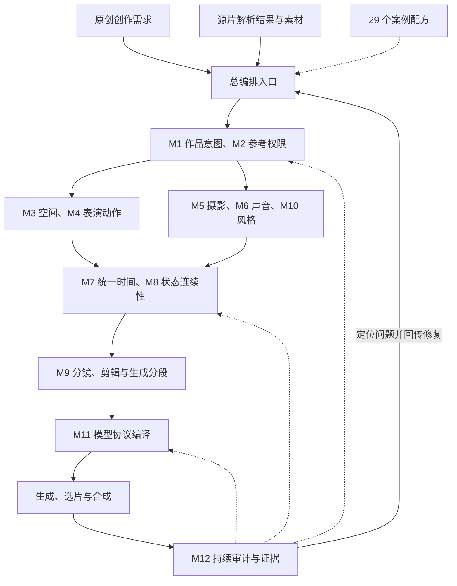

# AI 视频通用核心技能开发计划

**版本：** v0.1.2

**更新日期：** 2026-11-04（America/Los_Angeles）

**文档状态：** 通用核心实现为 planned；架构强制要求已经确立，本目录保存框架、约束与开发提炼计划。

**案例与既有技能基线：** `35658d3615d02c6aa6e4221fb223d73b86aa6875`。

**适用方向：** 影视剧提示词编排／审计、音乐 MV 提示词编排／审计。

## 核心摘要

本计划在已有 29 个独立案例技能的基础上，重点从 15 个 10 月案例的完整文本提炼通用核心。目标结构为：**一个总编排入口＋12 个职责模块＋一套共享数据契约＋影视剧／音乐 MV 两套创作策略＋五个审计关卡＋29 个案例配方**。

框架的主要交付对象是“镜头执行方案”：明确谁在什么空间和状态下，于何时完成什么事件，观众如何看见和听见，镜头如何连接，以及每项结论有什么证据。模块通过明确的字段归属和依赖关系联动，规则集中维护，提交给生成模型的每个片段保持自包含。

**全局强制要求：M1—M12 以及每个层级的全部子模块，必须遵循高内聚、低耦合、模块化、路由信息设计原则。** 当前与后续新增、拆分、合并或迁移的模块均受约束；具体条款、契约、递归登记与验收条件见 `06-modularity-routing-principles.md`。

**已存在的是 29 个案例技能及其文本／静态验证；拟建设的是统一的通用核心、接口、模块协作与分层媒体评估。** 本目录的框架和路线图不代表这些新能力已经实现或通过 H3 实片测试。[S18]

## 关键结论

1. 保持 M1—M12 编号稳定；12 个职责模块不要求打包成 12 个独立 Skill。
2. 身份与参考权限、动作事件、时间、动态状态必须分别建模，共享相同实体和事件编号。
3. 机位、景别、构图、光轴、焦点与运镜分别记录；关键动作的可见性是摄影计划的验收条件。
4. 同步支持提前、同相、滞后、固定观察及事件触发；剪辑支持连续接力、相位匹配、蒙太奇和时空省略。
5. 持续审计区分输入、设计、编译、生成片与成片；文本通过不代表媒体通过。
6. 案例中的人物数量、旋转预算、固定机位、无口型、歌词策略等保留作用域，不作为所有影视／MV 项目的统一限制。
7. 先完成开发框架、数据契约和证据裁决，再逐步实现模块与适配；既有独立案例技能继续作为可用基线和配方来源。
8. 四项架构原则递归适用于全部子模块：职责明确、依赖显式、接口可独立使用、路由可追踪；共享计划按需投影读取，专业字段经唯一责任方接受变更。

**关键词：** 模块化编排、导演意图、参考权限、动作事件、时间映射、状态交接、模型适配、持续审计、影视剧、音乐 MV。

## 目录导航

| 阅读顺序 | 文档 | 内容 |
|---|---|---|
| 强制规范 | `06-modularity-routing-principles.md` | 高内聚、低耦合、模块化和路由信息的递归要求、子模块设计清单、契约与验收 |
| 1 | `01-core-framework.md` | 完整框架、模块职责、共享对象、字段归属、接口、两条片型流程、审计关系 |
| 2 | `02-development-roadmap.md` | 分阶段开发、依赖顺序、每阶段产物与退出条件、迁移、测试和发布计划 |
| 3 | `03-source-evidence.md` | 15 案完整阅读覆盖、模块映射、来源版本、规则冲突、证据等级与影视剧缺口 |
| 4 | `05-workflow-routing.md` | 完整主干、各分支的触发／输入／输出／回传、片型路由、Gate 与修复回路 |
| 本次引用全文 | `04-framework-confirmation-full.md` | 用户本次选中答复的完整登记；含 12 模块三维表、全部说明、注意事项及历史交付记录 |
| 早期分析全文 | `00-analysis-full.md` | 更早一轮分析全文，包括 12 模块说明、示例、模块联动、泛化边界与全部参考链接 |
| 本次核对 | `validation-record.json` | 文档交付的一致性、链接、范围与源文件覆盖检查；只记录实际执行的检查 |

## 一、完整框架结构

### 1. 总体组成

统一入口管理任务范围与调度，专业决策由相应模块负责。模块及子模块可以接受用户、外部工具或已有计划提供的契约兼容输入；数据依赖不自动要求重新执行全部上游。所有共享记录通过必要字段的只读视图和版本化变更请求协作，独立能力与独立 Skill 安装包分别验收。

| 结构层 | 组成 | 主要职责 |
|---|---|---|
| 输入入口 | 原创 brief；或已有视频／图像／音频的解析结果 | 原创直接建立创作需求；改编接收可追溯的源片观察与资产 |
| 总编排入口 | 任务识别、片型策略、共享计划、模块路由、版本协调 | 决定本任务启用哪些模块和规则，维护统一任务状态 |
| 作品与素材层 | M1—M2 | 确定作品目标、段落功能、素材依据与参考权限 |
| 镜头与声画层 | M3—M10 | 设计空间、表演、摄影、声音、时间、状态、剪辑与视觉风格 |
| 模型执行层 | M11 | 将统一计划编译为 H3 或未来已核验后端的输入与参数 |
| 审计与证据层 | M12，贯穿所有阶段 | 检查、归因、记录证据、回传修复，区分计划与真实媒体 |
| 配方与案例层 | 当前 29 个案例技能；后续专项规则与样例 | 提供带适用条件的可复用做法，不覆盖上层任务意图 |
| 交付与反馈 | 提示词、生成任务、镜头表、审计报告；接入媒体后增加选片与成片验收 | 交付可审阅结果，保留未验证范围及回归记录 |

源片解析是可选前置输入能力。M2 消费解析结果和证据；本计划不把完整逆向识别系统声称为本次已实现组件。

图示表达主依赖与反馈，不把创作过程规定为只能单向执行一次；在不改变已定事实的前提下，相关模块可以联合调整，所有修改经过共享版本记录。

### 2. 十二模块主表

#### 2.1 模块／主要职责／核心输出与审计重点

以下三维表逐项保留用户本次确认的 12 行内容，与 `04-framework-confirmation-full.md` 归档正文对应。

| 编号 | 模块 | 主要职责 | 核心输出与审计重点 |
|---|---|---|---|
| **M1** | **作品意图、叙事／情绪与段落功能** | 明确作品目标、人物目标、信息变化、情绪发展和段落作用，为其他模块确定优先级 | 作品简报、段落任务、情绪／能量曲线、动作与视觉母题；检查每段是否承担明确功能 |
| **M2** | **素材解析、资产绑定与参考权限** | 消费素材及解析结果，明确每份参考提供哪些属性、绑定哪个实体、在哪些镜头生效 | 资产清单、实体绑定、属性继承范围、来源证据；检查身份、首帧、姿态、场景、摄影和声音参考是否混用 |
| **M3** | **场景空间、人物站位与交互调度** | 建立空间关系、人物走位、队形、屏幕方向、接触、避让与遮挡条件 | 空间与调度计划；检查动作是否有执行空间、人物关系是否清楚、关键互动是否被遮挡 |
| **M4** | **人物表演、动作链与物理因果** | 将动作、舞蹈、剑舞及戏剧表演拆成有起态、过程、结果和出态的事件 | 动作／表演事件链；检查支撑、重心、接触、动作承接、触发与反应、道具操作是否成立 |
| **M5** | **机位、景别、构图、焦点与运镜** | 根据观看目的设计摄影机位置、光轴、景别、构图、焦点和运动路径 | 摄影计划；检查关键动作是否可见，摄影机运动是否具有明确目的，空间与方向是否可读 |
| **M6** | **声音、音乐、对白与歌词关系** | 组织说话者、对白、歌词、音乐结构、环境声和动作声，明确复制或参考方式 | 声音分层计划、说话者绑定、音乐与歌词关系；检查声源、内容、用途和视觉事件是否对应 |
| **M7** | **统一时间轴与动作—镜头—声音协同** | 为动作、摄影、声音及剪辑建立统一时序，管理先后、重叠、偏移和事件触发 | 权威时间表与时间域映射；检查同步关系、时间容量、持续时长和跨片时间换算 |
| **M8** | **主体、道具、场景与跨镜状态连续性** | 管理固定属性、动态状态、允许变化、入态／出态和跨镜交接条件 | 计划状态与交接记录；检查服装、持物、位置、朝向、接触、场景等变化是否有依据 |
| **M9** | **分镜组织、转场、剪辑与生成分段** | 区分动作阶段、故事板、镜头、生成任务及成片使用区间，规划切点和装配关系 | 分镜表、生成分段、转场意图、裁剪与装配表；检查片段边界是否破坏动作或叙事 |
| **M10** | **视觉风格、光线、色彩与材质** | 统一作品视觉基线，并明确局部变化的范围与原因 | 风格、光色和材质计划；检查视觉连续性及风格变化是否服务段落目的 |
| **M11** | **模型协议编译与运行参数适配** | 将冻结后的共享计划转换为具体模型支持的提示词、素材绑定和运行参数 | 自包含提示词、资产映射、参数与生成任务；检查模式、字段、引用和后端能力是否匹配 |
| **M12** | **持续审计、问题归因与反馈修复** | 在输入、设计、编译、生成片和成片阶段记录问题、证据、责任模块及修复影响 | 审计报告、问题记录、媒体观察与复验记录；检查结论有无依据、修复是否解决原问题并引入新冲突 |

#### 2.2 核心输出与接口补充

以下接口说明继续保留，与上表及 `01-core-framework.md` 的详细合同共同使用。

| 编号 | 固定名称 | 核心输出 | 关键接口 |
|---|---|---|---|
| M1 | 作品意图、叙事／情绪与段落功能 | 作品简报、段落任务、情绪／能量曲线、动作与视觉母题 | 为动作、摄影、声音、剪辑提供目的与优先级 |
| M2 | 素材解析、资产绑定与参考权限 | 资产清单、实体绑定、属性继承范围、来源证据 | 明确身份、首帧、动作、摄影、声音等各自来源 |
| M3 | 场景空间、人物站位与交互调度 | 场景关系、走位、队形、接触／避让／遮挡要求 | 提供动作空间，供摄影检查可见性 |
| M4 | 人物表演、动作链与物理因果 | 有执行者、起态、过程、接触、结果和出态的事件链 | 事件语义交给 M7 排时，状态变化交给 M8 |
| M5 | 机位、景别、构图、焦点与运镜 | 摄影机路径、观看目的、构图、可见性与焦点计划 | 读取 M3/M4；把摄影事件交给 M7 |
| M6 | 声音、音乐、对白与歌词关系 | 声源、对白／歌词、复制或参考方式、分层声音计划 | 与实体、说话者和视觉事件绑定，交 M7 排时 |
| M7 | 统一时间轴与动作—镜头—声音协同 | 事件时间、先后与重叠、响应偏移、时间域映射 | 为动作、摄影、声音、剪辑提供同一权威时序 |
| M8 | 主体、道具、场景与跨镜状态连续性 | 入态、出态、变更原因、计划状态与交接条件；关联 M12 独立观察记录 | 消费事件结果，检查跨镜继承和允许变化；不改写媒体观察 |
| M9 | 分镜组织、转场、剪辑与生成分段 | 镜头与故事板映射、切点、生成片段、裁剪与装配表 | 分开动作阶段、镜头、生成任务和成片使用区间 |
| M10 | 视觉风格、光线、色彩与材质 | 风格与光色基线、材质规则、局部变化权限 | 在 M2 授权范围内设计，由 M8 检查连续性 |
| M11 | 模型协议编译与运行参数适配 | 自包含提示词、资产与参数映射、生成任务 | 读取冻结的共享计划和具体后端能力，不改写导演意图 |
| M12 | 持续审计、问题归因与反馈修复 | 分层检查、证据、问题归属、受影响项与修复回归 | 贯穿各模块；发现问题后交还字段责任模块修订 |

M4 定义“发生什么”，M7 定义“何时发生”，M8 管理“发生后的状态”，M5 定义“怎样看见”，M9 定义“怎样连接”，M12 检查它们的接口是否一致。详细字段责任与写入规则见完整框架文档。

### 3. 共用数据结构

以下是拟定义的内部对象，不是 MiniMax API 请求体。

| 数据对象 | 内容 |
|---|---|
| 项目与段落计划 | 作品目标、片型、场景／段落功能、约束与版本 |
| 资产与参考权限 | 素材身份、可访问性、提供属性、目标实体、作用时间／镜头 |
| 空间与交互计划 | 场景关系、世界／身体／屏幕方向、走位、接触、遮挡 |
| 动作、摄影与声音事件 | 各自独立的唯一事件编号、执行者、对象、条件、过程、可见／可听结果及关联引用 |
| 摄影与风格计划 | 机位、光轴、景别、构图、焦点、运动路径、光色材质 |
| 统一时间与装配映射 | 源素材时间、生成局部时间、裁剪／定格／变速关系、成片时间 |
| 状态与交接记录 | 固定属性、可变状态、计划入态／出态、边界类型和变更原因；实际观察由 M12 独立记录并关联 |
| 生成编译清单 | 模式、后端版本、素材顺序、提示词文件、实际参数与编译来源 |
| 审计与证据记录 | 检查层级、结果、来源、观察对象、责任模块、失效和复验状态 |

### 4. 两条片型流程

| 影视剧策略 | 音乐 MV 策略 |
|---|---|
| 人物目标／信息变化确定场景任务 | 音乐结构／情绪与能量确定段落任务 |
| 动作、对白、目光、停顿与听者反应形成事件 | 动作母题、运动质地、乐句与拍点形成事件 |
| 根据互动关系规划空间与镜头覆盖 | 根据动作可读性规划队形、机位与运镜 |
| 用事件先后与表演时长组织节奏 | 用实际音乐窗口与事件时间组织节奏 |
| 连续剪辑、反应、时间省略等按场景目的选择 | 连续接力、相位匹配、表演蒙太奇等按作品选择 |
| 检查关系变化、信息理解、声音与状态连续性 | 检查动作完成、音乐关系、段落差异和收束 |

两条流程共享同一数据对象和审计机制；对白、口型、BPM、人物数量、全片连续长镜等均按真实任务启用，不设置跨题材固定模板。

### 5. 五个审计关卡

| 关卡 | 检查对象 | 可以证明的范围 |
|---|---|---|
| G0 输入与证据 | 素材、用途、来源、缺失与推测 | 输入是否足以支持当前编排 |
| G1 设计与跨模块一致性 | 动作、空间、摄影、声音、时序、状态和剪辑 | 计划是否自洽，语义检查结论是否有依据 |
| G2 编译与运行契约 | 模式、字段、标签、参数、引用、时间范围 | 已检查的文本／配置是否符合契约 |
| G3 生成片验收 | 实际视频与音频 | 被观察或测量的媒体条件是否实现 |
| G4 全片验收 | 最终剪辑作品 | 跨片接续、叙事／音乐组织和成片要求是否满足 |

G0—G2 可用于文字编排最小版本；G3—G4 需要真实媒体。保留 `unverified` 等状态，不从前一关卡自动推导后续关卡通过。本文统一使用 G0—G4 命名，开发计划与框架文档沿用这一口径。

## 二、开发提炼顺序

此处是工程建设顺序，具体创作仍从作品目标与输入开始。

1. **冻结范围与证据：** 确认 15 案重点文本、29 技能基线、官方格式、源文冲突与适用条件。
2. **统一数据契约：** 优先建立参考权限、事件、时间映射、状态交接、检查证据及字段责任。
3. **建立静态与语义审计接口：** 校验可计算约束，明确需要人／模型判读或实际媒体的条件。
4. **实现一个总编排入口与首个闭环：** 贯通输入、模块产物、H3 编译、检查报告与局部修订。
5. **补齐两条片型流程：** MV 复用已有案例；影视剧增加动机、对白、反应、视线及叙事状态样本。
6. **逐步接入案例配方：** 按能力迁移、保留来源与适用条件，保持现有单目录可复制能力。
7. **完成分层回归与发布：** 格式／算术、语义、真实媒体和整片效果分开报告，版本与证据可追溯。

每阶段的产物、开始条件、退出条件与具体任务见开发路线文档。当前没有承诺未验证的性能指标、固定工期或视频成功率。

## 三、当前交付状态

| 项目 | 状态 |
|---|---|
| 更早一轮完整分析记录 | `00-analysis-full.md` 保存 |
| 用户本次引用答复的全文 | `04-framework-confirmation-full.md` 完整保存 |
| 工作流主干与分支路由 | `05-workflow-routing.md` 集中展开 |
| 全模块／全子模块四项架构原则 | 强制开发要求已登记；运行实现与验收待执行 |
| 初始子模块拆分 | `06-modularity-routing-principles.md` 的 planned 设计清单；不等同已实现技能 |
| 12 模块框架与接口设计 | 提案文档 |
| 分阶段开发计划 | 提案文档 |
| 15 个重点案例阅读、模块映射与冲突边界 | 证据文档 |
| 现有 29 个案例技能 | 已在 `docs/caseskill/`，作为既有基线 |
| 新通用核心代码、Schema、脚本、可安装技能 | 后续开发产物，当前不声称已实现 |
| H3 推理与通用核心媒体回归 | 需后续实际执行，当前未实施 |

## 四、本次完整登记与阅读对应

本次补充将“更早分析全文”与“用户选中答复全文”分别保存。完整登记覆盖原答复的正文、表格、全部说明和注意事项。归档中的 `196ebed`、6 个文件、2,298 行保留其历史含义，当前目录内容和检查范围由本版本及当前校验记录说明。

| 需要确认的内容 | 完整登记位置 | 进一步展开 |
|---|---|---|
| 十二模块三维表及职责区分 | 本文第 2.1 节、`04-framework-confirmation-full.md` 第一部分 | `01-core-framework.md` 逐模块合同 |
| 主干、分支、反馈、路由条件与回传 | `04-framework-confirmation-full.md` 的原始总图、`05-workflow-routing.md` | 主干步骤表、12 模块路由表、适用分支和缺陷修复表 |
| 共享结构及五条边界 | `04-framework-confirmation-full.md` 第二部分 | `01-core-framework.md` 第 4–5 节及路由文档的字段归属 |
| 影视剧与 MV 共用核心 | `04-framework-confirmation-full.md` 第三部分 | 两类策略路由、条件化规则及影视剧证据缺口 |
| G0–G4 持续审计与修复闭环 | `04-framework-confirmation-full.md` 第四部分 | 关卡进入／退出、结果状态、证据和受影响项复验 |
| P0–P9 完整开发与提炼路线 | `04-framework-confirmation-full.md` 第五部分 | `02-development-roadmap.md` 每阶段产物、条件、测试、迁移及发布 |
| 所有其他说明、注意事项和历史交付 | `04-framework-confirmation-full.md` 全文及第六部分 | 原始交付表、历史核验统计和原答复链接全部保留 |

`05-workflow-routing.md` 是基于已登记框架的设计细化。运行时路由与 P0–P9 工程建设顺序分别记录；本次没有把规划步骤写成已经运行的系统能力。

## 五、全部模块与子模块的强制设计要求

| 原则 | 必须落实的设计 | 验收重点 |
|---|---|---|
| **高内聚（HC）** | 一个模块围绕明确的专业职责和共同变化原因组织；子模块边界具有独立输入、结果和检查价值 | 职责、产物、规则与检查属于同一任务，不夹带其他模块的业务决定 |
| **低耦合（LC）** | 通过公开、带版本的最小契约交换数据；显式声明依赖、读写范围和来源；共享计划按需只读 | 可由外部兼容输入替代上游产物；无隐含兄弟目录、全局上下文或跨模块私有字段依赖 |
| **模块化（MD）** | 每个模块及子模块有身份、范围、接口、可组合产物、局部检查与兼容策略 | 能单独完成所声明的职责；可替换实现并组合；独立打包时依赖完整 |
| **路由信息（RT）** | 登记触发、目标、输入映射、前置条件、输出、返回、失败、修复、失效和执行记录 | 路由有明确理由和边界，重试与语义修订分开，检查结论可追溯 |

父模块负责对外合同，并明确子模块的提案或委派写入范围。同一字段、作用范围和有效版本只有一个权威提交路径。子模块再拆分时继续继承这些规则，不能通过改名为辅助流程、适配器或脚本绕开其实际承担职责的约束。

开发验收同时检查独立任务、组合任务、缺输入、版本不兼容、越权修改和修复回流。规则已经成为强制条件，文档核对通过不表示对应运行能力已经实现。原始答复归档保留历史原文；现行开发按本节与 `06-modularity-routing-principles.md` 执行。

## 资料、文档与引用入口

正文中的 [S01]—[S19] 对应来源与证据文档的编号。`00-analysis-full.md` 保留原独立数字引用；`04-framework-confirmation-full.md` 保留用户选中答复的原链接。

- [01-core-framework.md](01-core-framework.md)：首先阅读完整通用框架。
- [02-development-roadmap.md](02-development-roadmap.md)：开发阶段、任务、验收与迁移。
- [03-source-evidence.md](03-source-evidence.md)：覆盖、映射、冲突、证据等级与固定来源链接。
- [00-analysis-full.md](00-analysis-full.md)：更早一轮完整分析。
- [04-framework-confirmation-full.md](04-framework-confirmation-full.md)：用户本次确认的完整答复、三维表与全部注意事项。
- [05-workflow-routing.md](05-workflow-routing.md)：完整工作流主干、分支路由、回传与复验。
- [06-modularity-routing-principles.md](06-modularity-routing-principles.md)：全部模块及子模块的四项强制架构原则、契约与验收。
- [validation-record.json](validation-record.json)：本次文档核对记录。
- [既有案例技能索引](../caseskill/README.md)。
- [既有技能验证报告](../caseskill/_validation/validation-report.md)。
